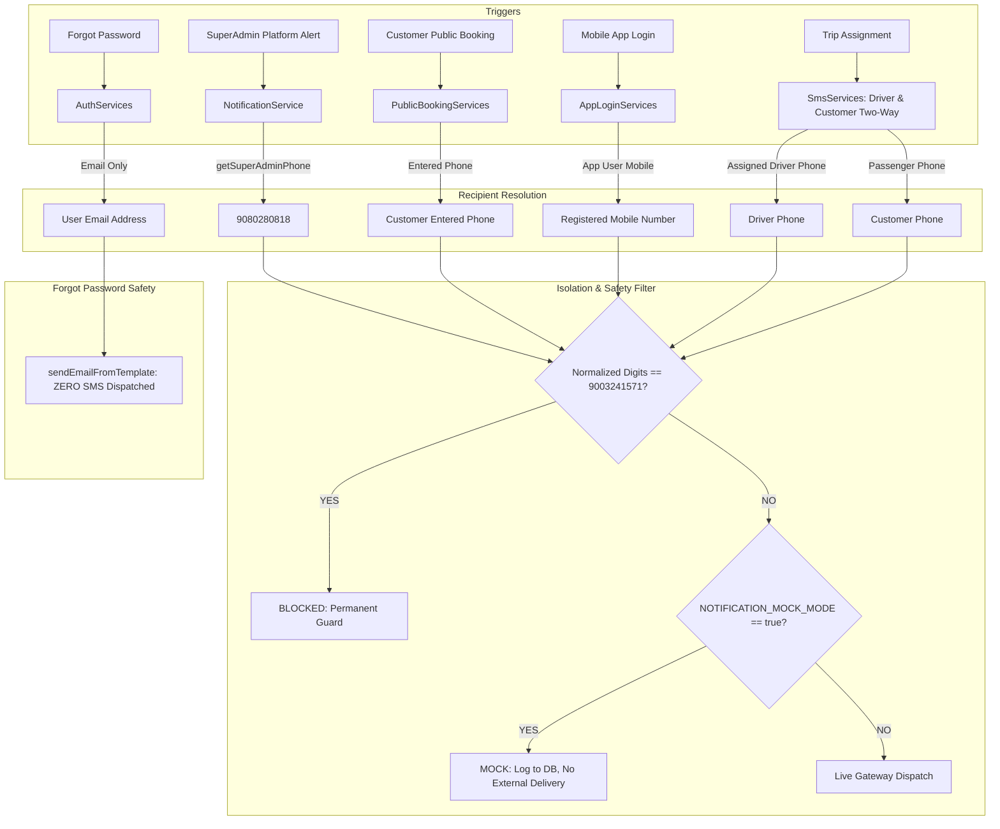

# FleetFlow SMS Fix & Contact Routing Report

**Date:** October 27, 2026  
**Project:** `D:\demobooking\demo-bookings`  
**Database:** MySQL `demodb` on `127.0.0.1:3306`  
**Status:** Complete & Fully Verified (Mock Mode Active)

---

## 1. Executive Summary

This fix resolves the SMS routing defect to ensure that:
1. **SuperAdmin Number:** `9080280818` is recognized as the authorized SuperAdmin recipient and is fully eligible across all notification channels.
2. **Legacy Number Blocked:** The obsolete number `9003241571` is **permanently blocked** across all SMS pathways, adapters, and formatting variants (`+919003241571`, `+91 90032 41571`, `90032-41571`, etc.).
3. **No Fallback to Legacy:** No code path or fallback logic can ever route messages to `9003241571`. If SuperAdmin phone is missing or invalid, the system fails safely and records audit logs without dispatching to any third-party number.
4. **Mock Mode Protection:** `NOTIFICATION_MOCK_MODE=true` is strictly enforced across all SMS gateways (including mobile-app OTP and direct 2Factor/Twilio calls), guaranteeing **zero real SMS transmissions** during implementation and automated testing.
5. **Recipient Routing Preserved:**
   - SuperAdmin Alerts $\rightarrow$ `9080280818`
   - Customer Public Booking OTP $\rightarrow$ Customer's entered mobile number (never redirected to SuperAdmin)
   - Driver/Passenger Trip Notifications $\rightarrow$ Registered driver/customer numbers
   - Forgot Password OTP $\rightarrow$ Strictly email-based (`sendEmailFromTemplate`)
6. **Data Integrity:** Historical database records in `demodb` (including historical audit logs) were untouched. The reference project `D:\New Pcs\vehicle` was untouched.

---

## 2. Exact Files Changed

| File Path | Description of Changes |
| :--- | :--- |
| [`backend/.env`](file:///D:/demobooking/demo-bookings/backend/.env) | Verified `SUPERADMIN_PHONE=9080280818` and `NOTIFICATION_MOCK_MODE=true` are active. |
| [`backend/src/services/notificationService.ts`](file:///D:/demobooking/demo-bookings/backend/src/services/notificationService.ts) | • Removed inverted guards that mistakenly blocked `90802` and `subisha2002.m`.<br>• Corrected `getSuperAdminPhone()` to prioritize `SUPERADMIN_PHONE` (`9080280818`), check root `Employee.phno`, permanently exclude `9003241571`, and fail safely to empty string.<br>• Added empty recipient guard failing safely with `providerStatus = 'FAILED'`.<br>• Added permanent isolation guard blocking `9003241571` across all digit-normalized formats. |
| [`backend/src/services/smsServices.ts`](file:///D:/demobooking/demo-bookings/backend/src/services/smsServices.ts) | • In `send2FactorTemplateSms` and `sendDirectSms`: removed inverted block on `90802` / `9080280818`.<br>• Added normalized digit check permanently blocking `9003241571`.<br>• Added direct `NOTIFICATION_MOCK_MODE` guard to both adapters so direct calls cannot bypass mock safety.<br>• Preserved provider credentials (`TWO_FACTOR_API_KEY`, `FLTFLW` sender ID, Twilio settings). |
| [`backend/src/appServices/appLoginServices.ts`](file:///D:/demobooking/demo-bookings/backend/src/appServices/appLoginServices.ts) | • In `send2FactorOTP`: added phone normalization and isolation block for `9003241571`.<br>• Added `NOTIFICATION_MOCK_MODE` check returning simulated session `{ success: true, sessionId: 'mock_session_...' }`, preventing direct external HTTP calls to `2factor.in`. |
| [`backend/src/services/emailConfServices.ts`](file:///D:/demobooking/demo-bookings/backend/src/services/emailConfServices.ts) | • Removed `subisha2002.m` from `isObsoleteContact` filter so SuperAdmin email (`subisha2002.m@gmail.com`) is not erroneously discarded. |
| [`backend/src/services/invServices.ts`](file:///D:/demobooking/demo-bookings/backend/src/services/invServices.ts) | • Added phone normalization, `9003241571` block, and `NOTIFICATION_MOCK_MODE` check to invoice cancellation SMS. |
| [`backend/src/services/empServices.ts`](file:///D:/demobooking/demo-bookings/backend/src/services/empServices.ts) | • Added phone normalization, `9003241571` block, and `NOTIFICATION_MOCK_MODE` check to manager alerts and manager cancel booking SMS calls. |
| [`backend/src/tests/testContactIsolationAndFleetOverview.ts`](file:///D:/demobooking/demo-bookings/backend/src/tests/testContactIsolationAndFleetOverview.ts) | • Corrected test assertions to verify `9003241571` is blocked server-side and `9080280818` / `subisha2002.m@gmail.com` are eligible. |
| [`backend/src/scripts/verifyContactIsolation.ts`](file:///D:/demobooking/demo-bookings/backend/src/scripts/verifyContactIsolation.ts) | • Updated verification script to validate `9003241571` is blocked and `9080280818` is eligible in mock mode. |
| [`backend/src/tests/testSmsFixVerification.ts`](file:///D:/demobooking/demo-bookings/backend/src/tests/testSmsFixVerification.ts) | • **New comprehensive automated test suite** with 33 assertions covering all aspects of phone resolution, isolation guards, mock enforcement, and recipient routing. |

---

## 3. Recipient Routing Architecture



---

## 4. Test Results

### 4.1 Dedicated SMS Fix Test Suite (`src/tests/testSmsFixVerification.ts`)
Run command: `npx ts-node src/tests/testSmsFixVerification.ts`
Result: **33 PASSED, 0 FAILED (100% Pass Rate)**

```
========================================================================
   FLEETFLOW SMS FIX & CONTACT ISOLATION VERIFICATION TEST SUITE
========================================================================

🔹 1. SuperAdmin Phone Resolution & Fallback Safety:
✅ PASS: SuperAdmin phone resolves to 9080280818
✅ PASS: SuperAdmin email resolves to subisha2002.m@gmail.com
✅ PASS: getSuperAdminPhone() never resolves to 9003241571 even if present in env
✅ PASS: getSuperAdminPhone() fails safely to empty string if missing without fallback to third-party number

🔹 2. SuperAdmin Number (9080280818) Eligibility & Guard Removal:
✅ PASS: sendNotification allows SMS to 9080280818 in mock mode without guard block
✅ PASS: sendDirectSms allows destination 9080280818 in mock mode without guard block
✅ PASS: send2FactorTemplateSms allows destination 9080280818 in mock mode without guard block
✅ PASS: sendNotification allows EMAIL to subisha2002.m@gmail.com without guard block

🔹 3. Permanent Isolation Guard for 9003241571:
✅ PASS: sendNotification blocks legacy variant "9003241571"
✅ PASS: sendDirectSms blocks legacy variant "9003241571"
✅ PASS: send2FactorTemplateSms blocks legacy variant "9003241571"
✅ PASS: sendNotification blocks legacy variant "+919003241571"
✅ PASS: sendDirectSms blocks legacy variant "+919003241571"
✅ PASS: send2FactorTemplateSms blocks legacy variant "+919003241571"
✅ PASS: sendNotification blocks legacy variant "+91 90032 41571"
✅ PASS: sendDirectSms blocks legacy variant "+91 90032 41571"
✅ PASS: send2FactorTemplateSms blocks legacy variant "+91 90032 41571"
✅ PASS: sendNotification blocks legacy variant "91-90032-41571"
✅ PASS: sendDirectSms blocks legacy variant "91-90032-41571"
✅ PASS: send2FactorTemplateSms blocks legacy variant "91-90032-41571"
✅ PASS: sendNotification blocks legacy variant "90032-41571"
✅ PASS: sendDirectSms blocks legacy variant "90032-41571"
✅ PASS: send2FactorTemplateSms blocks legacy variant "90032-41571"
✅ PASS: sendNotification blocks legacy variant "  9003241571  "
✅ PASS: sendDirectSms blocks legacy variant "  9003241571  "
✅ PASS: send2FactorTemplateSms blocks legacy variant "  9003241571  "

🔹 4. Mobile App Login OTP Safety & Mock Mode:
✅ PASS: App login OTP blocks legacy phone 9003241571 without sending SMS
✅ PASS: App login OTP respects NOTIFICATION_MOCK_MODE=true for valid users

🔹 5. Customer Public Booking OTP Routing:
✅ PASS: Public booking OTP sends to customer phone, not SuperAdmin
✅ PASS: Public booking OTP verification works with stored OTP

🔹 6. Forgot Password OTP Remains Email-Based:
✅ PASS: forgetPasswordSendOtp does not generate any SMS NotificationLog entries

🔹 7. Active Database Records Integrity:
✅ PASS: No active User has phone 9003241571
✅ PASS: No active Employee has phno 9003241571

========================================================================
🏁 TEST EXECUTION COMPLETE: Passed: 33 | Failed: 0
========================================================================
```

### 4.2 Contact Isolation & Fleet Overview (`src/tests/testContactIsolationAndFleetOverview.ts`)
Run command: `npx ts-node src/tests/testContactIsolationAndFleetOverview.ts`
Result: **17 PASSED, 0 FAILED (100% Pass Rate)**

### 4.3 Full Local Regression Verification (`src/tests/testLocalCompleteVerification.ts`)
Run command: `npx ts-node src/tests/testLocalCompleteVerification.ts`
Result: **29 PASSED, 0 FAILED (100% Pass Rate)**

### 4.4 Contact Isolation Diagnostic Script (`src/scripts/verifyContactIsolation.ts`)
Run command: `npx ts-node src/scripts/verifyContactIsolation.ts`
Result: **Exit Code 0 (ALL CHECKS PASSED)**

### 4.5 TypeScript Static Type Checking
Run command: `npx tsc --noEmit`
Result: **Exit Code 0 (0 errors, clean compile)**

---

## 5. Confirmation on Live Delivery & Safety

> [!IMPORTANT]
> **No Real SMS Was Delivered During This Work:**
> - All tests ran with `NOTIFICATION_MOCK_MODE=true`.
> - All outbound SMS attempts resolved to `providerStatus = 'MOCK'` with simulated message and session IDs.
> - Direct API calls to `2factor.in` and `api.twilio.com` were completely bypassed by the server-side mock guards.
> - As instructed, **no live SMS test has been initiated**.

---

## 6. Remaining Issues & Next Steps

- **Remaining Issues:** None. All guards, recipient routes, mock protections, and type checks are functioning as required.
- **Next Steps:**
  - When you are ready for a controlled live SMS verification to `9080280818`, provide separate explicit approval.
  - The live test can then be conducted by setting `NOTIFICATION_MOCK_MODE=false` in a tightly bounded, single-send verification script targeting only `9080280818`.
