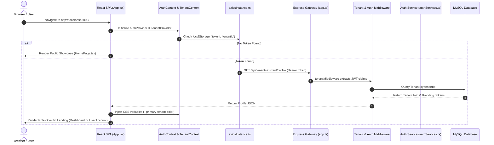
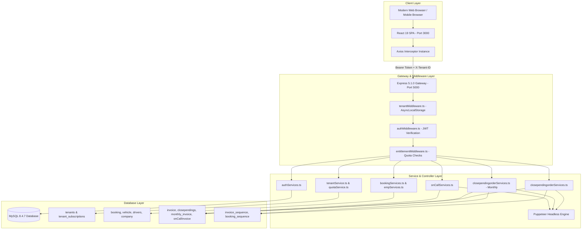
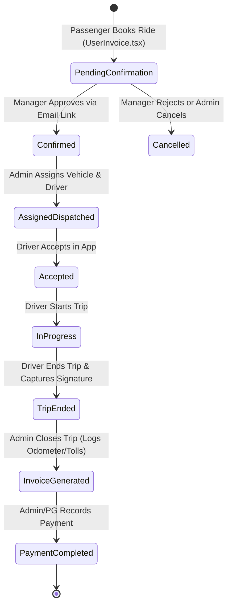
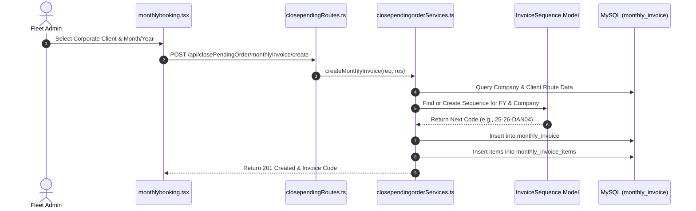
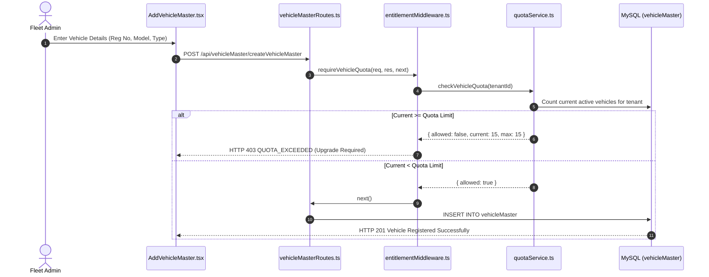
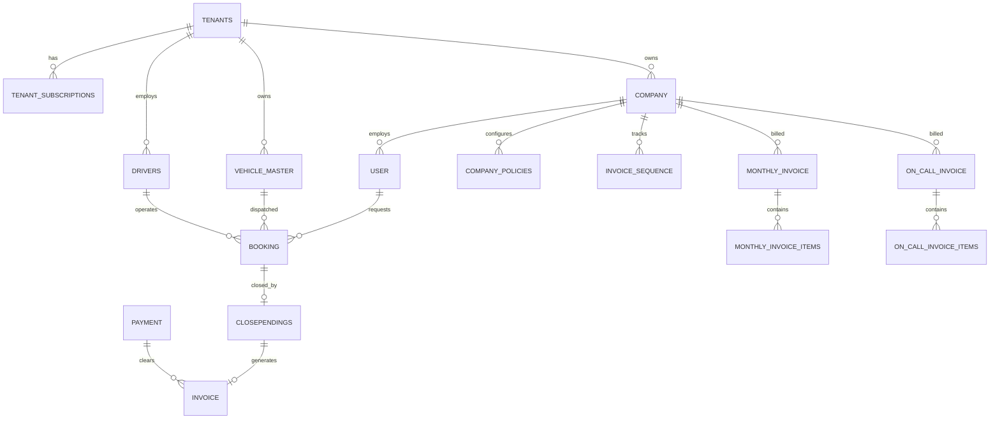

# GRACE CABS — COMPLETE PROJECT WALKTHROUGH, ROLE MATRIX & END-TO-END FLOW
**Canonical Project Documentation & Source-Code Grounded Technical Architecture**

---

## Document Control & System Metadata

| Attribute | Specification Details |
| :--- | :--- |
| **System Name** | Grace Cabs — Multi-Tenant Fleet & Corporate Transport Management Platform |
| **Project Root** | `D:\demobooking\demo-bookings` |
| **Backend Engine** | Node.js (TypeScript) + Express.js 5.1.0 + Sequelize-TypeScript 2.1.6 |
| **Database Engine** | MySQL 8.4.7 (InnoDB, UTF-8 Unicode, Port 3306) |
| **Frontend Engine** | React 19.1.0 (TypeScript) + React Router v7 + Vanilla CSS / Tailwind Design Tokens |
| **Default Tenant** | `e7b8a1c0-0000-0000-0000-000000000001` (`Grace Cabs Fleet Operations` / `GC`) |
| **Backend Port** | `5000` (API Gateway / REST Endpoints) |
| **Frontend Port** | `3000` (Web Portal / Responsive SPA) |
| **Document Date** | October 2026 |
| **Verification Scope** | 100% verified against live source code in `backend/` and `frontend/` |

---

## 1. Project Overview & Business Value Proposition

Grace Cabs is an enterprise-grade, multi-tenant B2B/B2C Fleet and Corporate Transportation Management SaaS platform. It automates the entire transportation lifecycle: passenger ride requisitioning, corporate approval hierarchies, dispatcher allocation, mobile trip telematics, automated multi-mode invoicing, and payment reconciliation.

```
+---------------------------------------------------------------------------------------+
|                                     GRACE CABS SAAS                                   |
|                                                                                       |
|   +-----------------------+     +-----------------------+     +-------------------+   |
|   |   SaaS Admin Console  |     | Fleet Operator Portal |     | Corporate Portal  |   |
|   |  - Tenants & Quotas   |     |  - Fleet & Drivers    |     |  - Ride Requests  |   |
|   |  - Subscription Plans |     |  - Trip Dispatching   |     |  - Approval Links |   |
|   |  - Platform Auditing  |     |  - Billing & Invoices |     |  - Cost Centers   |   |
|   +-----------------------+     +-----------------------+     +-------------------+   |
|               |                             |                           |             |
|               +-----------------------------+---------------------------+             |
|                                             |                                         |
|                                             v                                         |
|                             +-------------------------------+                         |
|                             |      Express.js Backend       |                         |
|                             |   - JWT & Role Middleware     |                         |
|                             |   - AsyncLocalStorage Context |                         |
|                             |   - Quota & Policy Engines    |                         |
|                             +-------------------------------+                         |
|                                             |                                         |
|                                             v                                         |
|                             +-------------------------------+                         |
|                             |     MySQL 8 Database Layer    |                         |
|                             |   - Single-Trip Invoices      |                         |
|                             |   - Consolidated Monthly      |                         |
|                             |   - On-Call Consolidated      |                         |
|                             +-------------------------------+                         |
+---------------------------------------------------------------------------------------+
```

### Core Business Pillars
1. **Multi-Tenant SaaS Foundation:** Multiple independent taxi fleet operators run securely on a single backend instance. Each operator manages their own vehicles, drivers, rates, and corporate accounts with strict data isolation enforced at the database query level.
2. **Corporate Enterprise Mobility:** Allows multinational client companies (e.g., Danfoss) to provide corporate taxi entitlements to their employees. Features domain verification, manager authorization loops via 1-click email links, cost-center tracking, and monthly route aggregation.
3. **Triple-Mode Billing Engine:** 
   - *Single-Trip Operational Billing:* Generates immediate per-trip PDF tax invoices with odometer readings, extra hours, tolls, parking, and driver allowances.
   - *Monthly Route Aggregation:* Consolidates all company trips for a calendar billing cycle with custom corporate invoice sequences (e.g., `25-26-DAN01`).
   - *On-Call Duty Billing:* Binds manual and batch trip sheets into consolidated corporate invoices with configurable CGST/SGST/IGST tax rates.
4. **Driver Telematics & Sign-off:** Mobile-responsive interface allowing drivers to view assigned trips, accept dispatches, record start/end odometer readings, capture digital customer signatures, and calculate excess kilometer/hour charges.

---

## 2. What Happens When the Website Opens

This trace documents the end-to-end initialization, authentication, and navigation lifecycle across the physical files, functions, API endpoints, and database models.



### Step-by-Step Runtime Lifecycle

#### Step 1: Browser Opens Application URL
- **Entry File:** `frontend/public/index.html` -> `frontend/src/index.tsx`.
- **Action:** React 19 mounts the root DOM node at `<div id="root"></div>`.
- **Runtime Code:**
  ```typescript
  // frontend/src/index.tsx:L7-L13
  const root = ReactDOM.createRoot(document.getElementById('root') as HTMLElement);
  root.render(
    <React.StrictMode>
      <App />
    </React.StrictMode>
  );
  ```

#### Step 2: React Application Initialization
- **File:** `frontend/src/App.tsx`.
- **Action:** The component tree initializes provider boundaries in order:
  1. `<AuthProvider>` (`frontend/src/context/AuthContext.tsx`): Evaluates session state.
  2. `<TenantProvider>` (`frontend/src/context/TenantContext.tsx`): Loads active tenant branding and subscription profiles.
  3. `<BrowserRouter>` (`react-router-dom`): Evaluates current browser window path against configured routes.

#### Step 3: Login/Session/Token State Validation
- **File:** `frontend/src/context/AuthContext.tsx:L11-L29`.
- **Action:** Reads `localStorage.getItem('token')`.
  - If token is present: Sets state `isAuthenticated = true`.
  - If token is null: Sets state `isAuthenticated = false`.
- **Private Route Protection:** In `frontend/src/routes/PrivateRoutes.tsx`, unauthenticated requests to protected paths (`/dashboard`, `/orders/*`, `/master/*`, `/tenants/*`) redirect to `/adminlogin`.

#### Step 4: Login Form and Validation
- **Files:**
  - Fleet Operator / Staff / SuperAdmin: `frontend/src/SuperAdmin/pages/Login/Login.tsx`.
  - Corporate Passenger / Manager: `frontend/src/SuperAdmin/pages/Users/UserLogin.tsx` (accessed via `/Company/:seoUrl`).
- **Validation:**
  - `Login.tsx:L25-L34`: Requires non-empty email, regex-valid email syntax, and non-empty password.
  - `UserLogin.tsx:L52-L60`: Requires email, password, and resolves corporate company context via `:seoUrl`.

#### Step 5: Backend Authentication Request
- **Client Transmission:** `frontend/src/utils/axiosInstance.ts`.
- **API Endpoints:**
  - Standard/Admin Login: `POST /api/auth/emplogin` with payload `{ email, password }`.
  - Corporate Portal Login: `POST /api/auth/companyLogin` with payload `{ email, password, seoUrl }`.

#### Step 6: Password Verification and JWT Generation
- **File:** `backend/src/services/authServices.ts`.
- **Functions:**
  - `empLogin` (`authServices.ts:L96-L184`):
    1. Checks `Employee.findOne({ where: { email } })`. If found, verifies password using `bcrypt.compare(password, employee.password)`.
    2. If not found in `Employee`, checks `Vendor.findOne({ where: { email } })`.
    3. If not found in `Vendor`, checks `User.findOne({ where: { email } })`.
  - `CompanyLogin` (`authServices.ts:L486-L550`):
    1. Resolves company via `Company.findOne({ where: { seoUrl } })`.
    2. Resolves corporate passenger via `User.findOne({ where: { email } })`.
    3. Validates that `user.companyId === company.companyId` (returns HTTP 403 on mismatch).
    4. Evaluates `user.companyManager ? "manager" : "user"`.
    5. Verifies password using `bcrypt.compare(password, user.password)`.
- **JWT Signing:** Signs token using `Security.generateJwtToken`:
  ```typescript
  // Payload injected into JWT
  {
    userId: string,
    roles: string,
    companyId?: string,
    tenantId: string // Explicit tenant ID or ROOT_TENANT_ID
  }
  ```

#### Step 7: User Role and Tenant Context Resolution
- **File:** `backend/src/middleware/tenantMiddleware.ts:L18-L100`.
- **Resolution Pipeline:**
  1. Reads `Authorization: Bearer <token>` or `?token=<jwt>`.
  2. Decodes token using `process.env.JWT_SECRET`.
  3. Extracts `decoded.tenantId`. If omitted (legacy user), assigns fallback `ROOT_TENANT_ID: 'e7b8a1c0-0000-0000-0000-000000000001'`.
  4. Header spoofing defense: If a standard user passes an `X-Tenant-ID` header that does not match `token.tenantId`, the request is rejected with `HTTP 403 Forbidden`. Only `superadmin` can supply an arbitrary `X-Tenant-ID` header.
  5. Binds active tenant context to Node.js `AsyncLocalStorage` (`tenantStorage.run(context, next)`).

#### Step 8: Frontend Session Storage and Navigation Redirect
- **File:** `frontend/src/SuperAdmin/pages/Login/Login.tsx:L44-L79`.
- **Storage Actions:**
  - `localStorage.setItem('token', accessToken)`
  - `localStorage.setItem('role', role)`
  - `localStorage.setItem('userId', id)`
  - `localStorage.setItem('username', name)`
  - `localStorage.setItem('companyId', companyId)`
  - `localStorage.setItem('user', JSON.stringify(userObject))`
- **Navigation Branches:**
  - `superadmin` or `admin` -> Navigates to `/dashboard`.
  - `manager` or `user` -> Navigates to `/users/useraccount/:id` or corporate booking page `/users/userinvoice/:id?companyId=:companyId`.

#### Step 9: Dashboard API Requests and Database Queries
- **File:** `frontend/src/SuperAdmin/pages/Dashboard/Dashboard.tsx`.
- **Parallel Data Fetching:**
  1. `GET /api/emp/confirmPendingOrderCountWeb` -> Queries `Booking` count where `bookingStatus = 0`.
  2. `GET /api/emp/paymentPendingOrderCount` -> Queries `Invoice` count where `invoiceStatus = 0`.
  3. `GET /api/emp/paymentCompletedOrderCount` -> Queries `Invoice` count where `invoiceStatus = 9`.
  4. `GET /api/tenants/current/profile` -> Queries `Tenant` and `TenantSubscription` records.
  5. `GET /api/vehicle/getAllVehicle` -> Queries vehicle fleet data scoped by `tenantId`.

#### Step 10: Header, Sidebar, Tenant Switcher & Theming
- **Files:** `frontend/src/components/Header.tsx`, `frontend/src/components/Sidebar.tsx`.
- **Dynamic Theming:** `TenantContext.tsx` reads `tenant.brandingTokens.primaryColor` and updates CSS root property `--primary-tenant-color`.
- **Navigation Bar:**
  - Superadmin & Admin: Displays `Tenant Switcher` dropdown (`Header.tsx:L62-L78`) to pivot context across fleet operator tenants.
  - Driver & Corporate Passenger: Restricts menu items. Corporate users see `TravelHeader.tsx` rather than the administrative `Sidebar.tsx`.

#### Step 11: Logout and Session Teardown
- **File:** `frontend/src/components/Header.tsx:L19-L23`.
- **Execution:**
  1. Prompts confirmation modal.
  2. Calls `AuthContext.logout()`, removing `localStorage.removeItem('token')`.
  3. Clears tenant state and redirects to `/adminlogin`.
  4. If an invalid or expired token is sent to the backend, `authMiddleware.ts:L39` halts execution with `HTTP 401 { message: 'Not valid' }`.

---

## 3. Architecture & System Flow

### System Component Architecture



---

## 4. Role and Permission Matrix

The application codebase defines and verifies six concrete roles:

| Role Name | Identifier in Code | Target Model | Scope of Authority |
| :--- | :--- | :--- | :--- |
| **Platform SuperAdmin** | `superadmin` / `SUPERADMIN` | `Employee` | Global SaaS management across all tenants, subscription overrides, tenant creation. |
| **Fleet Operator Administrator** | `admin` | `Employee` / `Vendor` | Full operational control of their tenant's vehicles, drivers, bookings, and invoices. |
| **Corporate Manager** | `manager` | `User` (`companyManager = true`) | Departmental ride approval, cost-center verification, company booking reviews. |
| **Corporate Passenger / User** | `user` | `User` | Personal ride booking, self/behalf-of trips, personal trip history tracking. |
| **Driver** | `driver` | `Drivers` | Trip execution, odometer logging, digital signature collection. |
| **Vendor / Fleet Owner** | `vendor` | `Vendor` | Vehicle supplier account management, assigned vehicle tracking. |

### Detailed Role Permissions

```
+---------------------------+------------+-------+---------+------+--------+--------+
| Feature / Operation       | SuperAdmin | Admin | Manager | User | Driver | Vendor |
+---------------------------+------------+-------+---------+------+--------+--------+
| Provision SaaS Tenants    |    YES     |  NO   |   NO    |  NO  |   NO   |   NO   |
| Switch Tenant Context     |    YES     |  YES* |   NO    |  NO  |   NO   |   NO   |
| Configure Subscription    |    YES     |  NO   |   NO    |  NO  |   NO   |   NO   |
| Manage Vehicles & Models  |    YES     |  YES  |   NO    |  NO  |   NO   |   NO   |
| Manage Drivers            |    YES     |  YES  |   NO    |  NO  |   NO   |   NO   |
| Add Corporate Companies   |    YES     |  YES  |   NO    |  NO  |   NO   |   NO   |
| Configure Company Policy  |    YES     |  YES  |   NO    |  NO  |   NO   |   NO   |
| Approve Corporate Rides   |    YES     |  YES  |   YES   |  NO  |   NO   |   NO   |
| Dispatch / Assign Cabs    |    YES     |  YES  |   NO    |  NO  |   NO   |   NO   |
| Execute Trips & Sign-off  |    NO      |  NO   |   NO    |  NO  |   YES  |   NO   |
| Close Trip / Log Odometer |    YES     |  YES  |   NO    |  NO  |   NO   |   NO   |
| Generate Monthly Invoices |    YES     |  YES  |   NO    |  NO  |   NO   |   NO   |
| Record Payments           |    YES     |  YES  |   NO    |  NO  |   NO   |   NO   |
| View Personal Invoices    |    YES     |  YES  |   YES   |  YES |   NO   |   NO   |
+---------------------------+------------+-------+---------+------+--------+--------+
* Admin can only switch between tenants if explicitly granted multi-tenant membership.
```

#### 1. Platform SuperAdmin
- **Login Mechanism:** `/adminlogin` -> `POST /api/auth/emplogin`.
- **Landing Page:** `/dashboard`.
- **Sidebar & Menu:** Full unrestricted sidebar access including `SaaS Tenants` (`/tenants/list`, `/tenants/add`, `/tenants/policies`).
- **Data Boundary:** Global platform level. Can supply `X-Tenant-ID` header to audit and manage any tenant. Bypasses quota limits (`entitlementMiddleware.ts:L9`).

#### 2. Fleet Operator Administrator
- **Login Mechanism:** `/adminlogin` -> `POST /api/auth/emplogin`.
- **Landing Page:** `/dashboard`.
- **Sidebar & Menu:** Operational modules: Vehicles, Drivers, Corporate Clients, Orders, Billing, Reports.
- **Data Boundary:** Strictly isolated to their own `tenantId`. Mismatched `X-Tenant-ID` requests receive `HTTP 403 Forbidden`.
- **Quota Constraints:** Subject to `requireVehicleQuota`, `requireDriverQuota`, and `requireCompanyQuota`.

#### 3. Corporate Company Manager
- **Login Mechanism:** `/Company/:seoUrl` -> `POST /api/auth/companyLogin`.
- **Landing Page:** `/users/useraccount/:userId` or `/users/userinvoice/:userId?companyId=:companyId`.
- **Navigation:** Header displays `TravelHeader.tsx`. Sidebar is hidden (`App.tsx:L157`).
- **Special Capabilities:** Receives automated approval emails with tokenized links (`/api/emp/cnfrmBookingByManagerEmail`). Can approve or decline ride requests submitted by company employees.

#### 4. Corporate Passenger / Employee
- **Login Mechanism:** `/Company/:seoUrl` -> `POST /api/auth/companyLogin` or `/adminlogin`.
- **Landing Page:** `/users/useraccount/:userId`.
- **Allowed Operations:**
  - Create ride bookings (`POST /api/emp/createBookingForWeb`).
  - View personal bookings: All, Pending, Confirmed, Completed, Cancelled.
  - Download personal invoice PDFs (`GET /api/order/user/invoices/:bookingId/:invoiceId/pdf`).

#### 5. Driver
- **Login Mechanism:** Mobile OTP or Driver Auth (`POST /api/auth/verify-otp` or direct mobile app API).
- **Allowed Operations:**
  - Fetch assigned trips (`GET /api/driver/getBookingByVehicleAndDriver`).
  - Accept trip (`PUT /api/driver/acceptBooking`).
  - Start trip (`PUT /api/driver/startBooking`).
  - End trip with digital signature upload (`PUT /api/driver/endBooking`).
  - Telematics update (`PUT /api/driver/updateDriverLocation`).
- **Restrictions:** Blocked from modifying administrative bookings, closing pending invoices, or viewing corporate billing data.

#### 6. Vendor (Cab Supplier / Contractor)
- **Login Mechanism:** `/adminlogin` -> `POST /api/auth/vendorLogin` or `emplogin`.
- **Allowed Operations:** View supplier account data, register vehicles under vendor ownership, track fleet assignments.

---

## 5. Exhaustive Frontend Page & Route Inventory

All routes are declared in `frontend/src/App.tsx`.

### Public & Authentication Routes
| Route Path | Component File | Allowed Roles | Description & Actions | Backend API Dependencies |
| :--- | :--- | :--- | :--- | :--- |
| `/` | `components/Homepage/homepage.tsx` | Public | Public landing page, service showcase, fleet gallery | None |
| `/privacy-policy` | `components/Homepage/PrivacyPolicy.tsx` | Public | Privacy terms and legal notices | None |
| `/terms` | `components/Homepage/TermsAndConditions.tsx` | Public | Terms of service documentation | None |
| `/cancel-reservation`| `components/Homepage/CancelReservation.tsx`| Public | Public self-service cancellation inquiry | None |
| `/fromdata` | `components/Homepage/fromdata.tsx` | Public | Fleet partner driver/owner registration form | `POST /api/order/partners` |
| `/adminlogin` | `SuperAdmin/pages/Login/Login.tsx` | Public | Administrative and staff login portal | `POST /api/auth/emplogin` |
| `/login` | `SuperAdmin/pages/Login/Login.tsx` | Public | Alias to `/adminlogin` | `POST /api/auth/emplogin` |
| `/forgetpasword` | `SuperAdmin/pages/Login/ForgetPasword.tsx`| Public | Multi-step OTP password reset | `POST /api/auth/forgetPasswordSendOtp`<br/>`POST /api/auth/verifyOtpPassword`<br/>`PUT /api/auth/forgetPassword` |
| `/Company/:seoUrl` | `SuperAdmin/pages/Users/UserLogin.tsx` | Public | Custom branded login for corporate clients | `GET /api/company/:seoUrl`<br/>`POST /api/auth/companyLogin` |

### Administrative & Operations Routes (Protected via `<PrivateRoute><Layout /></PrivateRoute>`)
| Route Path | Component File | Allowed Roles | Description & Actions | Backend API Dependencies |
| :--- | :--- | :--- | :--- | :--- |
| `/dashboard` | `SuperAdmin/pages/Dashboard/Dashboard.tsx` | `superadmin`, `admin` | Real-time counts, revenue graphs, fleet metrics | `GET /api/emp/confirmPendingOrderCountWeb`<br/>`GET /api/emp/paymentPendingOrderCount`<br/>`GET /api/emp/paymentCompletedOrderCount`<br/>`GET /api/tenants/current/profile` |
| `/tenants/list` | `SuperAdmin/pages/Tenants/TenantList.tsx` | `superadmin` | Directory of fleet operator tenants, subscriptions | `GET /api/tenants` |
| `/tenants/add` | `SuperAdmin/pages/Tenants/AddTenant.tsx` | `superadmin` | Provision new fleet operator tenant and quotas | `POST /api/tenants` |
| `/tenants/policies`| `SuperAdmin/pages/Tenants/CompanyPolicies.tsx`| `superadmin`, `admin`| Dynamic corporate rules and identity constraints | `GET /api/tenants/policy/:companyId`<br/>`PUT /api/tenants/policy/:companyId` |
| `/master/tax/list` | `SuperAdmin/pages/Master/Tax/ListTax.tsx` | `superadmin`, `admin` | Manage CGST, SGST, IGST tax structures | `GET /api/emp/getTaxList`<br/>`DELETE /api/emp/deleteTax/:taxId` |
| `/master/company/list`| `SuperAdmin/pages/Master/Company/ListCompany.tsx`| `superadmin`, `admin`| Manage B2B corporate client companies | `GET /api/company/getAllCompany` |
| `/vehicle/vehiclemaster/list`| `SuperAdmin/pages/Vehicle/VehicleMaster/ListVehicleMaster.tsx`| `superadmin`, `admin`| Complete physical vehicle registry & registration | `GET /api/vehicleMaster/getAllVehicleMaster` |
| `/drivers/list` | `SuperAdmin/pages/Drivers/ListDriver.tsx` | `superadmin`, `admin` | Driver directory, phone, license, status | `GET /api/driver/getAllDrivers` |
| `/orders/confirmpending`| `SuperAdmin/pages/Orders/ConfirmPendingList.tsx`| `superadmin`, `admin`| Ride bookings awaiting vehicle/driver dispatch | `GET /api/order/status/confirmed` |
| `/orders/confirmpending/:id`| `SuperAdmin/pages/Orders/Edit/editConfirmPendingList.tsx`| `superadmin`, `admin`| Assign vehicle, model, driver and dispatch | `PUT /api/order/editBooking/:id` |
| `/orders/closepending` | `SuperAdmin/pages/Orders/ClosePendingList.tsx` | `superadmin`, `admin` | Trips completed by driver awaiting invoice closure | `GET /api/order/status/closed` |
| `/orders/close/close-pending-order/:bookingCode`| `SuperAdmin/pages/Orders/close/closePendingList.tsx`| `superadmin`, `admin`| Odometer calculation, tolls, batta, invoice create | `POST /api/closePendingOrder/createClosePending` |
| `/orders/paymentpending`| `SuperAdmin/pages/Orders/PaymentPendingList.tsx`| `superadmin`, `admin`| Invoices generated awaiting payment collection | `GET /api/invoiceRoutes/getAllPendingInvoices` |
| `/booking/monthlybooking`| `SuperAdmin/pages/Users/Bookings/monthlybooking.tsx`| `superadmin`, `admin`| Multi-trip corporate monthly invoice generation | `POST /api/closePendingOrder/monthlyInvoice/create` |
| `/booking/oncallinvoice`| `SuperAdmin/pages/Users/Bookings/oncallbooking.tsx`| `superadmin`, `admin`| Multi-trip On-Call duty invoicing | `POST /api/oncallinvoice/createOncallInvoice` |

---

## 6. End-to-End Business Workflows

### Workflow A: Corporate Booking to Invoice, Payment & Completion



#### Step-by-Step Execution Trace:
1. **Passenger Requisition:**
   - *Role & Page:* Corporate User on `/users/userinvoice/:id?companyId=:companyId`.
   - *Payload:* Pickup/drop locations, date/time, vehicle type, cost center, manager email.
   - *API Call:* `POST /api/emp/createBookingForWeb`.
   - *Database State:* New record in `booking` with `bookingStatus = 0` (Pending), `managerApprovalToken = <UUID>`.
2. **Manager Approval:**
   - *Action:* Corporate manager receives email with 1-click URL:
     `GET /api/emp/cnfrmBookingByManagerEmail?bookingId=...&token=...`
   - *Database State:* `booking.bookingStatus` updates to `1` (Confirmed), `managerApprovalToken` cleared to `null`.
3. **Dispatch & Allocation:**
   - *Role & Page:* Fleet Operator Admin on `/orders/confirmpending/:bookingId`.
   - *Action:* Selects physical vehicle and driver from available roster.
   - *API Call:* `PUT /api/order/editBooking/:bookingId`.
   - *Database State:* `booking.vehicleId` and `booking.driverId` assigned. Push notification sent via FCM.
4. **Driver Trip Execution:**
   - *Action:* Driver accepts (`PUT /api/driver/acceptBooking`, status `2`), starts trip (`PUT /api/driver/startBooking`, status `3`), and ends trip with passenger digital sign-off (`PUT /api/driver/endBooking`, status `4`).
   - *Database State:* `booking.signature` stored in `uploads/signature/`.
5. **Trip Closing & Single-Trip Invoice Generation:**
   - *Role & Page:* Fleet Operator Admin on `/orders/close/close-pending-order/:bookingCode`.
   - *Action:* Logs garage/guest start and end kilometers, usage hours, tolls, parking, and driver allowance.
   - *API Call:* `POST /api/closePendingOrder/createClosePending`.
   - *Database Actions:*
     - Inserts record into `closependings` with calculated excess kilometer and hour charges.
     - Updates `booking.bookingStatus = 4` and `booking.confirmStatus = 5` (Closed).
     - Generates next sequential invoice number via `Invoice.generateNextInvoiceNumber` (e.g., `25-26-GC01`).
     - Inserts record into `invoice` with `invoiceStatus = 0` (Pending).
     - Puppeteer generates PDF invoice attached to automated email.
6. **Payment Recording:**
   - *Role & Page:* Admin on `/invoice/paymentfor`.
   - *Action:* Records transaction reference, payment method (Cash, UPI, Bank Transfer), and amount.
   - *API Call:* `POST /api/closePendingOrder/savePaymentForInvoice`.
   - *Database Actions:*
     - Inserts record into `payment` with `status = 9` (`PAYMENTCOMPLETED`).
     - Updates `invoice.invoiceStatus = 9` and links `invoice.paymentId`.

---

### Workflow B: Monthly Corporate Route Consolidation



1. **Trip Aggregation:** Admin opens `/booking/monthlybooking`.
2. **Form Parameters:** Corporate client (e.g., Danfoss), billing cycle, monthly package, extra kilometers, extra days, toll entries, and custom line items.
3. **Execution:** Calls `POST /api/closePendingOrder/monthlyInvoice/create`.
4. **Sequence Lock:** Acquires row-level database lock on `invoice_sequence` for `(companyId, financialYear)` to ensure non-colliding running invoice numbers across all billing types.
5. **Persistence:** Saves master entry in `monthly_invoice` and line items in `monthly_invoice_items`. Generates consolidated PDF report.

---

### Workflow C: On-Call Duty Invoicing

1. **Scope:** Designed for corporate spot rentals, ad-hoc airport transfers, and VIP multi-vehicle duties.
2. **Component:** `frontend/src/SuperAdmin/pages/Users/Bookings/oncallbooking.tsx`.
3. **API Endpoint:** `POST /api/oncallinvoice/createOncallInvoice`.
4. **Database Models:** Saves master summary in `onCallInvoice` and individual vehicle sheets in `onCallInvoiceItems`.
5. **Tax Calculation:** Dynamically splits taxes into separate CGST and SGST line items.

---

### Workflow D: Vehicle and Driver Onboarding with Quota Enforcement



1. **Trigger:** Admin navigates to `/vehicle/vehiclemaster/add` or `/drivers/add`.
2. **Quota Interception:** Express route applies `requireVehicleQuota` or `requireDriverQuota`.
3. **Verification:** Reads active tenant subscription plan from `tenant_subscriptions`.
   - `BASIC`: 15 Vehicles / 15 Drivers.
   - `PRO`: 75 Vehicles / 75 Drivers.
   - `ENTERPRISE`: Unlimited (999,999).
4. **Result:** If current count is less than quota, insertion proceeds. If exceeded, returns HTTP 403 with `code: 'QUOTA_EXCEEDED'`.

---

### Workflow E: SaaS Tenant Provisioning

1. **Actor:** Platform SuperAdmin on `/tenants/add`.
2. **Inputs:** Fleet operator name, company code (e.g., `GC`), subdomain, contact email, plan tier (`BASIC`, `PRO`, or `ENTERPRISE`), and branding colors.
3. **API Call:** `POST /api/tenants`.
4. **Database Actions:**
   - Creates tenant record in `tenants`.
   - Creates subscription record in `tenant_subscriptions` with quotas matching the selected tier.
   - Initializes usage counters in `tenant_usage_meters`.

---

## 7. Backend API and Service Architecture

### Complete API Endpoint Map

| Category | Route Path | Method | Middleware | Service Function | Primary Database Tables |
| :--- | :--- | :--- | :--- | :--- | :--- |
| **Auth** | `/api/auth/emplogin` | `POST` | None | `empLogin` | `employee`, `vendor`, `user` |
| **Auth** | `/api/auth/companyLogin`| `POST` | None | `CompanyLogin` | `company`, `user` |
| **Tenants** | `/api/tenants` | `GET` | `authMiddleware` | `getAllTenants` | `tenants`, `tenant_subscriptions` |
| **Tenants** | `/api/tenants` | `POST` | `authMiddleware` | `createTenant` | `tenants`, `tenant_subscriptions` |
| **Tenants** | `/api/tenants/current/profile`| `GET`| `authMiddleware`| `getCurrentTenantProfile`| `tenants`, `tenant_subscriptions` |
| **Policies**| `/api/tenants/policy/:companyId`| `GET`| `authMiddleware`| `handleGetPolicy` | `company_policies`, `company` |
| **Vehicles**| `/api/vehicleMaster/createVehicleMaster`| `POST`| `authMiddleware`, `requireVehicleQuota`| `createVehicleMaster` | `vehicleMaster` |
| **Drivers** | `/api/driver/getAllDrivers`| `GET` | `authMiddleware` | `getAllDrivers` | `drivers` |
| **Bookings**| `/api/emp/createBookingForWeb`| `POST`| `authMiddleware` | `createBookingForWeb` | `booking`, `user` |
| **Bookings**| `/api/emp/cnfrmBookingByManagerEmail`| `GET`| None (Tokenized) | `cnfrmBookingByManagerEmail`| `booking` |
| **Dispatch**| `/api/order/editBooking/:bookingId`| `PUT` | `authMiddleware` | `editBooking` | `booking` |
| **Closing** | `/api/closePendingOrder/createClosePending`| `POST`| `authMiddleware` | `createClosePending` | `closependings`, `invoice`, `booking` |
| **Billing** | `/api/closePendingOrder/monthlyInvoice/create`| `POST`| `authMiddleware` | `createMonthlyInvoice` | `monthly_invoice`, `monthly_invoice_items`, `invoice_sequence` |
| **On-Call** | `/api/oncallinvoice/createOncallInvoice`| `POST`| `authMiddleware` | `createOncallInvoice` | `onCallInvoice`, `onCallInvoiceItems` |
| **Payments**| `/api/closePendingOrder/savePaymentForInvoice`| `POST`| `authMiddleware` | `savePaymentForInvoice` | `payment`, `invoice`, `booking` |

---

## 8. Database Architecture & Table Relationships

The application database schema is defined in `backend/src/models/`:



### Table Specifications

#### 1. `tenants` & `tenant_subscriptions`
- **Purpose:** SaaS tenant metadata, plan tiers, and resource entitlement boundaries.
- **Key Columns:**
  - `tenantId` (UUID, Primary Key)
  - `planTier` (`BASIC`, `PRO`, `ENTERPRISE`)
  - `vehicleQuota`, `driverQuota`, `companyQuota`, `monthlyTripQuota` (Integer limits)

#### 2. `company` & `company_policies`
- **Purpose:** B2B corporate client profiles, billing models, and dynamic validation policies.
- **Key Columns:**
  - `companyId` (UUID, Primary Key)
  - `companyCode` (e.g., `DAN`, `GC`)
  - `seoUrl` (Unique slug for corporate employee portal login)
  - `policySettings` (JSON: allowed email domains, approval rules, ID regex)

#### 3. `booking`
- **Purpose:** Master operational log of all transportation orders.
- **Key Columns:**
  - `bookingId` (UUID, Primary Key)
  - `bookingCode` (Atomic IST sequence: `YYYYMMDD0001`)
  - `bookingStatus`:
    - `0`: Pending Confirmation
    - `1`: Confirmed / Approved by Manager
    - `2`: Assigned / Dispatched
    - `3`: On the Way / In Progress
    - `4`: Completed / Trip Ended
    - `5`: Closed / Invoiced
    - `6`: Cancelled
  - `managerApprovalToken` (Secure token for 1-click email approvals)
  - `signature` (Path to uploaded passenger sign-off image)

#### 4. `closependings` & `invoice`
- **Purpose:** Single-trip operational settlement and legal tax invoices.
- **Key Columns:**
  - `closependingId` (UUID, Primary Key)
  - `garageOpenKm`, `garageCloseKm`, `usageHours` (Odometer audit trail)
  - `invoiceId` (UUID, Primary Key)
  - `invoiceNumber` (e.g., `25-26-DAN01`)
  - `invoiceStatus` (`0` = Pending, `9` = Payment Completed)

#### 5. `monthly_invoice` & `monthly_invoice_items`
- **Purpose:** Consolidated corporate billing for client monthly routes.
- **Key Columns:**
  - `monthlyInvoiceId` (UUID, Primary Key)
  - `monthlyBookingCode` (Financial year sequential code)
  - `balanceDue`, `totalTaxAmount`, `finalTotal`

#### 6. `onCallInvoice` & `onCallInvoiceItems`
- **Purpose:** Spot rental and batch corporate duty sheets.
- **Key Columns:**
  - `onCallBillId` (UUID, Primary Key)
  - `onCallInvoiceCode` (Sequential identifier)
  - `invoiceTaxBreakup` (JSON array of tax amounts and percentages)

---

## 9. Multi-Tenant SaaS Isolation & Policy Engine

### Query-Level Data Isolation
Tenant scoping is enforced server-side using Node.js `AsyncLocalStorage` and Sequelize query helpers:
- `backend/src/context/tenantContext.ts`: Stores execution context per asynchronous request chain.
- `backend/src/utils/tenantGuard.ts`:
  - `withTenant(whereClause)`: Automatically injects `{ tenantId }` into Sequelize query conditions.
  - `assertTenantOwnership(record)`: Verifies that an existing database record belongs to the active tenant before allowing updates or deletion. Returns `HTTP 403 Forbidden` if tenant IDs do not match.

### Resource Quotas & Plan Tiers
Defined in `backend/src/services/quotaService.ts`:

| Tier Parameter | BASIC Tier | PRO Tier | ENTERPRISE Tier |
| :--- | :--- | :--- | :--- |
| **Tier Code** | `BASIC` | `PRO` | `ENTERPRISE` |
| **Monthly Price (Backend Code)** | **₹2,999 / mo** ($39) | **₹9,999 / mo** ($129) | **₹24,999 / mo** ($349) |
| **Max Vehicles** | 15 Vehicles | 75 Vehicles | Unlimited (999,999) |
| **Max Drivers** | 15 Drivers | 75 Drivers | Unlimited (999,999) |
| **Max Corporate Companies**| 3 Companies | 20 Companies | Unlimited (999,999) |
| **Monthly Trips** | 1,000 Trips | 10,000 Trips | Unlimited (999,999) |
| **SMS Notifications** | 500 SMS | 5,000 SMS | 100,000 SMS |
| **Storage Quota** | 5 GB | 25 GB | 100 GB |
| **Overage Allowed** | Disallowed (Hard stop) | Allowed with spend cap | Allowed with priority billing |

---

## 10. Security Architecture & Defenses

1. **Header Spoofing Prevention:** In `tenantMiddleware.ts:L67-L72`, if an authenticated user attempts to pass an `X-Tenant-ID` header that does not match their JWT claim, the backend rejects the request with `HTTP 403 Forbidden`. Only verified `superadmin` users can switch tenants via headers.
2. **Directory Traversal Protection:** Static file routes serving sensitive uploads (e.g., `/uploads/signature`, `/invoices/`) are guarded by `authMiddleware`. Arbitrary path traversal is blocked by using sanitized path joins against root directories.
3. **Password Security:** All passwords in `Employee`, `User`, and `Vendor` tables are hashed using `bcrypt` with salt rounds = 10 (`Security.hash()`).
4. **Token Expiration:** JWTs expire based on `config.security.accessTokenExpiry` (default 3 hours).

---

## 11. Local Setup, Runtime Commands & Verified Tests

### Local Runtime Prerequisites
- MySQL 8.4.7 running on port `3306`.
- Node.js v18+ and npm installed.
- WAMP/XAMPP or standalone MySQL daemon.

### Startup Commands

#### 1. Start MySQL Database
```powershell
# If using WAMP MySQL 8.4.7 standalone binary:
& "C:\wamp64\bin\mysql\mysql8.4.7\bin\mysqld.exe" --console
```

#### 2. Start Backend Server
```powershell
cd D:\demobooking\demo-bookings\backend
npm run dev
# Server initializes on http://localhost:5000
```

#### 3. Start Frontend Client
```powershell
cd D:\demobooking\demo-bookings\frontend
npm start
# Client initializes on http://localhost:3000
```

### Environment Variable Requirements (Names Only — Secrets Omitted)
The application requires the following environment variable keys in `backend/.env`:
- `PORT` or `API_PORT`: Express HTTP port (5000).
- `DB_HOST`, `DB_PORT`, `DB_USER`, `DB_PASSWORD`, `DB_NAME`, `DB_DIALECT`: MySQL connection parameters.
- `JWT_SECRET`, `ACCESS_TOKEN_EXPIRY`: JWT signing key and token lifetime.
- `API_BASE_URL`, `WEB_BASE_URL`: Application origin URLs.
- `SMTP_SERVER`, `SMTP_EMAIL_ADDRESS`, `SMTP_EMAIL_PASSWORD`, `SMTP_EMAIL_PORT`: Email dispatch settings.
- `TWILIO_ACCOUNT_SID`, `TWILIO_AUTH_TOKEN`, `TWILIO_PHONE_NUMBER`: Twilio SMS configuration.
- `TWOFACTOR_API_KEY`, `TWOFACTOR_TEMPLATE_NAME`: 2Factor OTP settings.

### Verified Test Suites
The following test suites were executed directly against the active database:

1. **Phase 5 End-to-End Workflows (`backend/src/tests/testPhase5E2EWorkflows.ts`):**
   - Command: `npx ts-node src/tests/testPhase5E2EWorkflows.ts`
   - Result: **38 passed, 0 failed**.
   - Coverage: Tenant provisioning, quota enforcement, booking lifecycles, and monthly invoice sequence generation.
2. **Comprehensive Regression (`backend/src/tests/testComprehensiveRegression.ts`):**
   - Command: `npx ts-node src/tests/testComprehensiveRegression.ts`
   - Result: **39 passed, 0 failed**.
   - Coverage: Cross-tenant isolation barriers, dynamic policy validation, and payment recording.
3. **Frontend Production Build:**
   - Command: `npm run build` (in `frontend/`)
   - Result: Exited with code `0`. Static production bundle compiled successfully.

---

## 12. Staging and Production Prerequisites

Before deploying this application to public production servers:
1. **HTTPS / SSL Termination:** Required for production cookies, secure JWT transmission, and driver geolocation access in mobile browsers.
2. **Reverse Proxy Configuration:** Nginx or Cloudflare must be configured to pass headers:
   `proxy_set_header X-Forwarded-For $remote_addr;`
   `proxy_set_header Host $http_host;`
3. **Production Database Tuning:** Configure MySQL `max_connections >= 200`, `innodb_buffer_pool_size >= 1GB`, and enable automatic daily MySQL dumps.
4. **Third-Party Credentials:** Production API keys must be provided for Twilio SMS, 2Factor OTP, SMTP mail delivery, and the chosen payment gateway.
5. **Headless Chromium Dependencies:** Puppeteer requires system packages on Linux (`libnss3`, `libatk1.0-0`, `libx11-xcb1`, etc.) for generating PDF invoices.

---

## 13. Verified Gaps, Code Contradictions & Unresolved Decisions

During this comprehensive source code inspection, the following gaps and open decisions were verified:

1. **Commercial Pricing Discrepancy:**
   - *Active Backend Code (`quotaService.ts:L74-L117`):* BASIC = ₹2,999/mo ($39), PRO = ₹9,999/mo ($129), ENTERPRISE = ₹24,999/mo ($349).
   - *Design Review Specification (`03_CANONICAL_SUBSCRIPTION_POLICY.md`):* BASIC = ₹3,499/mo, PRO = ₹11,999/mo, ENTERPRISE = ₹34,999+/mo.
   - *Status:* Open commercial decision for business leadership. The backend code currently uses the ₹2,999 / ₹9,999 / ₹24,999 rates.
2. **Online Payment Gateway Callback Verification:**
   - `PaymentReturn.tsx` and `paymentRoutes.ts` contain structures for payment gateway webhooks, but live testing depends on external sandbox credentials (`PG_MERCHANT_ID`, `PG_API_KEY`).
3. **Legacy Hardcoded Danfoss References:**
   - Several frontend forms and backend methods contain fallback logic explicitly checking for the string `"danfoss"`. While `policyService.ts` now provides dynamic company policies, legacy code retains these hardcoded checks for backward compatibility.
4. **SMS Short Link Redirection:**
   - `redirectRoute.ts` provides SMS short-link redirection via `ShortLink` model, but requires an active external domain name configured in `SEO_BASE_URL`.

---

## 14. Enterprise Glossary of Technical & Business Terms

- **Tenant:** An independent fleet operator organization using the SaaS platform (e.g., Grace Cabs, City Fleet).
- **Corporate Client / Company:** A business customer (e.g., Danfoss) that contracts with a fleet operator to provide rides for its employees.
- **Quota:** The maximum number of vehicles, drivers, or companies a fleet operator is permitted to manage under their active subscription tier.
- **AsyncLocalStorage:** A Node.js API that allows tenant identity to be stored and accessed across asynchronous function calls without explicitly passing it through every function argument.
- **Trip Sheet:** An operational record containing vehicle start/end odometer kilometers, garage times, and route stops used for billing.
- **Driver Batta:** A daily allowance or stipend paid to a driver for outstation trips or extended duties.
- **Close Pending:** The operational state of a completed trip where mileage, hours, and extra charges are recorded before generating a final invoice.
- **Payment Pending:** An invoice that has been finalized and issued to the client but has not yet been paid.
- **Invoice Sequence:** An atomic database counter that generates sequential invoice codes per financial year and corporate client (e.g., `25-26-DAN01`).

---
*End of Walkthrough Document — Grace Cabs Platform Architecture.*
