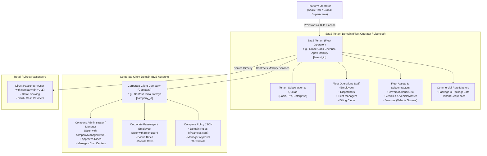
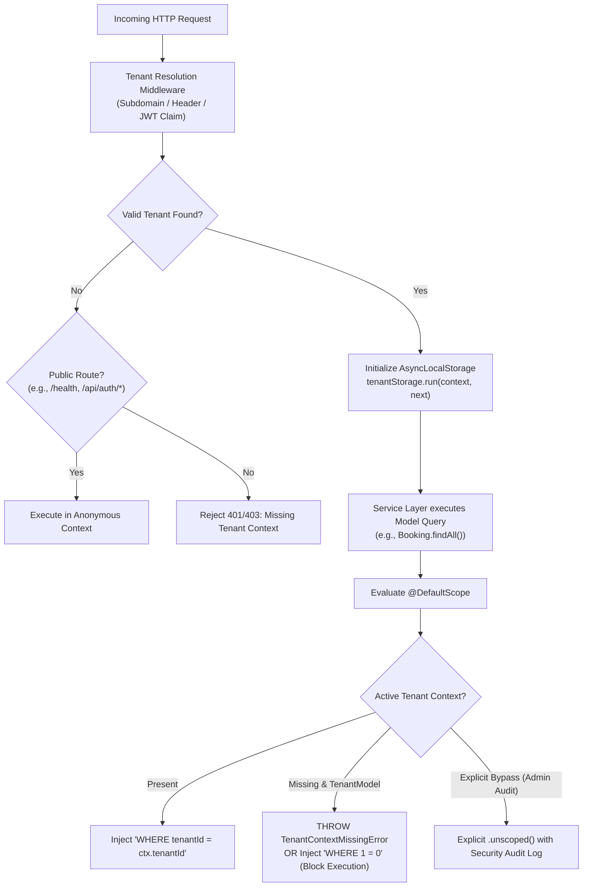
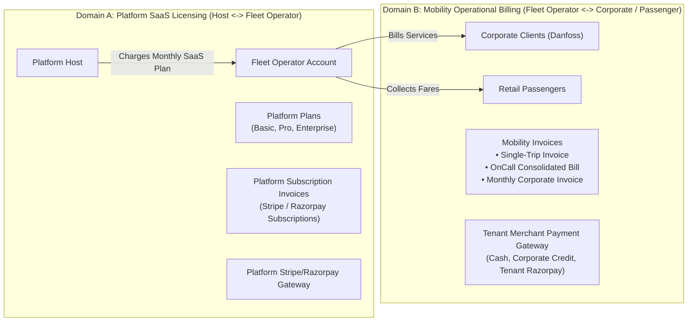
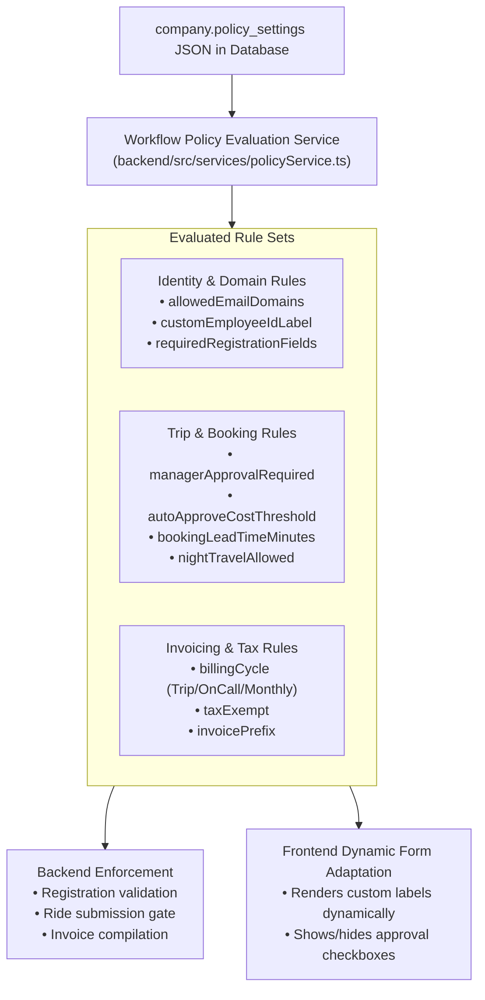
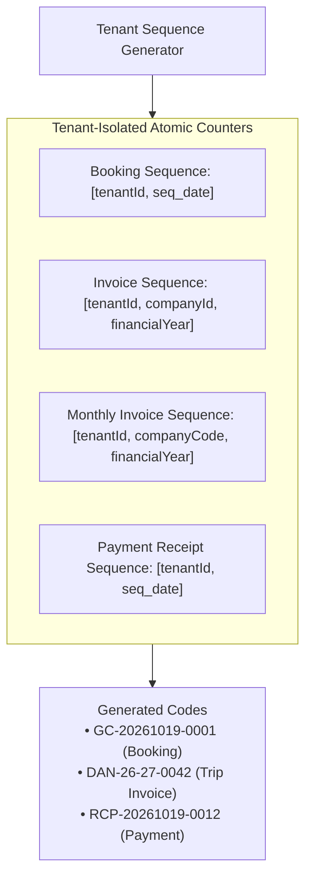
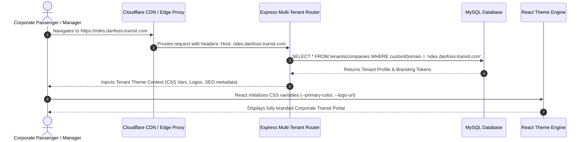

# Document 01: Reconciled Target Architecture & System Specifications

## 1. Executive Summary & Purpose of Reconciliation

The **Grace Cabs Fleet & Corporate Mobility Platform** (`demo-bookings`) is undergoing an architectural transformation from an operator-centric, single-tenant fleet management system with hardcoded corporate overrides into an enterprise-grade, multi-tenant **Software-as-a-Service (SaaS)** platform.

Earlier architectural analyses ([Document 01](../docs/01_EXISTING_SYSTEM_ARCHITECTURE.md), [Document 02](../docs/02_SECURITY_AND_DATA_ISOLATION_AUDIT.md), and [Document 03](../docs/03_MULTI_TENANT_SAAS_FEASIBILITY_AND_ARCHITECTURE.md)) identified the foundational feasibility of this transition. However, several critical design ambiguities and potential security flaws persisted:
1. **Taxonomic Ambiguity**: Conflating the SaaS Tenant (the paying fleet operator licensee) with the Corporate Client Company (e.g., Danfoss India), and conflating internal fleet operations employees with corporate passenger employees.
2. **Fatal Fail-Open Global Scopes**: The proposed Sequelize `@DefaultScope` in Document 03 defaulted to querying global data whenever the execution context was absent—introducing a catastrophic fail-open vulnerability.
3. **Domain Conflation**: Mixing platform subscription billing (software licensing fees paid by fleet operators) with operational cab-trip, on-call, and monthly corporate invoicing.
4. **Bespoke Logic Entanglement**: Deeply embedded client-specific branches (specifically for Danfoss) across database columns, authentication validators, and frontend forms.

This document establishes the reconciled target architecture, resolves core taxonomy, defines fail-closed tenant context isolation, delineates billing domains, and specifies the decoupled policy engine.

---

## 2. Reconciled Taxonomy & Entity Hierarchy

A precise separation of roles and scopes is mandatory to prevent access control confusion and erroneous schema alterations.



### Detailed Actor & Entity Specifications

| Role / Entity | Existing Code Entity | Target Reconciled Entity | Functional Definition & Access Boundary |
| :--- | :--- | :--- | :--- |
| **Platform Host (Global SuperAdmin)** | `employee` (`role='superadmin'`) | Dedicated Platform Admin (`platform_users`) | Owner and operator of the multi-tenant SaaS cloud infrastructure. Manages tenant accounts, subscription plans, platform-wide telemetry, global SMTP defaults, and system health. Has **no operational involvement** in daily cab dispatching or trip closure. |
| **SaaS Tenant (Fleet Operator)** | *Concept absent* (Implicitly hardcoded as Grace Cabs) | `Tenant` (`tenants` table) | The paying commercial licensee of the platform. Operates a fleet of cabs, contracts corporate accounts, employs dispatch staff, and owns commercial pricing matrices. Isolated by a unique `tenantId` (UUID). |
| **Fleet Operator Staff** | `Employee` (`employee` table) | `TenantEmployee` (`employee` table with `tenantId`) | Internal workforce of the Fleet Operator. Roles include: Local Fleet Admin, Dispatcher, Operations Supervisor, and Billing Clerk. Manages vehicles, assigns drivers to rides, audits trip sheets (`ClosePending`), and generates customer invoices. |
| **Fleet Chauffeur / Driver** | `Drivers` (`drivers` table) | `TenantDriver` (`drivers` table with `tenantId`) | Field drivers executing trips. Uses the mobile driver application or PWA. Authenticates via phone OTP, logs start/end odometer readings, streams GPS telemetry (`trackLocation`), and captures passenger signatures. Bound strictly to a single `tenantId`. |
| **Corporate Client Company** | `Company` (`company` table) | `CorporateClient` (`company` table with `tenantId`) | A B2B corporate customer contracted by a Fleet Operator for employee transit (e.g., Danfoss India). Holds billing GST, physical office addresses, corporate booking windows (`startTime`, `closeTime`, `priorMinutes`), manager approval flags, and negotiated package rates. **Is NOT a SaaS tenant**; does not pay platform subscription fees. |
| **Company Administrator / Manager** | `User` (`isManager=true`, `companyManager=true`) | Corporate Manager (`user` table with `companyId` & `tenantId`) | An employee of the Corporate Client Company with managerial rights. Approves or declines departmental ride bookings, uploads staff rosters via Excel, validates cost center allocations, and accesses corporate consolidated billing summaries. |
| **Corporate Passenger / Employee** | `User` (`role='user'`) | Corporate Passenger (`user` table with `companyId` & `tenantId`) | Individual employee of a Corporate Client Company. Submits personal or on-behalf ride requests, tracks cab arrival, boards vehicle, and signs digital trip sheets upon completion. |
| **Retail Passenger** | `User` (`companyId=NULL`) | Retail Customer (`user` table with `tenantId`, `companyId=NULL`) | Individual consumer booking retail rides directly with the Fleet Operator. Subject to retail rate packages, upfront or on-trip retail payments (Cash, UPI, Credit Card). |

---

## 3. Core Architecture: Shared Database with Strict Fail-Closed Row-Level Isolation

### 3.1 Architectural Decision Justification

After evaluating Database-per-tenant, Schema-per-tenant, and Shared-database models ([Document 03, Section 2](../docs/03_MULTI_TENANT_SAAS_FEASIBILITY_AND_ARCHITECTURE.md#2-evaluation-of-tenancy-isolation-models)), the platform commits to:

> **Primary Model**: Shared Database with Row-Level Isolation enforced by indexed `tenantId` foreign keys, Node.js `AsyncLocalStorage` context propagation, and fail-closed Sequelize global scopes.
>
> **Enterprise Exception**: For Tier 3 Enterprise clients requiring dedicated regulatory compliance (e.g., defense, banking transit contracts), provide an isolated database deployment (Hybrid Pool/Silo).

### 3.2 The Fail-Closed Tenant Context Engine

#### The Critical Vulnerability in Document 03
In Document 03 (Section 4.3), the proposed Sequelize scope was:
```typescript
// 🔴 CRITICAL VULNERABILITY IN DOCUMENT 03:
@DefaultScope(() => {
  const ctx = tenantStorage.getStore();
  if (!ctx || ctx.role === "SUPERADMIN_GLOBAL") {
    return { where: { isDeleted: false } }; // FAILS OPEN! Returns all tenants' data!
  }
  return { where: { tenantId: ctx.tenantId, isDeleted: false } };
})
```
If an asynchronous thread lost context, or if an endpoint was called without `tenantContextMiddleware`, `ctx` evaluated to `undefined`, causing the scope to execute `WHERE isDeleted = false` with **no tenant filter**—exposing all tenants' data.

#### The Reconciled Fail-Closed Implementation
The target architecture mandates a strict **Fail-Closed** design. If tenant context is missing for any tenant-scoped model, the ORM **must throw an exception** or inject an impossible predicate (`WHERE 1=0`), mathematically blocking unauthorized data retrieval.



```typescript
// Reconciled Tenant Context Definition: backend/src/context/tenantContext.ts
import { AsyncLocalStorage } from "async_hooks";

export interface TenantContextData {
  tenantId: string;
  tenantCode: string;
  userId?: string;
  role?: string;
  companyId?: string;
  isPlatformSuperAdmin?: boolean;
}

export const tenantStorage = new AsyncLocalStorage<TenantContextData>();

export class TenantContextMissingError extends Error {
  constructor(modelName: string) {
    super(`Security Violation: Model '${modelName}' executed without active TenantContext. Operation failed closed.`);
    this.name = "TenantContextMissingError";
  }
}

/**
 * Generates a fail-closed default scope for tenant-owned models.
 */
export const createTenantScope = (modelName: string) => {
  return () => {
    const ctx = tenantStorage.getStore();

    // 1. Authorized Platform SuperAdmin bypass (Audited)
    if (ctx?.isPlatformSuperAdmin) {
      return { where: { isDeleted: false } };
    }

    // 2. Missing Context: FAIL CLOSED
    if (!ctx || !ctx.tenantId) {
      // In production, throwing prevents query construction entirely.
      // Alternatively, inject an impossible condition to prevent SQL execution:
      return {
        where: {
          tenantId: "__NO_CONTEXT_FAIL_CLOSED__", // Guaranteed 0 records
          isDeleted: false,
        },
      };
    }

    // 3. Normal Tenant-Scoped execution
    return {
      where: {
        tenantId: ctx.tenantId,
        isDeleted: false,
      },
    };
  };
};
```

### 3.3 Defense-in-Depth: Dual-Layer Authorization

ORM default scopes provide automated protection, but Sequelize queries using raw SQL, `update()` calls without instance hooks, or subqueries can bypass scopes if improperly constructed. Therefore, the system enforces **Dual-Layer Authorization**:
1. **Layer 1 (Database/ORM)**: Automated `@DefaultScope` injecting `tenantId = ctx.tenantId`.
2. **Layer 2 (Controller/Service)**: Explicit tenancy and ownership assertion middleware:
   ```typescript
   export const assertTenantOwnership = (record: { tenantId: string }, callerTenantId: string) => {
     if (!record || record.tenantId !== callerTenantId) {
       throw new ForbiddenException("Cross-tenant resource access blocked.");
     }
   };
   ```

---

## 4. Separation of Platform Billing vs Operational Transport Billing

A critical reconciliation requirement is establishing total separation between the two distinct financial domains operating within the system.



### Comparative Financial Domain Matrix

| Dimension | Domain A: Platform SaaS Subscription | Domain B: Mobility Transport Billing |
| :--- | :--- | :--- |
| **Creditor (Billed By)** | **Platform Host** (SaaS Provider) | **SaaS Tenant** (Fleet Operator, e.g., Grace Cabs) |
| **Debtor (Payer)** | **SaaS Tenant** (Fleet Operator) | **Corporate Client** (Danfoss) or **Individual Passenger** |
| **Billing Basis** | Platform access, seat/fleet capacity quotas (15/75/Unlimited vehicles), metered telemetry (SMS, Maps, Storage). | Traveled distance (KMs), trip duration (hours), vehicle type, garage-to-guest metrics, driver batta, tolls, and parking. |
| **Billing Frequency** | Monthly or Annual recurring subscription schedule. | Immediate per-trip, on-demand on-call batch, or monthly consolidated contract statement. |
| **Database Entities** | `tenant_subscriptions`, `subscription_invoices`, `tenant_usage_meters`. | `invoice`, `closependings`, `onCallInvoice`, `monthly_invoice`, `payment`. |
| **Payment Gateways** | Platform's Stripe Billing / Razorpay Subscriptions integration. | Fleet Operator's merchant gateway account (Razorpay/Paytm/Cash/Direct Bank Transfer). |
| **Sequence Counter** | Global Platform Invoice Counter (`SAAS-YYYY-XXXX`). | Tenant & Company isolated series (`DAN-25-26-0001`). |

---

## 5. Decoupling Bespoke Client Logic: The Generic Policy Engine

To eliminate the "Danfoss problem" documented in [Document 02, Section 4](../docs/02_SECURITY_AND_DATA_ISOLATION_AUDIT.md#4-the-danfoss-problem-hardcoded-bespoke-client-logic) and [Document 03, Section 5](../docs/03_MULTI_TENANT_SAAS_FEASIBILITY_AND_ARCHITECTURE.md#5-decoupling-the-danfoss-problem-the-generic-policy-engine), bespoke customer branching is completely removed from application code and replaced by a metadata-driven **Workflow Policy Engine**.

### 5.1 Architecture of the Policy Engine



### 5.2 Dynamic Policy Schema Specification

Rather than adding bespoke columns to `user` or `company`, configuration is stored in `company.policy_settings` (JSON) and custom user attributes in `user.metadata` (JSON):

```typescript
// Proposed Policy Settings Schema
export interface CompanyPolicySettings {
  identity: {
    allowedEmailDomains: string[];        // e.g., ["@danfoss.com"] or ["@client.com"]
    employeeIdLabel: string;             // e.g., "Danfoss User ID" or "Staff Number"
    requireCostCenter: boolean;
    requireDepartment: boolean;
  };
  bookingRules: {
    requireManagerApproval: boolean;
    approvalThresholdAmount?: number;    // Auto-approve if cost is below this value
    allowSelfBookingOnBehalf: boolean;
    minAdvanceBookingMinutes: number;    // e.g., 60 minutes
    allowNightTravel: boolean;
  };
  invoicing: {
    billingMode: "SINGLE_TRIP" | "ON_CALL" | "MONTHLY";
    taxExempt: boolean;
    customInvoicePrefix?: string;
  };
}
```

---

## 6. Tenant-Isolated Sequencing Architecture

The legacy system relied on atomic global tables (`booking_sequence`, `monthly_booking_sequence`) keyed strictly by date (`seq_date`) or company code. This leaked platform-wide daily trip volumes across competitive fleets and created multi-tenant collision risks.

### Reconciled Sequencing Rules



1. **Booking Sequence (`booking_sequence`)**:
   - Re-keyed to composite primary key `(tenantId, seq_date)`.
   - Generates tenant-prefixed booking codes: `[TENANT_CODE]-[YYYYMMDD]-[0001]`.
2. **Invoice Sequences (`invoice_sequences` & `monthlyBookingSequence`)**:
   - Re-keyed to composite primary key `(tenantId, companyId, financialYear)`.
   - Preserves per-company financial invoice numbering while guaranteeing isolation across different fleet operators.
3. **Payment Receipt Sequence (`payment_sequence`)**:
   - Re-keyed to composite primary key `(tenantId, seq_date)`.

---

## 7. Dynamic White-Labeling & Domain Routing Architecture

To allow fleet operators to present a fully branded portal to their corporate clients and passengers, the platform implements a three-tier domain resolution pipeline:



### Resolution Hierarchy
1. **Custom Domain**: `fleet.clientoperator.com` (Matched against `tenants.customDomain`).
2. **Tenant Subdomain**: `metrofleet.gracecabs.com` (Subdomain parsed and matched against `tenants.subdomain`).
3. **Standard Corporate Vanity Path**: `app.gracecabs.com/Company/danfoss` (Matched against `company.seoUrl`).
4. **Fallback Public Portal**: Default landing page for Grace Cabs retail operations.

---

## 8. Explicit Open Architectural Decisions

The following architectural decisions are deliberately highlighted for stakeholder alignment prior to Phase 2 implementation:

| Decision ID | Architectural Topic | Options Under Consideration | Trade-offs & Recommendation |
| :---: | :--- | :--- | :--- |
| **DEC-01** | Dedicated Database Strategy for Enterprise Tier | **Option A**: Dynamic connection pooling per tenant in Node.js.<br/>**Option B**: Standalone dedicated container cluster per enterprise client. | **Recommendation: Option B**. Dynamic connection switching in Sequelize is prone to connection leaks. Dedicated containers provide cleaner security boundaries. |
| **DEC-02** | Automated SSL Certificate Provisioning for Custom Domains | **Option A**: Cloudflare for SaaS (automated SSL via API).<br/>**Option B**: In-house Caddy / Let's Encrypt reverse proxy. | **Recommendation: Option A**. Cloudflare for SaaS eliminates certificate renewal operations and provides edge DDoS protection. |
| **DEC-03** | Retail User Tenancy Binding | **Option A**: Retail users belong to a default "Platform Root Tenant".<br/>**Option B**: Retail users are bound to the specific Fleet Operator whose portal they registered through. | **Recommendation: Option B**. Prevents cross-operator passenger poaching and maintains data isolation. |
