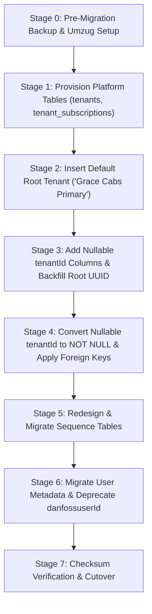

# Document 02: Tenant and Database Ownership Matrix

## 1. Executive Overview & Critical Correction of Prior Assumptions

In [Document 05, Section 4](../docs/05_GAP_ANALYSIS_AND_MIGRATION_ROADMAP.md#4-zero-downtime-data-migration-plan), the initial migration strategy proposed:
```sql
-- 🔴 FLAWED MIGRATION ASSUMPTION IN DOCUMENT 05:
-- "Loop for each existing table: ALTER TABLE <table> ADD COLUMN tenantId CHAR(36) NOT NULL..."
```
This naive assumption failed to distinguish between:
1. **Platform-Global Infrastructure** (e.g., subscription plans, tenant definitions, platform audit logs).
2. **Tenant-Owned Fleet Assets** (e.g., dispatchers, drivers, vehicles, rate cards).
3. **Corporate-Client-Owned Data** (e.g., client companies, employee rosters, corporate cost centers).
4. **Normalized Child Line-Items** (e.g., `monthly_invoice_items`, `onCallInvoiceItems`), which naturally inherit tenancy from their parent header document.
5. **Shared Reference / Operational Masters** (e.g., `pickupcity`, `pickuparea`, `paymentmode`), which represent global geographical or standard master data.

Blindly appending `tenantId` to all 37 database tables creates severe schema redundancy, breaks third-party GIS lookups, complicates foreign key constraints, and corrupts child-table referential integrity.

This document establishes the **authoritative classification matrix** for all existing and target database tables, defines foreign key relationships, redesigns sequence tables, and outlines an atomic, ordered migration execution plan.

---

## 2. Definitive Database Ownership Classification Matrix

### Taxonomy Classifications
- **Platform-Global (PG)**: Managed exclusively by the SaaS platform host. Independent of any single fleet operator.
- **Tenant-Owned (TO)**: Owned by a specific SaaS Tenant (Fleet Operator). Must carry a mandatory, indexed `tenantId` foreign key and enforce fail-closed tenant scoping.
- **Corporate-Client-Owned (CO)**: Owned by a specific B2B Corporate Client (`companyId`), which in turn belongs to a Tenant (`tenantId`). Carries `companyId` and a direct or denormalized `tenantId` for query efficiency.
- **Operational / Reference Data (REF)**: Shared lookup data, geographic boundaries, or ephemeral transactional caches that are either shared globally or scoped through contextual foreign keys.

```mermaid
graph TD
    subgraph PG["Platform-Global Tables"]
        T_TENANTS["tenants"]
        T_SUBS["tenant_subscriptions"]
        T_METERS["tenant_usage_meters"]
    end

    subgraph TO["Tenant-Owned (Fleet Operator Scope)"]
        T_EMP["employee (Staff)"]
        T_DRV["drivers (Chauffeurs)"]
        T_VEND["vendor (Fleet Owners)"]
        T_VM["vehicleMaster (Plates)"]
        T_VEH["vehicle (Fleet Models)"]
        T_PKG["package & packagedata"]
        T_CFG["configuration (Tenant Settings)"]
        T_ECFG["emailconfiguration"]
        T_SEQS["Sequence Tables (booking, payment, invoice)"]
        T_SL["shortlinks"]
        T_PARTNER["partners"]
    end

    subgraph CO["Corporate-Client-Owned (B2B Scope)"]
        T_CO["company (Corporate Client)"]
        T_USR["user (Passengers / Staff)"]
        T_BKG["booking (Reservations)"]
        T_CP["closependings (Trip Audits)"]
        T_INV["invoice (Single-Trip)"]
        T_OCI["onCallInvoice (Parent)"]
        T_MI["monthly_invoice (Parent)"]
        T_PAY["payment (Trip Payments)"]
        T_OS["ordersummery"]
    end

    subgraph REF["Reference / Child / Ephemeral"]
        T_CITY["pickupcity & pickuparea"]
        T_TAX["tax (Master Slabs)"]
        T_PMODE["paymentmode"]
        T_VTYPE["vehicletype"]
        T_OCII["onCallInvoiceItems (Child)"]
        T_MII["monthly_invoice_items (Child)"]
        T_OTP["otps"]
        T_MAP["mapcount"]
    end

    PG --> TO
    TO --> CO
    CO --> REF
```



---

### Comprehensive 37+ Table Ownership & Tenancy Specification

| # | Model Name | Physical Table Name | Ownership Class | `tenantId` Column Strategy | `companyId` Association | Foreign Key Constraints & Indexes | Default Scope Filter | Technical Justification |
| :-: | :--- | :--- | :-: | :--- | :--- | :--- | :--- | :--- |
| **NEW** | `Tenant` | `tenants` | **PG** | Primary Key (`tenantId`) | None | `PRIMARY KEY (tenantId)`, `UNIQUE (subdomain)`, `UNIQUE (customDomain)` | None (Global) | Root tenant entity representing the subscribed fleet operator. |
| **NEW** | `TenantSubscription`| `tenant_subscriptions`| **PG** | Foreign Key (`tenantId`) | None | `FK -> tenants(tenantId)`, `INDEX (status, currentPeriodEnd)` | Scoped to Tenant | Manages SaaS billing, tiers, renewal dates, and fleet quotas. |
| **NEW** | `TenantUsageMeter` | `tenant_usage_meters` | **PG** | Foreign Key (`tenantId`) | None | `FK -> tenants(tenantId)`, `UNIQUE (tenantId, billingMonth, metricName)` | Scoped to Tenant | Tracks monthly usage (SMS count, Maps API calls, storage bytes) for overage billing. |
| **1** | `Employee` | `employee` | **TO** | **Mandatory Direct FK** | None (Operates across clients) | `FK -> tenants(tenantId)`, `INDEX (tenantId, role)` | `WHERE tenantId = ctx.tenantId` | Internal staff (dispatchers, local admins) employed by the fleet operator. Must be strictly tenant-isolated. |
| **2** | `Drivers` | `drivers` | **TO** | **Mandatory Direct FK** | None | `FK -> tenants(tenantId)`, `INDEX (tenantId, isDeleted)` | `WHERE tenantId = ctx.tenantId` | Fleet chauffeurs. Drivers belong exclusively to a fleet operator and cannot be dispatched across tenants. |
| **3** | `Vendor` | `vendor` | **TO** | **Mandatory Direct FK** | None | `FK -> tenants(tenantId)`, `INDEX (tenantId, isDeleted)` | `WHERE tenantId = ctx.tenantId` | Vehicle contractors/owners providing assets to the specific fleet operator. |
| **4** | `VehicleMaster` | `vehicleMaster` | **TO** | **Mandatory Direct FK** | None | `FK -> tenants(tenantId)`, `FK -> vendor(vendorId)`, `INDEX (tenantId, vehicleNumber)` | `WHERE tenantId = ctx.tenantId` | Physical vehicle registrations (license number plates). Assets are owned/managed by the tenant. |
| **5** | `Vehicle` | `vehicle` | **TO** | **Mandatory Direct FK** | None | `FK -> tenants(tenantId)`, `FK -> vehicletype(vehicleTypeId)` | `WHERE tenantId = ctx.tenantId` | Tenant's vehicle fleet catalog and assigned operational models. |
| **6** | `Company` | `company` | **CO** | **Mandatory Direct FK** | Primary Key (`companyId`) | `FK -> tenants(tenantId)`, `INDEX (tenantId, isDeleted)`, `UNIQUE (tenantId, companyCode)` | `WHERE tenantId = ctx.tenantId` | B2B Corporate Client (e.g., Danfoss). Contracted by a specific Tenant. Code uniqueness is scoped per tenant. |
| **7** | `User` | `user` | **CO / TO** | **Mandatory Denormalized FK** | BelongsTo `companyId` (Nullable) | `FK -> tenants(tenantId)`, `FK -> company(companyId)`, `INDEX (tenantId, email)`, `INDEX (tenantId, mobile)` | `WHERE tenantId = ctx.tenantId` | Passengers & corporate staff. Denormalized `tenantId` enables fast indexing for retail users (`companyId=NULL`) and corporate users alike. |
| **8** | `Booking` | `booking` | **CO / TO** | **Mandatory Direct FK** | BelongsTo `companyId` (Nullable) | `FK -> tenants(tenantId)`, `FK -> company(companyId)`, `FK -> user(userId)`, `INDEX (tenantId, bookingDate)` | `WHERE tenantId = ctx.tenantId` | Core trip reservation. Must carry `tenantId` for instant row isolation without joining `user` or `company`. |
| **9** | `ClosePending` | `closependings` | **CO / TO** | **Mandatory Direct FK** | BelongsTo `companyId` (Nullable) | `FK -> tenants(tenantId)`, `FK -> booking(bookingId)`, `INDEX (tenantId, createdAt)` | `WHERE tenantId = ctx.tenantId` | Post-trip audit record. Contains financial calculations and toll breakdowns. Direct `tenantId` prevents cross-tenant audit access. |
| **10** | `Invoice` | `invoice` | **CO / TO** | **Mandatory Direct FK** | BelongsTo `companyId` (Nullable) | `FK -> tenants(tenantId)`, `FK -> company(companyId)`, `INDEX (tenantId, invoiceNumber)` | `WHERE tenantId = ctx.tenantId` | Single-trip financial bill. Carries `tenantId` to ensure total isolation of commercial billing records. |
| **11** | `OnCallInvoice` | `onCallInvoice` | **CO** | **Mandatory Direct FK** | BelongsTo `companyId` (Mandatory) | `FK -> tenants(tenantId)`, `FK -> company(companyId)`, `INDEX (tenantId, onCallBillId)` | `WHERE tenantId = ctx.tenantId` | Consolidated on-call invoice header. Scoped to the billing tenant and target corporate client. |
| **12** | `OnCallInvoiceItems` | `onCallInvoiceItems`| **CO (Child)** | **No Direct `tenantId`** (Child) | Inherited via `onCallBillId` | `FK -> onCallInvoice(onCallBillId) ON DELETE CASCADE`, `FK -> booking(bookingId)` | Inherited through Parent Join | Normalized child line items. Adding `tenantId` is redundant and risks data divergence; isolation is guaranteed by parent foreign key. |
| **13** | `MonthlyInvoice` | `monthly_invoice` | **CO** | **Mandatory Direct FK** | BelongsTo `companyId` (Mandatory) | `FK -> tenants(tenantId)`, `FK -> company(companyId)`, `INDEX (tenantId, financialYear)` | `WHERE tenantId = ctx.tenantId` | Monthly aggregated corporate invoice header. Direct `tenantId` guarantees tenant-level invoice reporting. |
| **14** | `MonthlyInvoiceItems`| `monthly_invoice_items`| **CO (Child)** | **No Direct `tenantId`** (Child) | Inherited via `monthlyInvoiceId` | `FK -> monthly_invoice(monthlyInvoiceId) ON DELETE CASCADE` | Inherited through Parent Join | Normalized daily route items. Tenant boundary enforced through parent `monthly_invoice` foreign key. |
| **15** | `Payment` | `payment` | **CO / TO** | **Mandatory Direct FK** | BelongsTo `companyId` (via Booking) | `FK -> tenants(tenantId)`, `INDEX (tenantId, paymentDate)` | `WHERE tenantId = ctx.tenantId` | Cab-trip payment receipts collected by the tenant. Must be strictly segregated per tenant merchant account. |
| **16** | `orderSummery` | `ordersummery` | **CO** | **Mandatory Direct FK** | BelongsTo `companyId` | `FK -> tenants(tenantId)`, `FK -> company(companyId)`, `FK -> invoice(invoiceId)` | `WHERE tenantId = ctx.tenantId` | Corporate billing aggregation summary. Direct tenant scoping ensures clean reconciliation. |
| **17** | `Package` | `package` | **TO / CO** | **Mandatory Direct FK** | BelongsTo `companyId` | `FK -> tenants(tenantId)`, `FK -> company(companyId)`, `INDEX (tenantId, packageType)` | `WHERE tenantId = ctx.tenantId` | Rate category master (Outstation vs Local). Scoped to tenant and negotiated client. |
| **18** | `PackageData` | `packagedata` | **TO / CO** | **Mandatory Direct FK** | BelongsTo `companyId` | `FK -> tenants(tenantId)`, `FK -> company(companyId)` | `WHERE tenantId = ctx.tenantId` | Specific pricing matrix slabs (JSON rates per vehicle type). Scoped to tenant. |
| **19** | `Configuration` | `configuration` | **TO** | **Mandatory Direct FK** | None | `FK -> tenants(tenantId)`, `UNIQUE (tenantId)` | `WHERE tenantId = ctx.tenantId` | Migrated from single-row global table to **per-tenant configuration** (tenant SMTP, tax percentage, invoice prefix). |
| **20** | `EmailConfiguration`| `emailconfiguration`| **TO** | **Mandatory Direct FK** | None | `FK -> tenants(tenantId)`, `INDEX (tenantId, emailType)` | `WHERE tenantId = ctx.tenantId` | Tenant-specific HTML email templates and branding. |
| **21** | `BookingSequence` | `booking_sequence` | **TO** | **Composite Key Column** | None | `PRIMARY KEY (tenantId, seq_date)` | Handled in Atomic Hook | Redesigned from global `seq_date` PK to composite `(tenantId, seq_date)`. Prevents volume leakage. |
| **22** | `InvoiceSequence` | `invoice_sequences` | **TO** | **Composite Key Column** | Composite FK `companyId` | `PRIMARY KEY (tenantId, companyId, financialYear)` | Handled in Atomic Hook | Preserves corporate sequence while isolating across fleet operators. |
| **23** | `MonthlyBookingSequence`| `monthlyBookingSequence`| **TO** | **Composite Key Column** | Scoped by `companyCode` | `PRIMARY KEY (tenantId, companyCode, financialYear)` | Handled in Atomic Hook | Isolates monthly invoice numbering across tenants. |
| **24** | `PaymentSequence` | `payment_sequence` | **TO** | **Composite Key Column** | None | `PRIMARY KEY (tenantId, seq_date)` | Handled in Atomic Hook | Daily payment receipt counter scoped per tenant. |
| **25** | `ShortLink` | `shortlinks` | **TO** | **Mandatory Direct FK** | None | `FK -> tenants(tenantId)`, `INDEX (tenantId, code)` | `WHERE tenantId = ctx.tenantId` | SMS short URLs. Tenant scoping ensures isolation and tracks SMS usage. |
| **26** | `Partner` | `partners` | **TO** | **Mandatory Direct FK** | None | `FK -> tenants(tenantId)`, `INDEX (tenantId, createdAt)` | `WHERE tenantId = ctx.tenantId` | Driver/vendor partnership inquiries submitted via the tenant's public portal. |
| **27** | `VehicleType` | `vehicleType` | **REF / TO** | **Optional / Tenant Override** | None | `INDEX (isDeleted)` | Global or Tenant-Overridden | Standard vehicle classes (Sedan, SUV, Hatchback, Prime). Shared globally by default; enterprise tenants may define custom types. |
| **28** | `Pickupcity` | `pickupcity` | **REF** | **No `tenantId`** (Global Master) | None | `PRIMARY KEY (pickupCityId)`, `UNIQUE (cityName)` | None (Shared Reference) | Geographic master list of operating cities (e.g., Chennai, Bangalore). Shared globally across all tenants. |
| **29** | `Pickuparea` | `pickuparea` | **REF** | **No `tenantId`** (Global Master) | None | `FK -> pickupcity(pickupCityId)`, `INDEX (areaName)` | None (Shared Reference) | Geographic master list of sub-localities and airports. Shared across tenants. |
| **30** | `Tax` | `tax` | **REF / TO** | **No `tenantId`** (Global Master) | None | `PRIMARY KEY (taxId)` | None (Shared Reference) | Standard Indian statutory GST definitions (CGST 2.5%, SGST 2.5%, IGST 5%). Individual tenant tax exemption is handled via `company.allowTax`. |
| **31** | `PaymentMode` | `paymentmode` | **REF** | **No `tenantId`** (Global Master) | None | `PRIMARY KEY (paymentModeId)` | None (Shared Reference) | Standard payment mode definitions (Cash, Card, UPI, Corporate Credit, Bank Transfer). |
| **32** | `OTP` | `otps` | **REF / Ephemeral** | **No `tenantId`** (Phone-Bound) | None | `INDEX (mobile, expiresAt)` | Filtered by Phone & Expiry | Ephemeral 6-digit phone verification records. Tied to mobile numbers with 10-minute expiry; zero cross-tenant risk. |
| **33** | `MapCount` | `mapcount` | **REF / Telemetry** | **No `tenantId`** (Migrated to Meter)| None | `PRIMARY KEY (mapCountId)` | None (Legacy Telemetry) | Legacy single-row global Maps counter. Converted to platform telemetry; per-tenant metrics moved to `tenant_usage_meters`. |
| **34** | `bookingRule` | `bookingRule` | **REF / Empty** | **Deprecated** | N/A | None | N/A | Code artifact (0 bytes). Dropped during migration cleanup. |

---

## 3. Sequence Tables Architecture & Re-Keying Specification

The legacy sequence tables created severe concurrency, data collision, and business intelligence leakage risks across multi-tenant boundaries.

### 3.1 `booking_sequence`
- **Legacy Schema**: `PRIMARY KEY (seq_date DATEONLY)`, `last_number INTEGER`.
- **Defect**: Daily booking volume was aggregated across all operators.
- **Reconciled Target Schema**:
  ```sql
  CREATE TABLE booking_sequences (
    tenantId CHAR(36) NOT NULL,
    seq_date DATE NOT NULL,
    last_number INT NOT NULL DEFAULT 1,
    PRIMARY KEY (tenantId, seq_date),
    CONSTRAINT fk_bkg_seq_tenant FOREIGN KEY (tenantId) REFERENCES tenants(tenantId) ON DELETE CASCADE
  ) ENGINE=InnoDB;
  ```
- **Code Generation Logic**:
  ```typescript
  // Atomic increment per tenant
  await sequelize.query(`
    INSERT INTO booking_sequences (tenantId, seq_date, last_number)
    VALUES (:tenantId, :dateStr, 1)
    ON DUPLICATE KEY UPDATE last_number = last_number + 1
  `, { replacements: { tenantId, dateStr } });
  ```

### 3.2 `invoice_sequences`
- **Legacy Schema**: `PRIMARY KEY (companyId UUID, financialYear VARCHAR)`.
- **Defect**: Scoped by `companyId`, but had no tenant foreign key; could collide if company IDs were mismatched.
- **Reconciled Target Schema**:
  ```sql
  CREATE TABLE invoice_sequences (
    tenantId CHAR(36) NOT NULL,
    companyId CHAR(36) NOT NULL,
    financialYear VARCHAR(10) NOT NULL,
    current INT NOT NULL DEFAULT 0,
    PRIMARY KEY (tenantId, companyId, financialYear),
    CONSTRAINT fk_inv_seq_tenant FOREIGN KEY (tenantId) REFERENCES tenants(tenantId) ON DELETE CASCADE,
    CONSTRAINT fk_inv_seq_company FOREIGN KEY (companyId) REFERENCES company(companyId) ON DELETE CASCADE
  ) ENGINE=InnoDB;
  ```

### 3.3 `monthlyBookingSequence`
- **Legacy Schema**: `PRIMARY KEY (financialYear VARCHAR, companyCode VARCHAR)`.
- **Defect**: Collided if two different fleet operators had a corporate client sharing the same code (e.g., "DAN" or "INF").
- **Reconciled Target Schema**:
  ```sql
  CREATE TABLE monthly_booking_sequences (
    tenantId CHAR(36) NOT NULL,
    companyCode VARCHAR(20) NOT NULL,
    financialYear VARCHAR(10) NOT NULL,
    lastNumber INT NOT NULL DEFAULT 0,
    PRIMARY KEY (tenantId, companyCode, financialYear),
    CONSTRAINT fk_mbs_tenant FOREIGN KEY (tenantId) REFERENCES tenants(tenantId) ON DELETE CASCADE
  ) ENGINE=InnoDB;
  ```

---

## 4. Atomic Migration Strategy & Foreign Key Sequencing

To avoid locking large tables, violating foreign key constraints, or triggering database deadlocks, migration DDL must execute in a strictly defined topological sequence:



### Topological DDL Execution Order

1. **Step 1: Create Platform Infrastructure**:
   - Create `tenants`, `tenant_subscriptions`, `tenant_usage_meters`.
2. **Step 2: Seed Baseline Tenant**:
   - Insert primary root tenant record (`ROOT_TENANT_ID = 'e7b8a1c0-0000-0000-0000-000000000001'`).
3. **Step 3: Migrate Primary Tenant Entities (Level 1)**:
   - Tables: `employee`, `vendor`, `vehicletype`, `configuration`, `emailconfiguration`, `partners`.
   - Action: `ADD COLUMN tenantId CHAR(36) NULL` -> `UPDATE SET tenantId = ROOT_ID` -> `MODIFY COLUMN tenantId NOT NULL` -> `ADD FOREIGN KEY`.
4. **Step 4: Migrate Fleet Asset Entities (Level 2)**:
   - Tables: `vehicle`, `drivers`, `vehicleMaster`, `company`.
   - Action: Same nullable-add, backfill, not-null, FK sequence.
5. **Step 5: Migrate Rate Masters & Client Entities (Level 3)**:
   - Tables: `package`, `packagedata`, `user`.
   - Backfill `user.metadata` JSON from `user.danfossuserId`.
6. **Step 6: Migrate Transactional Entities (Level 4)**:
   - Tables: `booking`, `closependings`, `invoice`, `onCallInvoice`, `monthly_invoice`, `payment`, `ordersummery`, `shortlinks`.
7. **Step 7: Sequence Table Re-Keying**:
   - Create new composite sequence tables, copy current counters, swap table names atomically.
8. **Step 8: Performance Indexes**:
   - Create compound indexes: `idx_booking_tenant_date(tenantId, bookingDate)`, `idx_user_tenant_email(tenantId, email)`.

### Rollback & Failsafe Guarantees
- **Binary Snapshot**: Full physical storage snapshot executed immediately prior to Step 1.
- **Transactional Migrations**: Each DDL step is wrapped in Umzug migration transactions where supported by MySQL 8.0 DDL engine.
- **Non-Destructive Backfill**: The legacy `danfossuserId` column in `user` and legacy single-row `configuration` table are retained as read-only fallbacks for 30 days post-cutover.
- **Automated Checksums**: The migration runner calculates `COUNT(*)`, `SUM(subTotal)`, and `MAX(bookingCode)` before and after execution to guarantee zero data loss.

---

## 5. Explicit Open Schema Decisions

| Decision ID | Schema Topic | Options Under Consideration | Recommendation & Impact |
| :---: | :--- | :--- | :--- |
| **SCH-01** | VehicleType Tenancy Scope | **Option A**: 100% Platform-Global reference table.<br/>**Option B**: Tenant-owned with platform defaults. | **Recommendation: Option A with tenant-specific rate overrides in `packagedata`**. Keeps vehicle classification standardized for mobile apps. |
| **SCH-02** | Child Line-Item Tenancy Denormalization | **Option A**: Leave child tables without `tenantId` (pure normalized).<br/>**Option B**: Denormalize `tenantId` into `monthly_invoice_items` and `onCallInvoiceItems`. | **Recommendation: Option A**. Foreign key cascade is simpler, prevents tenant-mismatch bugs between parent and child lines. |
| **SCH-03** | Phone Number Uniqueness Scope | **Option A**: Globally unique across all tenants (`UNIQUE(mobile)`).<br/>**Option B**: Unique only within tenant (`UNIQUE(tenantId, mobile)`). | **Recommendation: Option B**. Allows the same passenger to hold corporate accounts with different regional fleet operators. |
