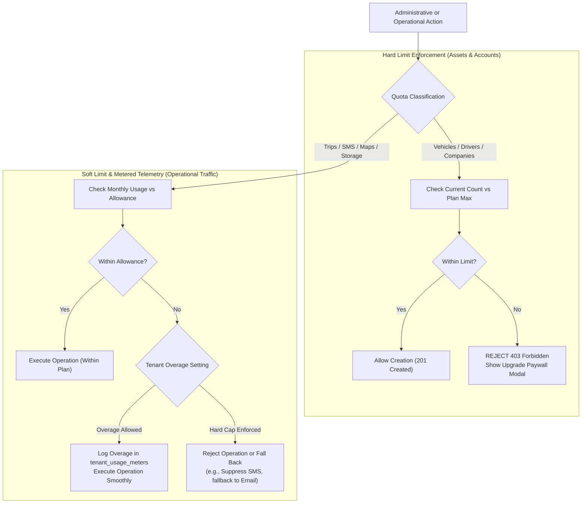
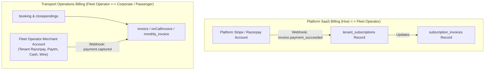
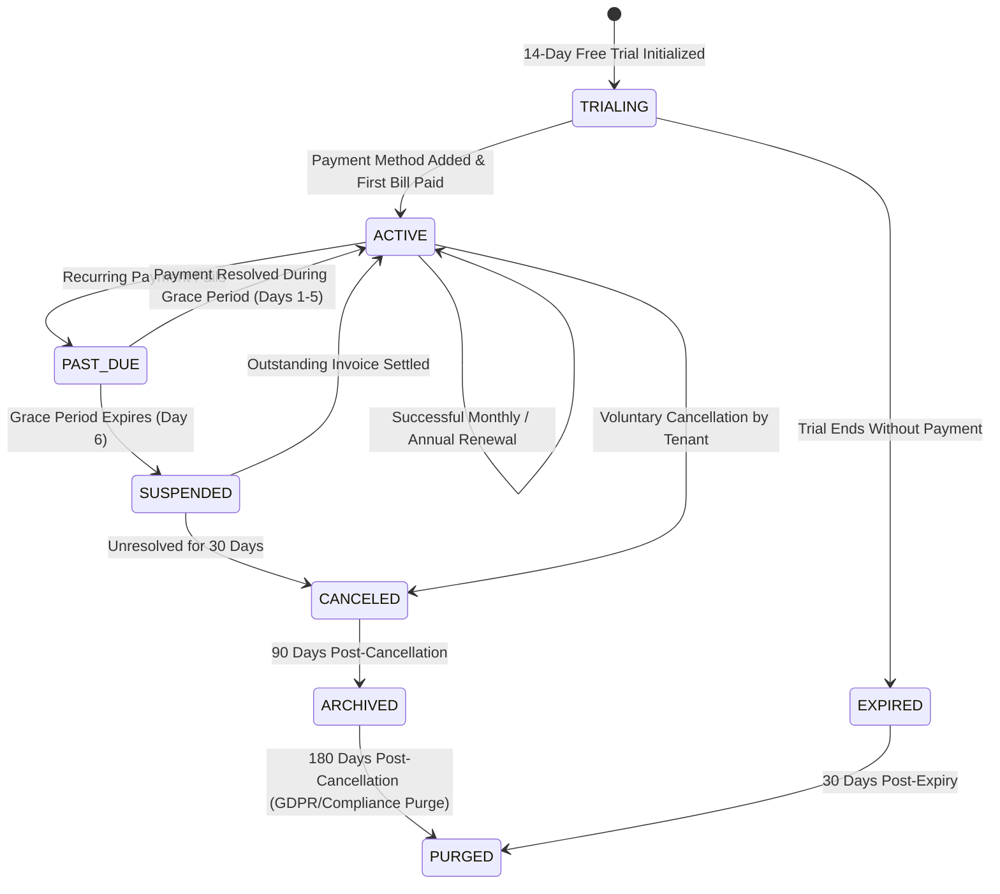

# Document 03: Final Subscription and Quota Rules

## 1. Commercial Architecture & Monetization Model

The Grace Cabs Multi-Tenant SaaS Platform operates on a **Value-Metric Subscription Model** tailored for regional taxi operators, fleet contractors, and enterprise corporate logistics departments.

The commercial structure aligns platform licensing fees with the licensee's operational scale:
1. **Recurring Base Platform License**: Monthly or annual access fee tiered by fleet size and feature entitlements.
2. **Hard Fleet Limits & Account Ceilings**: Predictable tier caps preventing platform resource exhaustion.
3. **Usage-Based Telemetry & Metering**: Variable infrastructure costs (SMS OTP dispatches, Google Maps route calculations, cloud file storage) metered with configurable overage allowances.

---

## 2. Reconciled Product Subscription Tiers

```mermaid
graph LR
    subgraph T1["BASIC TIER (Starter Fleet)"]
        B_TARGET["Small / Boutique Fleets<br/>(1-15 Vehicles)"]
        B_PRICE["₹3,499 / month<br/>($49 USD)"]
        B_QUOTA["• 15 Vehicles<br/>• 15 Drivers<br/>• 3 Corporate Clients<br/>• 1,000 Trips / mo"]
    end

    subgraph T2["PRO TIER (Regional Growth)"]
        P_TARGET["Mid-Market Fleet Operators<br/>(Up to 75 Vehicles)"]
        P_PRICE["₹11,999 / month<br/>($149 USD)"]
        P_QUOTA["• 75 Vehicles<br/>• 75 Drivers<br/>• 20 Corporate Clients<br/>• 10,000 Trips / mo"]
    end

    subgraph T3["ENTERPRISE TIER (Fleet Network)"]
        E_TARGET["National Aggregators / In-House<br/>(Unlimited Fleet Scale)"]
        E_PRICE["Custom / Starting ₹34,999 / mo<br/>($449+ USD)"]
        E_QUOTA["• Unlimited Vehicles<br/>• Unlimited Drivers<br/>• Unlimited Clients<br/>• Unlimited Trips"]
    end

    T1 --> T2 --> T3
```



### Comprehensive Tier Entitlement & Feature Matrix

| Feature / Quota Dimension | Basic Tier (Starter) | Pro Tier (Growth) | Enterprise Tier |
| :--- | :---: | :---: | :---: |
| **Target Audience** | Local taxi operators, boutique car rentals | Regional multi-city fleet operators | Large transport aggregators, enterprise in-house fleets |
| **Monthly Subscription Price** | ₹3,499 / month | ₹11,999 / month | Starting at ₹34,999 / month |
| **Annual Subscription (15% Off)**| ₹35,690 / year | ₹1,22,390 / year | Custom Enterprise Agreement |
| **Active Vehicle Fleet Limit** | **15 Vehicles** (Hard cap) | **75 Vehicles** (Hard cap) | **Unlimited** (Metered volume packs) |
| **Active Driver Limit** | **15 Drivers** (Hard cap) | **75 Drivers** (Hard cap) | **Unlimited** |
| **Corporate Clients (`Company`)** | **3 Companies** (Hard cap) | **20 Companies** (Hard cap) | **Unlimited** |
| **Monthly Booking Volume** | Up to **1,000 trips / month** | Up to **10,000 trips / month** | **Unlimited** |
| **Fleet Dispatch & Monitoring** | Manual dispatch console | Automated + manual dispatch | AI-assisted auto-allocation |
| **Driver Application Access** | Web PWA access | Web PWA + Native Mobile App | White-labeled Driver App (Play Store) |
| **Live GPS Tracking Telemetry** | Odometer log only | Real-time map tracking | Real-time tracking + historical route replay |
| **Single-Trip Retail Invoicing** | ✅ Included | ✅ Included | ✅ Included |
| **On-Call Multi-Trip Invoicing** | ❌ Not included | ✅ Included | ✅ Included |
| **Monthly Corporate Invoicing** | ❌ Not included | ✅ Included | ✅ Included |
| **Manager Ride Approvals** | Auto-confirm only | Single-tier manager approval | Multi-tier hierarchical approval engine |
| **Workflow Policy Engine** | Standard default rules | Standard default rules | **Configurable Policy Engine** (Domain regex, bespoke metadata) |
| **Branding & White-Labeling** | Shared SaaS portal | Tenant Subdomain (`operator.gracecabs.in`)| **Full White-Label** (`rides.operator.com`) + Custom CSS |
| **Email Infrastructure** | Shared platform SMTP | Custom SMTP server credentials | Dedicated IP pool & custom DKIM/SPF |
| **SMS OTP / Notifications** | 500 SMS / month included | 5,000 SMS / month included | Custom volume packs or BYO Gateway |
| **Google Maps Geocoding API** | 1,000 queries / month | 10,000 queries / month | High-volume package or BYO API Key |
| **Cloud Storage (Docs/Signatures)**| 5 GB included | 25 GB included | 100 GB included (Scale as needed) |
| **REST API & Webhooks Access** | ❌ No API access | Read-only reporting API | Full bi-directional REST API + Webhooks |
| **Database Deployment Model** | Shared multi-tenant pool | Shared multi-tenant pool | Shared Pool OR Dedicated DB Silo |
| **Support SLA** | Email support (48h response) | Priority email & chat (12h SLA) | 24/7 Phone & Dedicated Technical AM (1h SLA) |

---

## 3. Quota Reconciliations: Hard Limits vs Soft Limits & Overage Rules

A common failure in SaaS billing is either abruptly blocking critical operational tasks or incurring unexpected run-away overage costs. The reconciled architecture classifies quotas into **Hard Limits** and **Soft Limits with Configurable Overage**.



### Detailed Quota Matrix & Enforcement Policies

| Quota Dimension | Enforcement Mechanism | Tenant Setting Available? | Telemetry Source | Overage Rate (When Allowed) | Behavior at Limit |
| :--- | :---: | :---: | :--- | :--- | :--- |
| **Active Vehicles** | **HARD LIMIT** | No (Plan Upgrade Required) | `COUNT(vehicle) WHERE tenantId = :id AND isDeleted = false` | ₹150 / vehicle / month (Pro & Enterprise only) | Mutation blocked with HTTP 403. Upgrade modal rendered in admin UI. |
| **Active Drivers** | **HARD LIMIT** | No (Plan Upgrade Required) | `COUNT(drivers) WHERE tenantId = :id AND isDeleted = false` | ₹120 / driver / month (Pro & Enterprise only) | Driver registration blocked. Existing drivers unaffected. |
| **Corporate Clients** | **HARD LIMIT** | No (Plan Upgrade Required) | `COUNT(company) WHERE tenantId = :id AND isDeleted = false` | ₹499 / company / month | Adding new company master blocked. Existing client bookings unaffected. |
| **Monthly Trip Volume**| **SOFT LIMIT** | Yes (`allowTripOverage`) | `COUNT(booking) WHERE tenantId = :id AND MONTH(createdAt) = :m` | ₹3.50 per additional trip | If overage allowed: trip booked, logged in usage meter. If hard cap: booking rejected with plan limit alert. |
| **Transactional SMS** | **SOFT LIMIT** | Yes (`allowSmsOverage`) | `COUNT(otps) + Notification Log` | ₹0.30 per additional SMS | If overage allowed: SMS dispatched. If hard cap: SMS suppressed; fallback to Email / Push notifications. |
| **Google Maps API** | **SOFT LIMIT** | Yes (`allowMapOverage`) | `tenant_usage_meters (METRIC_MAPS)` | ₹25 per 1,000 queries | If overage allowed: route computed smoothly. If hard cap: fallback to straight-line distance calculation. |
| **Cloud Storage (GB)** | **SOFT LIMIT** | Yes (`allowStorageOverage`) | S3 / MinIO Bucket Bytes / 10^9 | ₹15 per additional GB / month | Operations continue smoothly. Overage billed on next subscription invoice. |

### Tenant Overage Configuration Controls
Each tenant administrator can toggle overage preferences in their billing settings:
- **`allowOverage: true`**: Guarantees uninterrupted customer dispatch and passenger ride bookings. Excess consumption is recorded in `tenant_usage_meters` and billed at the next billing cycle.
- **`allowOverage: false`**: Enforces strict financial caps. When thresholds are reached, non-critical services (e.g., SMS alerts) fall back to free alternatives (email/push), preventing surprise charges.

---

## 4. Separation of Platform SaaS Billing from Transport Operations Billing

To preserve clean commercial accounting and avoid legal/tax entanglement:



1. **Independent Merchant Credentials**:
   - Platform subscription fees are charged using the **Platform Operator's** payment gateway credentials (defined in platform `.env` settings).
   - Cab fares and trip payments are collected using the **Tenant's individual merchant credentials** (configured in `configuration` table).
2. **Distinct Invoice Records**:
   - Platform software invoices are stored in `subscription_invoices` with GST compliance for SaaS software licensing.
   - Cab-trip bills are stored in `invoice`, `onCallInvoice`, and `monthly_invoice` with GST compliance for passenger road transport services (SAC 9964).

---

## 5. Subscription Lifecycle State Machine & Dunning Rules



### Detailed Lifecycle State Specifications

| Status | Operational Capabilities | Tenant Access Level | Dunning & Alert Schedule |
| :--- | :--- | :--- | :--- |
| **`TRIALING`** | Full Pro Tier capabilities. Hard limits: 15 vehicles, 500 trips. | Full platform administrative access. | Welcome email on Day 1; upgrade reminder on Day 10; expiration warning on Day 13. |
| **`ACTIVE`** | All entitled features and quotas operational according to subscribed tier. | Unrestricted platform access. | Renewal notice 7 days prior to billing anchor date. |
| **`PAST_DUE`** | Normal operational dispatch continues for **5-day grace period**. | Admin dashboard displays prominent payment warning banner. | **Day 1**: Payment failure notification.<br/>**Day 3**: Urgent grace period reminder.<br/>**Day 5**: Final warning (suspension tomorrow). |
| **`SUSPENDED`** | **Dispatch & Booking Frozen**: New booking creation, driver assignment, and trip closure blocked. Active rides allowed to complete. | **Read-Only Mode**: Invoices, ride history, and reports can be viewed and downloaded. Admin actions blocked. | Daily payment link emails. Public customer bookings display "Service Temporarily Unavailable". |
| **`CANCELED`** | Platform completely inactive. Subdomain and custom domain routes deactivated. | Login permitted only to access billing history and trigger full data export. | Cancellation confirmation email. Reminder to download historical records before purge. |
| **`ARCHIVED`** | Background jobs ignore tenant. Database records flagged for cold storage. | Tenant login blocked. Platform admin can reactivate upon payment of restoration fee. | System status notice. |
| **`PURGED`** | Irreversible physical or anonymized purge of operational data. | Records deleted. System logs retain anonymized transaction totals for tax audits. | Final purge notification. |

---

## 6. Upgrades, Downgrades, and Proration Formulas

### 6.1 Plan Upgrades (Immediate Effect)
- When a tenant upgrades (e.g., from Basic to Pro mid-cycle), the upgrade takes effect **immediately**.
- **Proration Formula**:
  $$\text{Prorated Credit} = \text{Current Tier Price} \times \left(\frac{\text{Days Remaining in Cycle}}{\text{Total Days in Cycle}}\right)$$
  $$\text{Charge Amount} = \text{New Tier Price} \times \left(\frac{\text{Days Remaining in Cycle}}{\text{Total Days in Cycle}}\right) - \text{Prorated Credit}$$
- The payment gateway charges the net difference immediately and extends new quota limits instantly.

### 6.2 Plan Downgrades (Scheduled at Period End)
- Downgrades (e.g., Pro to Basic) take effect **at the end of the current billing period** (`currentPeriodEnd`).
- **Downgrade Quota Safeguard**:
  Prior to executing a downgrade, the system verifies that the tenant's current active fleet complies with the target tier's caps:
  ```typescript
  if (activeVehicles > targetTier.vehicleQuota || activeDrivers > targetTier.driverQuota || activeCompanies > targetTier.companyQuota) {
    throw new QuotaViolationException(
      `Cannot downgrade to ${targetTier.name}. Current active fleet (${activeVehicles} vehicles, ${activeDrivers} drivers, ${activeCompanies} companies) exceeds plan limits. Deactivate excess resources before downgrading.`
    );
  }
  ```

---

## 7. Data Retention & Archiving Policy

| Data Category | Active / Past Due | Suspended | Canceled | Retention Mandate |
| :--- | :--- | :--- | :--- | :--- |
| **Trip Sheets & GPS Telemetry** | Full live access | Read-only | Exportable for 90 days; deleted after 180 days | Operational data: 180 days post-cancellation. |
| **Invoices & Financial Bills** | Permanent live access | Read-only | Retained 7 years in cold archive | Statutory tax compliance (Indian GST Act / IT Act): 7 years. |
| **Passenger Signatures** | Permanent live access | Read-only | Retained 7 years linked to invoices | Digital contract audit trail: 7 years. |
| **Customer Personal Data (PII)**| Full operational access | Read-only | Anonymized after 180 days post-cancellation | Privacy compliance (DPDP Act 2023): Right to erasure. |

---

## 8. Entitlement Gatekeeper Middleware Architecture

```typescript
// Proposed Entitlement Middleware: backend/src/middleware/entitlementMiddleware.ts
import { Request, Response, NextFunction } from "express";
import { getTenantContext } from "../context/tenantContext";
import { TenantSubscription } from "../models/tenantSubscription";
import { Vehicle } from "../models/vehicle";

export const requireVehicleQuota = async (req: Request, res: Response, next: NextFunction) => {
  try {
    const { tenantId } = getTenantContext();
    const sub = await TenantSubscription.findOne({ where: { tenantId } });

    if (!sub || (sub.status !== "ACTIVE" && sub.status !== "TRIALING")) {
      return res.status(402).json({
        success: false,
        message: "Payment Required: Active subscription required to register new vehicles.",
        code: "SUBSCRIPTION_INACTIVE",
      });
    }

    const currentCount = await Vehicle.count({ where: { tenantId, isDeleted: false } });

    if (currentCount >= sub.vehicleQuota) {
      return res.status(403).json({
        success: false,
        message: `Plan vehicle limit reached (${sub.vehicleQuota} vehicles). Upgrade your plan to add more.`,
        code: "QUOTA_EXCEEDED",
        upgradeUrl: "/admin/billing/upgrade",
      });
    }

    next();
  } catch (error) {
    next(error);
  }
};
```

---

## 9. Explicit Open Commercial Decisions

| Decision ID | Commercial Topic | Options Under Consideration | Recommendation |
| :---: | :--- | :--- | :--- |
| **COM-01** | SMS Overage Default Behavior | **Option A**: Allow overage by default (charge ₹0.30/SMS).<br/>**Option B**: Hard block SMS at tier limit by default. | **Recommendation: Option A with ₹1,000 monthly overage spend cap** to prevent surprise bills while guaranteeing passenger OTP delivery. |
| **COM-02** | BYO Gateway Fee | **Option A**: Permit Enterprise BYO Payment Gateway free of charge.<br/>**Option B**: Levy a 0.5% platform transaction fee on BYO GMV. | **Recommendation: Option A**. Enterprise tier pricing already factors in platform margins; avoiding transaction fees increases enterprise adoption. |
| **COM-03** | Trial Period Card Requirement | **Option A**: Require credit card upfront for 14-day trial.<br/>**Option B**: Frictionless trial with no credit card required. | **Recommendation: Option B**. Significantly boosts self-serve conversion for regional operators. |
