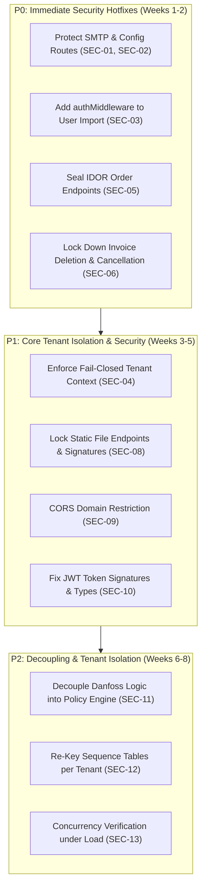

# Document 04: Security Remediation Priorities & Vulnerability Audit

## 1. Executive Summary & Verification Protocol

A comprehensive security audit of the **Grace Cabs** application was conducted by cross-referencing the findings presented in [Document 02](../docs/02_SECURITY_AND_DATA_ISOLATION_AUDIT.md) with the actual source code across `backend/src/` and `frontend/src/`.

Every proposed security vulnerability was subjected to a rigorous three-state verification standard:
1. **Source-Verified (SV)**: Conclusively verified by direct line-by-line inspection of the backend routing table, middleware stack, controllers, service functions, or database models.
2. **Unverified (UV)**: Theoretical, speculative, or unsubstantiated by actual code implementation.
3. **Requiring Runtime Testing (RRT)**: Depends on live environment variables, external infrastructure state, or concurrency race conditions that require active execution.

> [!CAUTION]
> The audit verified that **critical security vulnerabilities exist in the production codebase**. Sensitive endpoints lack authentication entirely, administrative queries dump cross-tenant data, static directories serve passenger signatures publicly, and SMTP credentials can be retrieved unauthenticated. Immediate remediation is mandatory before onboarding external SaaS tenants.

---

## 2. Master Vulnerability Verification & Prioritization Matrix

| ID | Vulnerability Title | Severity | Verification Status | Source Location | Direct Exploit Impact | Remediation Priority |
| :---: | :--- | :---: | :---: | :--- | :--- | :---: |
| **SEC-01** | Plain-Text SMTP Credential Exposure | **CRITICAL** | **Source-Verified** | [configurationRoutes.ts:7-10](file:///d:/demobooking/demo-bookings/backend/src/routes/configurationRoutes.ts#L7-L10), [configurationService.ts:98-115](file:///d:/demobooking/demo-bookings/backend/src/services/configurationService.ts#L98-L115) | Public unauthenticated disclosure of production SMTP server password and email host. | **P0 (Immediate Hotfix)** |
| **SEC-02** | Unauthenticated System Configuration Overwrite | **CRITICAL** | **Source-Verified** | [configurationRoutes.ts:7](file:///d:/demobooking/demo-bookings/backend/src/routes/configurationRoutes.ts#L7), [configurationService.ts:5-95](file:///d:/demobooking/demo-bookings/backend/src/services/configurationService.ts#L5-L95) | Anyone can modify tax percentage, invoice prefix, cancellation hours, and hijack mail delivery. | **P0 (Immediate Hotfix)** |
| **SEC-03** | Unauthenticated Bulk User Excel Injection | **CRITICAL** | **Source-Verified** | [userRoutes.ts:18](file:///d:/demobooking/demo-bookings/backend/src/routes/userRoutes.ts#L18), [userServices.ts:322](file:///d:/demobooking/demo-bookings/backend/src/services/userServices.ts#L322) | Arbitrary account creation across companies with known default password (`123456`). | **P0 (Immediate Hotfix)** |
| **SEC-04** | Cross-Tenant Data Leak in Administrative Orders | **HIGH** | **Source-Verified** | [bookingServices.ts:358-386](file:///d:/demobooking/demo-bookings/backend/src/services/bookingServices.ts#L358-L386), [bookingServices.ts:407-414](file:///d:/demobooking/demo-bookings/backend/src/services/bookingServices.ts#L407-L414) | Any logged-in manager or dispatcher executes queries with no `companyId`/`tenantId` filter, exposing all corporate trips. | **P1 (Phase 1/2 Foundation)** |
| **SEC-05** | Unauthenticated BOLA / IDOR Order History Scraping | **HIGH** | **Source-Verified** | [bookingRoutes.ts:38-50](file:///d:/demobooking/demo-bookings/backend/src/routes/bookingRoutes.ts#L38-L50) | Scraping passenger names, phone numbers, GPS coordinates, flight details, and billing amounts without authentication. | **P0 (Immediate Hotfix)** |
| **SEC-06** | Unauthenticated Destructive Invoicing Endpoints | **HIGH** | **Source-Verified** | [closependingRoutes.ts:37](file:///d:/demobooking/demo-bookings/backend/src/routes/closependingRoutes.ts#L37), [invoiceRoutes.ts:29](file:///d:/demobooking/demo-bookings/backend/src/routes/invoiceRoutes.ts#L29), [onCallRoutes.ts:7-22](file:///d:/demobooking/demo-bookings/backend/src/routes/onCallRoutes.ts#L7-L22) | Anonymous deletion of monthly corporate invoices, cancellation of trip bills, and deletion of OnCall bills. | **P0 (Immediate Hotfix)** |
| **SEC-07** | Public Corporate Client Directory Exposure | **MEDIUM** | **Source-Verified** | [companyRoutes.ts:8-10](file:///d:/demobooking/demo-bookings/backend/src/routes/companyRoutes.ts#L8-L10), [userRoutes.ts:54](file:///d:/demobooking/demo-bookings/backend/src/routes/userRoutes.ts#L54) | Anonymous harvesting of all registered corporate accounts, GST numbers, phone numbers, and employee rosters. | **P1 (Phase 1 Foundation)** |
| **SEC-08** | Unauthenticated Public Static File Serving | **HIGH** | **Source-Verified** | [app.ts:70-86](file:///d:/demobooking/demo-bookings/backend/src/app.ts#L70-L86), [app.ts:114-156](file:///d:/demobooking/demo-bookings/backend/src/app.ts#L114-L156) | Unauthenticated direct browser access to passenger signatures (`/uploads/signature/`) and PDF invoices (`/invoices/`). | **P1 (Phase 1 Foundation)** |
| **SEC-09** | Wildcard Permissive CORS with Credentials | **MEDIUM** | **Source-Verified** | [app.ts:78-82](file:///d:/demobooking/demo-bookings/backend/src/app.ts#L78-L82) | Potential cross-site request forgery and token interception via unauthorized third-party origins. | **P1 (Phase 1 Foundation)** |
| **SEC-10** | Inconsistent JWT Signatures & Typing Defect | **MEDIUM** | **Source-Verified** | [authMiddleware.ts:4-28](file:///d:/demobooking/demo-bookings/backend/src/middleware/authMiddleware.ts#L4-L28) | Type-mismatch (`userId: number` vs UUID string) and missing tenant context in decoded claims. | **P1 (Phase 1 Foundation)** |
| **SEC-11** | Hardcoded Bespoke Client Branching (Danfoss) | **MEDIUM** | **Source-Verified** | [user.ts:36](file:///d:/demobooking/demo-bookings/backend/src/models/user.ts#L36), [authServices.ts:325](file:///d:/demobooking/demo-bookings/backend/src/services/authServices.ts#L325), [userServices.ts:415](file:///d:/demobooking/demo-bookings/backend/src/services/userServices.ts#L415), [UserInvoice.tsx:374](file:///d:/demobooking/demo-bookings/frontend/src/SuperAdmin/pages/Users/UserInvoice.tsx#L374) | Prevents multi-tenant scaling; leaks client identities and private validation rules across unrelated tenants. | **P2 (Phase 3 Decoupling)** |
| **SEC-12** | Global Sequential Booking Code Leakage | **LOW** | **Source-Verified** | [booking.ts:63-93](file:///d:/demobooking/demo-bookings/backend/src/models/booking.ts#L63-L93), [booking_sequence.ts](file:///d:/demobooking/demo-bookings/backend/src/models/booking_sequence.ts) | Competitors or rival clients can infer platform daily order volume by subtracting consecutive booking numbers. | **P2 (Phase 2 Tenancy)** |
| **SEC-13** | Concurrency Race in Atomic Sequence Increment | **MEDIUM** | **Requiring Runtime Testing** | [booking.ts:74-84](file:///d:/demobooking/demo-bookings/backend/src/models/booking.ts#L74-L84), [invoice.ts:61-95](file:///d:/demobooking/demo-bookings/backend/src/models/invoice.ts#L61-L95) | Sequence collisions under high concurrent booking volume (100+ requests/second) due to transaction isolation level. | **P2 (Phase 2 Testing)** |
| **SEC-14** | Memory Leak in Headless Puppeteer Generation | **MEDIUM** | **Requiring Runtime Testing** | [appInvoiceRoutes.ts](file:///d:/demobooking/demo-bookings/backend/src/appRoutes/appInvoiceRoutes.ts), [downloadPdf.ts](file:///d:/demobooking/demo-bookings/backend/src/routes/downloadPdf.ts) | Unclosed Chromium browser processes leading to server exhaustion during batch monthly invoicing. | **P3 (Phase 5 Polish)** |

---

## 3. Deep-Dive Analysis of Source-Verified Critical Vulnerabilities

### SEC-01 & SEC-02: Plain-Text SMTP Exposure & Configuration Hijacking

#### Code Evidence
In [backend/src/routes/configurationRoutes.ts](file:///d:/demobooking/demo-bookings/backend/src/routes/configurationRoutes.ts#L1-L13):
```typescript
const router = Router();
router.post('/createConfiguration', createConfiguration); // 🔴 Completely unauthenticated!
router.get('/getConfiguration', getConfiguration);       // 🔴 Completely unauthenticated!
```
In [backend/src/services/configurationService.ts](file:///d:/demobooking/demo-bookings/backend/src/services/configurationService.ts#L98-L115):
```typescript
export const getConfiguration = async (req: Request, res: Response): Promise<void> => {
  const configuration = await Configuration.findOne();
  res.status(200).json({
    success: true,
    data: configuration // 🔴 Dumps smtpServer, smtpEmailAddress, and smtpEmailPassword in plain text!
  });
};
```

#### Exploit Scenario & Direct Business Impact
- Any internet user can send `GET /api/config/getConfiguration` without an API key or token.
- The server responds with the production Mailgun/SMTP credentials (`smtpEmailAddress`, `smtpEmailPassword`, `smtpServer`, `smtpEmailPort`).
- An attacker can seize the corporate mail domain, intercept password reset tokens, execute spear-phishing campaigns against corporate customers (e.g., Danfoss executives), or weaponize the server for spam relay.
- Furthermore, sending `POST /api/config/createConfiguration` allows an attacker to change `serviceTaxPercentage` to `0%` or redirect mail deliveries to an attacker-controlled server.

#### Remediation Design
1. Bind `Configuration` to `tenantId`.
2. Apply `authMiddleware` and require `SUPERADMIN` role.
3. Exclude `smtpEmailPassword` from API responses (use Sequelize `attributes: { exclude: ['smtpEmailPassword'] }`).
4. Store passwords as encrypted values using AES-256-GCM.

---

### SEC-03: Unauthenticated Bulk User Excel Injection

#### Code Evidence
In [backend/src/routes/userRoutes.ts](file:///d:/demobooking/demo-bookings/backend/src/routes/userRoutes.ts#L18):
```typescript
router.post("/upload-users", upload.single("file"), uploadUsersFromExcel); // 🔴 No authMiddleware!
```
In [backend/src/services/userServices.ts](file:///d:/demobooking/demo-bookings/backend/src/services/userServices.ts#L322):
```typescript
if (!userPayload.password) userPayload.password = "123456"; // 🔴 Insecure default password!
if (!userPayload.role) userPayload.role = "user";
if (!userPayload.status) userPayload.status = "active";
```

#### Exploit Scenario & Direct Business Impact
- An attacker sends an automated `POST` request with an Excel spreadsheet containing malicious user profiles.
- Because `authMiddleware` is missing, the file is parsed and injected directly into the `user` table.
- Accounts are created with default passwords (`123456`), allowing mass account takeover, fake booking generation, and denial of fleet resources.

#### Remediation Design
1. Enforce `authMiddleware` and verify caller is an authorized `TenantAdmin` or `CompanyManager`.
2. Restrict user creation strictly to the caller's verified `tenantId` and `companyId`.
3. Require unique random temporary passwords hashed via Bcrypt (salt rounds = 12) and trigger an email activation workflow.

---

### SEC-04: Cross-Tenant Data Leakage in Administrative Queries

#### Code Evidence
In [backend/src/services/bookingServices.ts](file:///d:/demobooking/demo-bookings/backend/src/services/bookingServices.ts#L358-L386):
```typescript
if (role === ROLES.USER) {
  const orders = await Booking.findAll({ where: { userId: userid }, ... });
  return res.status(200).json({ success: true, data: orders });
} else {
  // 🔴 VULNERABILITY: Any other role (Admin, Dispatcher, Manager, Vendor)
  // executes findAll() with ZERO companyId or tenantId filter!
  const orders = await Booking.findAll({
    include: [ VehicleType, Vehicle, User, Company ],
    order: [['createdAt', 'DESC']]
  });
  return res.status(200).json({ success: true, data: orders });
}
```
In [backend/src/services/bookingServices.ts](file:///d:/demobooking/demo-bookings/backend/src/services/bookingServices.ts#L407-L414):
```typescript
export const getOrdersByStatus = async (confirmStatus: number) => {
  return await Booking.findAll({ where: { confirmStatus }, ... }); // 🔴 Global dump!
};
```

#### Exploit Scenario & Direct Business Impact
- If a dispatcher or corporate manager from **Company A** calls `/api/order/getAllOrders`, the backend enters the `else` branch.
- The response contains trips, passengers, and VIP travel schedules for **Company B**, **Company C**, and competing fleets.
- Violates non-disclosure agreements, enterprise master service agreements (MSAs), and data protection regulations (GDPR, DPDP Act).

#### Remediation Design
1. Enforce fail-closed `@DefaultScope` injecting `WHERE tenantId = ctx.tenantId`.
2. For corporate managers (`role === 'manager'`), append `WHERE companyId = ctx.companyId`.

---

### SEC-05: Unauthenticated BOLA / IDOR Order Routes

#### Code Evidence
In [backend/src/routes/bookingRoutes.ts](file:///d:/demobooking/demo-bookings/backend/src/routes/bookingRoutes.ts#L38-L50):
```typescript
router.get("/details/:bookingCode", getBookingDetails);                     // 🔴 No auth!
router.get("/getallinvoicereport", getOverallInvoiceReport);                 // 🔴 No auth!
router.get("/user/:userId/all", getAllOrdersByUser);                        // 🔴 No auth!
router.get("/user/:userId/pending", getPendingOrdersByUser);                // 🔴 No auth!
router.get("/user/:userId/pending-invoices", getPendingInvoicesByUser);    // 🔴 No auth!
router.get("/user/:userId/confirmed", getConfirmedOrdersByUser);            // 🔴 No auth!
router.get("/user/:userId/payment-completed", getPaymentCompletedOrdersByUser); // 🔴 No auth!
router.get("/user/:userId/closed", getClosedOrdersByUser);                  // 🔴 No auth!
router.get("/user/:userId/cancelled", getCancelledOrdersByUser);            // 🔴 No auth!
router.get("/user/:userId/payment-pending", getPaymentPendingOrdersByUser); // 🔴 No auth!
```

#### Exploit Scenario & Direct Business Impact
- An anonymous scraper can enumerate UUIDs or sequential numbers against `/api/order/user/:userId/all` and `/api/order/details/:bookingCode`.
- Harvests passenger phone numbers, home addresses, office drop locations, pickup timestamps, flight numbers, and payment details with zero credentials.

#### Remediation Design
1. Add `authMiddleware` to all routes in `bookingRoutes.ts`.
2. Enforce object-level authorization: caller `req.userId` must match `:userId`, or caller must hold an administrative role within the same `tenantId`.

---

### SEC-06: Unauthenticated Destructive Invoicing Endpoints

#### Code Evidence
In [backend/src/routes/closependingRoutes.ts](file:///d:/demobooking/demo-bookings/backend/src/routes/closependingRoutes.ts#L37):
```typescript
router.delete("/monthlyInvoice/:monthlyInvoiceId", deleteMonthlyInvoice); // 🔴 No auth!
```
In [backend/src/routes/invoiceRoutes.ts](file:///d:/demobooking/demo-bookings/backend/src/routes/invoiceRoutes.ts#L29):
```typescript
router.put("/invoice/cancelInvoice", cancelInvoice); // 🔴 No auth!
```
In [backend/src/routes/onCallRoutes.ts](file:///d:/demobooking/demo-bookings/backend/src/routes/onCallRoutes.ts#L19-L21):
```typescript
router.delete("/onCallInvoice/:onCallBillId", deleteOnCallInvoice); // 🔴 No auth!
```

#### Exploit Scenario & Direct Business Impact
- Anyone can send `DELETE /api/closePendingOrder/monthlyInvoice/UUID` or `PUT /api/invoiceRoutes/invoice/cancelInvoice`.
- Finalized corporate billing statements are deleted or canceled without authorization, corrupting financial records and causing direct revenue loss.

#### Remediation Design
1. Attach `authMiddleware` requiring `ADMIN` or `BILLING_CLERK` role.
2. Require tenant context verification: `WHERE tenantId = ctx.tenantId AND invoiceId = :id`.
3. Prohibit hard physical deletes; transition to soft deletion (`isDeleted = true`) with immutable audit logging.

---

### SEC-08: Public Unauthenticated Static File Serving

#### Code Evidence
In [backend/src/app.ts](file:///d:/demobooking/demo-bookings/backend/src/app.ts#L70-L86) & [app.ts:114-156](file:///d:/demobooking/demo-bookings/backend/src/app.ts#L114-L156):
```typescript
app.use('/uploads', express.static(uploadsFolder));
app.use('/uploads/signature', express.static(path.join(__dirname, '..', '..', 'uploads', 'signature')));
app.use('/oncallinvoice', express.static(path.join(process.cwd(), 'uploads', 'oncallinvoice')));
app.use('/invoices', express.static(path.join(process.cwd(), 'uploads', 'invoices')));
```

#### Exploit Scenario & Direct Business Impact
- Express statically serves raw directories without checking request headers or authentication tokens.
- An attacker can browse or brute-force filenames under `https://api.gracecabs.in/invoices/INV-2026-0012.pdf` or `https://api.gracecabs.in/uploads/signature/sig_123.png`.
- Passenger digital signatures can be extracted and forged on fraudulent transport vouchers.

#### Remediation Design
1. Remove direct public `express.static` mappings for `/uploads/signature`, `/invoices`, and `/oncallinvoice`.
2. Serve assets through an authenticated streaming controller:
   `GET /api/documents/stream/:documentType/:fileId`
   validating JWT session, tenant context, and user entitlement before streaming the file.
3. For enterprise cloud deployments, transition to AWS S3 / Cloudflare R2 Presigned URLs with 15-minute expirations.

---

## 4. Prioritized Remediation Roadmap



### Remediation Action Plan

1. **Sprint 1 (P0 - Critical Hotfix)**:
   - Apply `authMiddleware` to all routes in `configurationRoutes.ts`, `userRoutes.ts`, `bookingRoutes.ts`, `invoiceRoutes.ts`, `closependingRoutes.ts`, and `onCallRoutes.ts`.
   - Redact `smtpEmailPassword` from all GET responses.
   - Enforce Bcrypt password hashing on user Excel import.
2. **Sprint 2 (P1 - Foundation Hardening)**:
   - Deprecate public static serving for `/invoices` and `/uploads/signature`; route via signed streaming controllers.
   - Restrict CORS origin in `app.ts` to verified tenant domains.
   - Standardize JWT payload to `{ userId: string, role: string, tenantId: string, companyId?: string }`.
3. **Sprint 3 (P2 - Tenancy & Policy Decoupling)**:
   - Implement fail-closed `AsyncLocalStorage` tenant context and ORM scopes.
   - Migrate Danfoss hardcoding to generic `CompanyPolicy` records.
   - Re-key sequence tables to composite tenant keys.
