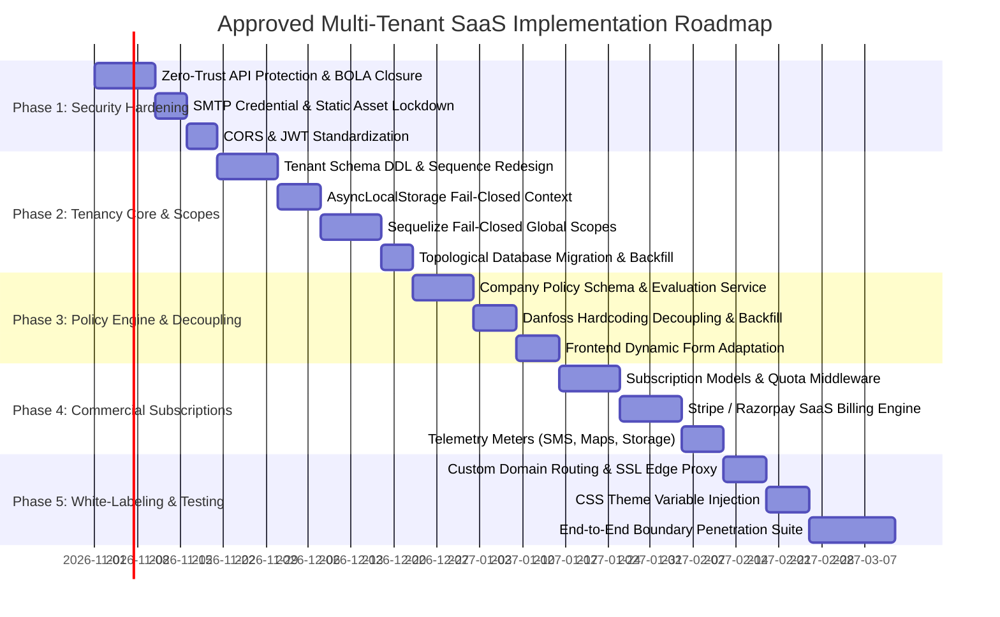

# Document 05: Approved Implementation Sequence & Verification Roadmap

## 1. Executive Summary & Phased Implementation Strategy

Transitioning the **Grace Cabs** application into a multi-tenant SaaS platform requires a disciplined, sequential execution sequence. Attempting to implement multi-tenancy before sealing existing security vulnerabilities or decoupling hardcoded customer logic would multiply risks, complicate debugging, and risk data corruption.

This document establishes the **Approved 5-Phase Engineering Implementation Sequence**, complete with task breakdowns, dependency graphs, entry/exit criteria, zero-downtime database migration scripts, and an automated verification protocol.



---

## 2. Detailed Work Breakdown Structure (WBS)

### Phase 1: Security Hardening & Zero-Trust Foundation (Weeks 1–3)
**Primary Objective**: Remediate all critical vulnerabilities identified in Document 04 without modifying application data schemas.

| Task ID | Task Description | Target File(s) | Dependencies | Deliverable / Acceptance Criteria |
| :---: | :--- | :--- | :---: | :--- |
| **T1.1** | Add `authMiddleware` to all unprotected routes | `configurationRoutes.ts`, `userRoutes.ts`, `bookingRoutes.ts`, `invoiceRoutes.ts`, `closependingRoutes.ts`, `onCallRoutes.ts` | None | 100% of non-public routes reject anonymous requests with `401 Unauthorized`. |
| **T1.2** | Redact plain-text SMTP password | `configurationService.ts`, `configurationRoutes.ts` | T1.1 | `GET /api/config/getConfiguration` omits `smtpEmailPassword`; password update requires SuperAdmin JWT. |
| **T1.3** | Secure Excel user upload with Bcrypt | `userRoutes.ts`, `userServices.ts` | T1.1 | User import requires Admin JWT; passwords hashed with Bcrypt (salt = 12); default `123456` eliminated. |
| **T1.4** | Remediate BOLA/IDOR on order routes | `bookingRoutes.ts`, `bookingServices.ts` | T1.1 | `/api/order/user/:userId/*` verifies `req.userId === params.userId` or caller holds Admin role. |
| **T1.5** | Secure destructive invoicing endpoints | `closependingRoutes.ts`, `invoiceRoutes.ts`, `onCallRoutes.ts` | T1.1 | Deletion/cancellation routes require Admin role; operations recorded in audit log. |
| **T1.6** | Tokenize static file streaming | `app.ts`, new `documentController.ts` | None | Direct static directory serving removed; signatures and invoices streamed via authenticated endpoints. |
| **T1.7** | Restrict CORS origin | `app.ts` | None | Wildcard `*` removed; CORS restricts origins to verified application hostnames. |
| **T1.8** | Standardize JWT typing | `authMiddleware.ts`, `authServices.ts` | None | Interface `AuthenticatedRequest` updated to `userId: string` (UUID); token signs `{ userId, role, tenantId, companyId }`. |

- **Exit Gate 1**: Automated security regression suite verifies zero unauthenticated access to sensitive endpoints; all 6 critical vulnerabilities sealed.

---

### Phase 2: Tenancy Core & Fail-Closed Database Isolation (Weeks 4–7)
**Primary Objective**: Introduce tenant schema entities, implement fail-closed tenant context, and redesign atomic sequence counters.

| Task ID | Task Description | Target File(s) | Dependencies | Deliverable / Acceptance Criteria |
| :---: | :--- | :--- | :---: | :--- |
| **T2.1** | Create `tenants` and `tenant_subscriptions` schemas | New migrations in `backend/src/migrations/` | Gate 1 | Database tables created with indexes, subdomains, and foreign keys. |
| **T2.2** | Implement `AsyncLocalStorage` tenant context | `backend/src/context/tenantContext.ts` | T2.1 | Thread-safe context stores active `tenantId`, `role`, and `companyId`. |
| **T2.3** | Implement tenant resolution middleware | `backend/src/middleware/tenantMiddleware.ts` | T2.2 | Resolves tenant from Subdomain, Custom Domain, or verified JWT claim. |
| **T2.4** | Implement fail-closed Sequelize `@DefaultScope` | `backend/src/models/*` (Tenant models) | T2.2 | Queries executed without active tenant context fail closed (`TenantContextMissingError`). |
| **T2.5** | Redesign sequence tables | `booking_sequence.ts`, `invoice_sequence.ts`, `monthlyBookingSequence.ts` | T2.1 | Sequences re-keyed to composite `(tenantId, seq_date)` and `(tenantId, companyId, financialYear)`. |
| **T2.6** | Execute topological data migration | Umzug migration runner | T2.1-T2.5 | Existing records backfilled with `ROOT_TENANT_ID`; foreign keys and indexes applied without data loss. |

- **Exit Gate 2**: Cross-tenant penetration tests verify that Tenant A cannot read, query, update, or delete Tenant B records under any condition.

---

### Phase 3: Decoupling Bespoke Client Logic & Policy Engine (Weeks 8–10)
**Primary Objective**: Eliminate hardcoded Danfoss logic and deploy the dynamic workflow policy engine.

| Task ID | Task Description | Target File(s) | Dependencies | Deliverable / Acceptance Criteria |
| :---: | :--- | :--- | :---: | :--- |
| **T3.1** | Implement `CompanyPolicy` schema & service | `backend/src/models/companyPolicy.ts`, `policyService.ts` | Gate 2 | JSON policy definitions stored per corporate client. |
| **T3.2** | Add `metadata` JSON column to `user` model | `backend/src/models/user.ts` | Gate 2 | Extensible JSON column added for bespoke client fields (e.g., `corporateEmpId`). |
| **T3.3** | Migrate Danfoss records & backfill data | Migration script | T3.1, T3.2 | Danfoss user IDs copied from `danfossuserId` to `metadata.corporateEmpId`; Danfoss policy record created. |
| **T3.4** | Decouple backend domain checks | `authServices.ts`, `userServices.ts` | T3.3 | Hardcoded `companyName.includes("danfoss")` removed; replaced with `policyService.validateEmailDomain()`. |
| **T3.5** | Frontend dynamic policy integration | `UserInvoice.tsx`, `UserDetails.tsx`, `UserLogin.tsx` | T3.4 | Dynamic fields rendered based on company policy; hardcoded `showDanfossFields` removed. |

- **Exit Gate 3**: Zero occurrences of `"danfoss"` in application business logic; all client rules evaluate dynamically through the Policy Engine.

---

### Phase 4: Commercial Subscription Engine, Quotas & Metering (Weeks 11–13)
**Primary Objective**: Build the SaaS monetization infrastructure to enforce fleet quotas and automate subscription billing.

| Task ID | Task Description | Target File(s) | Dependencies | Deliverable / Acceptance Criteria |
| :---: | :--- | :--- | :---: | :--- |
| **T4.1** | Implement Entitlement Gatekeeper Middleware | `backend/src/middleware/entitlementMiddleware.ts` | Gate 3 | Intercepts vehicle, driver, and company creation APIs; blocks mutations exceeding plan quotas. |
| **T4.2** | Integrate Stripe / Razorpay Subscriptions | `backend/src/services/subscriptionService.ts` | T4.1 | Automated recurring billing; webhook handlers for payment success, failure, and cancellation. |
| **T4.3** | Implement Telemetry Metering | `backend/src/services/telemetryService.ts` | T4.1 | Tracks monthly SMS dispatches, Google Maps API lookups, and storage bytes in `tenant_usage_meters`. |
| **T4.4** | Build SuperAdmin Tenant Management UI | `frontend/src/SuperAdmin/pages/Tenants/` | T4.2 | SaaS host console to monitor tenant accounts, MRR, active fleets, and plan usage. |

- **Exit Gate 4**: Quota enforcement correctly blocks creation of the 16th vehicle on Basic plan; payment failure triggers 5-day grace period and dunning workflow.

---

### Phase 5: Dynamic White-Labeling, Custom Domains & Verification (Weeks 14–16)
**Primary Objective**: Deliver full white-label capabilities for enterprise tenants and execute end-to-end security and load verification.

| Task ID | Task Description | Target File(s) | Dependencies | Deliverable / Acceptance Criteria |
| :---: | :--- | :--- | :---: | :--- |
| **T5.1** | Custom domain routing & edge SSL | Reverse proxy configuration (Cloudflare / Nginx) | Gate 4 | Multi-tenant router resolves tenant from custom domains with valid SSL certificates. |
| **T5.2** | Dynamic CSS variable theming | `frontend/src/context/ThemeContext.tsx`, `index.css` | T5.1 | Tenant primary color, secondary color, and logos injected dynamically at app initialization. |
| **T5.3** | End-to-End penetration testing | Automated test suites | T5.2 | Complete execution of SEC-01 through SEC-06 and IDOR-01 through IDOR-05 test suites. |
| **T5.4** | Concurrency and load benchmarking | k6 / Artillery benchmark scripts | T5.3 | System handles 100 concurrent booking creations and 50 concurrent sequence increments without collisions. |

- **Exit Gate 5**: 100% test pass rate across boundary penetration, quota enforcement, and concurrency benchmarks; production cutover authorization.

---

## 3. Zero-Downtime Data Migration Plan

```mermaid
sequenceDiagram
    autonumber
    actor DevOps as Deployment Engineer
    participant Script as Umzug Migration Runner
    participant DB as Production MySQL Database
    participant App as Backend API Cluster

    DevOps->>DB: Pre-Migration Full Binary Volume Snapshot
    DevOps->>Script: Execute 20261101_phase2_multitenancy.ts
    
    rect rgb(240, 248, 255)
        Note over Script,DB: Step 1: Platform & Tenant Infrastructure
        Script->>DB: CREATE TABLE tenants (...) & tenant_subscriptions (...)
        Script->>DB: INSERT INTO tenants (tenantId, name, code) VALUES ('ROOT_UUID', 'Grace Cabs Primary', 'GC')
    end

    rect rgb(255, 250, 240)
        Note over Script,DB: Step 2: Level 1-4 Schema Evolution (Topological Order)
        loop For each table in topological order
            Script->>DB: ALTER TABLE <table> ADD COLUMN tenantId CHAR(36) NULL
            Script->>DB: UPDATE <table> SET tenantId = 'ROOT_UUID' WHERE tenantId IS NULL
            Script->>DB: ALTER TABLE <table> MODIFY COLUMN tenantId CHAR(36) NOT NULL
            Script->>DB: CREATE INDEX idx_<table>_tenant ON <table>(tenantId)
            Script->>DB: ALTER TABLE <table> ADD CONSTRAINT fk_... FOREIGN KEY (tenantId) REFERENCES tenants(tenantId)
        end
    end

    rect rgb(240, 255, 240)
        Note over Script,DB: Step 3: Sequence Redesign & Metadata Backfill
        Script->>DB: Migrate booking_sequence to composite (tenantId, seq_date)
        Script->>DB: Backfill user.metadata from user.danfossuserId
        Script->>DB: Compute pre/post checksums (booking count, invoice totals)
    end

    Script-->>DevOps: Schema Migration Complete (Checksums Match 100%)
    DevOps->>App: Rolling deployment of Phase 2 Application Code
    App-->>DevOps: All pods healthy; active TenantContext operational
```

### Rollback Strategy
1. **Immediate Abort**: If any DDL statement fails, Umzug rolls back the active transaction.
2. **Snapshot Restore**: If post-migration checksum verification detects discrepancies in booking counts or invoice totals, traffic is held at the load balancer and the database is restored from the pre-migration snapshot within 15 minutes.
3. **Legacy Column Preservation**: The legacy `danfossuserId` column and single-row `configuration` table are retained in a read-only state for 30 days post-cutover.

---

## 4. Comprehensive Testing & Verification Protocol

### 4.1 Automated Boundary Penetration Test Suite

| Test ID | Test Scenario | Execution Method | Expected Result | Pass/Fail Gate |
| :---: | :--- | :--- | :--- | :--- |
| **SEC-01** | Cross-Tenant Order Fetch by ID | Issue `GET /api/order/details/:bookingCode` for a Tenant B order using a Tenant A token. | Response `404 Not Found` or `403 Forbidden`. Zero Tenant B data returned. | **CRITICAL BUILD BLOCKER** |
| **SEC-02** | Cross-Tenant Order Listing | Issue `GET /api/order/getAllOrders` using Tenant A Admin token. | Result array contains **only** records matching Tenant A's `tenantId`. | **CRITICAL BUILD BLOCKER** |
| **SEC-03** | Cross-Tenant Mutation Attempt | Issue `PUT /api/order/editBooking/:id` targeting Tenant B trip using Tenant A token. | Response `404 Not Found` or `403 Forbidden`. Record remains unmodified. | **CRITICAL BUILD BLOCKER** |
| **SEC-04** | Cross-Tenant Driver Assignment | Attempt to assign a Tenant B driver to a Tenant A booking. | Rejected with `400 Bad Request` or foreign key validation error. | **CRITICAL BUILD BLOCKER** |
| **SEC-05** | Cross-Tenant Invoice PDF Stream | Request `GET /api/documents/stream/invoice/:id` for Tenant B invoice using Tenant A token. | Response `403 Forbidden` (`Access denied to cross-tenant asset`). | **CRITICAL BUILD BLOCKER** |
| **SEC-06** | Fail-Closed Context Test | Execute `Booking.findAll()` in a background worker without initializing `tenantStorage`. | Throws `TenantContextMissingError` or returns empty array (`WHERE 1=0`). | **CRITICAL BUILD BLOCKER** |

---

### 4.2 Broken Object-Level Authorization (IDOR) Test Suite

| Test ID | Test Scenario | Execution Method | Expected Result | Pass/Fail Gate |
| :---: | :--- | :--- | :--- | :--- |
| **IDOR-01** | Anonymous Order Scrape | Issue `GET /api/order/user/:userId/all` without `Authorization` header. | Server rejects immediately with `401 Unauthorized`. | Zero trip data disclosed. |
| **IDOR-02** | User-to-User Snooping | User X requests `GET /api/order/user/:userId/all` specifying User Y's UUID. | Server rejects with `403 Forbidden`. | User X cannot inspect User Y's rides. |
| **IDOR-03** | Anonymous Invoice Cancellation | Issue `PUT /api/invoiceRoutes/invoice/cancelInvoice` without token. | Server rejects with `401 Unauthorized`. Invoice status unchanged. | Bill status unaltered. |
| **IDOR-04** | Anonymous Monthly Invoice Deletion | Issue `DELETE /api/closePendingOrder/monthlyInvoice/:id` without token. | Server rejects with `401 Unauthorized`. Record preserved. | Zero data loss. |

---

### 4.3 Commercial Quota & Paywall Test Suite

| Test ID | Test Scenario | Execution Method | Expected Result | Pass/Fail Gate |
| :---: | :--- | :--- | :--- | :--- |
| **QUOTA-01** | Vehicle Hard Limit Enforcement | Attempt to register 16th vehicle on Basic plan (Quota = 15). | Server rejects with `403 Forbidden` (`Plan vehicle limit reached`). Upgrade URL returned. | Vehicle not created in DB. |
| **QUOTA-02** | Corporate Client Limit Enforcement | Attempt to create 4th corporate client on Basic plan (Quota = 3). | Server rejects with `403 Forbidden` (`Plan company limit reached`). | Company not created in DB. |
| **QUOTA-03** | Soft Quota Trip Overage | Execute 1,001st trip on Basic plan with `allowTripOverage = true`. | Trip created successfully (201 Created); usage incremented in `tenant_usage_meters`. | Overage tracked cleanly. |
| **QUOTA-04** | Soft Quota Hard Cap Fallback | Execute 1,001st trip on Basic plan with `allowTripOverage = false`. | Booking creation blocked or alert rendered to upgrade plan. | Hard cap enforced as requested. |

---

### 4.4 Concurrency & Sequence Integrity Benchmarks

| Benchmark Scenario | Concurrency Target | Target Latency | Pass/Fail Benchmark |
| :--- | :--- | :--- | :--- |
| **Concurrent Booking Creation** | 100 simultaneous reservations within 1 second across 2 tenants. | $p95 \le 250\text{ms}$ | Zero duplicate booking codes; strictly sequential counters per tenant; zero deadlocks. |
| **Concurrent Invoice Finalization** | 50 concurrent invoice closures for the same tenant. | $p95 \le 350\text{ms}$ | Sequences increment strictly from $N$ to $N+50$ with zero collisions or gaps. |
| **Headless PDF Generation** | 20 concurrent invoice PDF requests. | $p95 \le 3.0\text{s}$ | Zero Chromium process orphan leaks; memory remains stable under 1.5 GB. |

---

## 5. Explicit Unresolved Decisions Summary

The following open decisions from Documents 01–04 are consolidated here for final executive sign-off:

1. **Enterprise Database Model (DEC-01)**: Confirm Option B (dedicated container cluster per enterprise client) over dynamic in-app connection switching.
2. **Custom Domain SSL (DEC-02)**: Approve Cloudflare for SaaS edge SSL provisioning.
3. **Retail User Tenancy Binding (DEC-03)**: Confirm that direct retail passengers are bound to the specific Fleet Operator whose portal they registered through.
4. **SMS Overage Spend Cap (COM-01)**: Approve ₹1,000 monthly default overage cap on metered SMS OTPs.
5. **BYO Gateway Policy (COM-02)**: Confirm zero platform transaction fee on Enterprise BYO payment gateway accounts.
