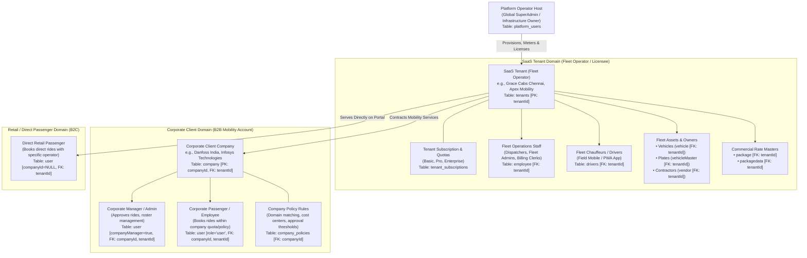
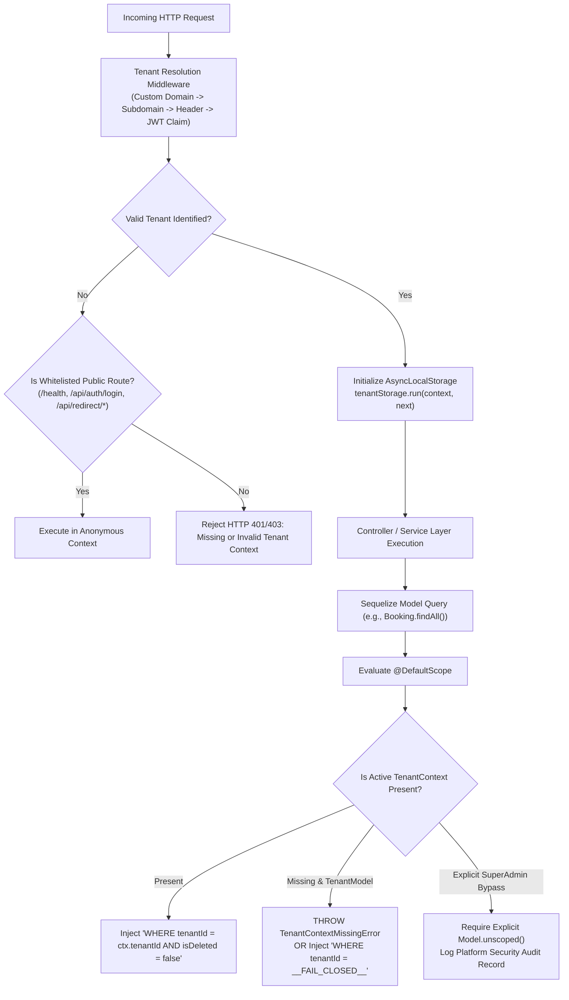
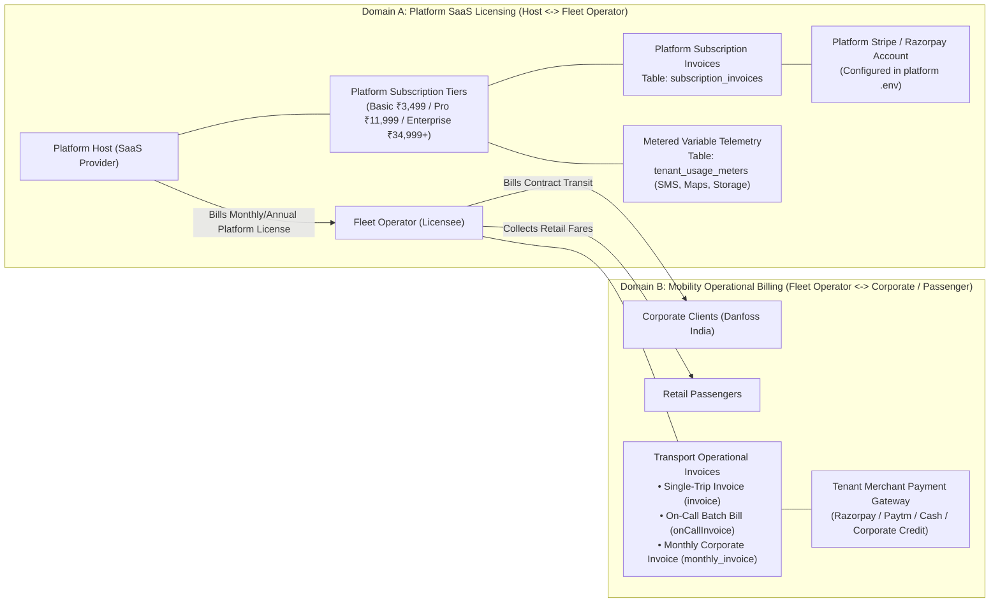
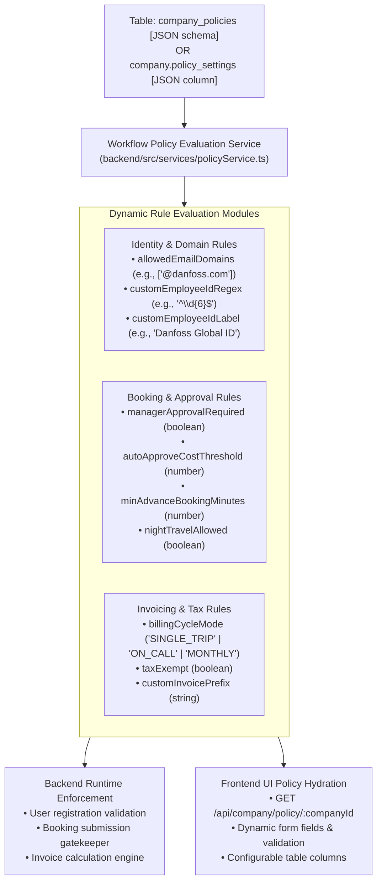
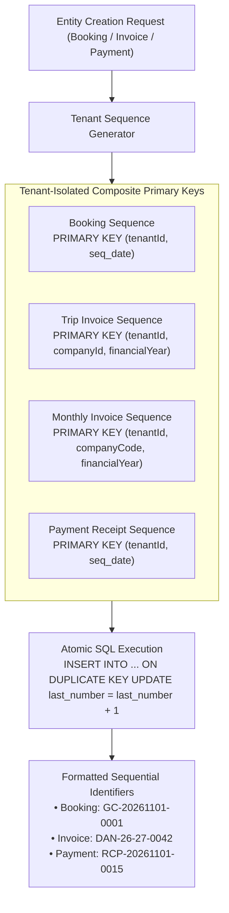
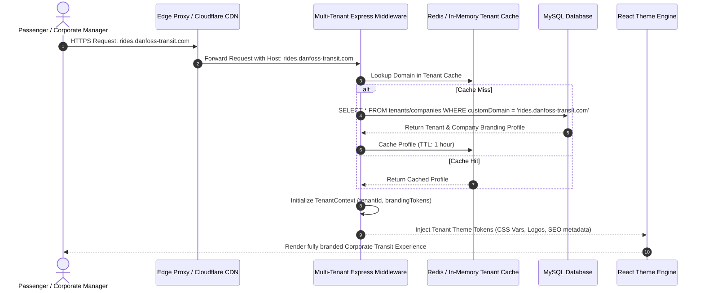

# Document 01: Final Target Architecture & System Specifications

## 1. Executive Summary & Purpose of Reconciliation

The **Grace Cabs / `demo-bookings`** platform is transitioning from an operator-centric, single-tenant fleet management application with hardcoded corporate overrides into an enterprise-grade, multi-tenant **Software-as-a-Service (SaaS)** platform for fleet and corporate mobility management.

This document represents the **authoritative, reconciled target architecture** for the platform. It resolves the ambiguities, contradictions, and critical architectural flaws discovered across earlier iterations ([`docs/01_EXISTING_SYSTEM_ARCHITECTURE.md`](file:///d:/demobooking/demo-bookings/docs/01_EXISTING_SYSTEM_ARCHITECTURE.md), [`docs/02_SECURITY_AND_DATA_ISOLATION_AUDIT.md`](file:///d:/demobooking/demo-bookings/docs/02_SECURITY_AND_DATA_ISOLATION_AUDIT.md), [`docs/03_MULTI_TENANT_SAAS_FEASIBILITY_AND_ARCHITECTURE.md`](file:///d:/demobooking/demo-bookings/docs/03_MULTI_TENANT_SAAS_FEASIBILITY_AND_ARCHITECTURE.md), and [`GRACE_CABS_SAAS_DESIGN_REVIEW/01_RECONCILED_TARGET_ARCHITECTURE.md`](file:///d:/demobooking/demo-bookings/GRACE_CABS_SAAS_DESIGN_REVIEW/01_RECONCILED_TARGET_ARCHITECTURE.md)):

1. **Taxonomy & Identity Boundary Resolution**: Conflation of SaaS tenants with corporate clients and platform users is fully eliminated. A strict 3-tier entity hierarchy is established.
2. **Elimination of the Catastrophic Fail-Open Default Scope**: The vulnerable scope proposed in `docs/03` (which defaulted to returning all data across all tenants if execution context was undefined) is replaced with a mathematical **Fail-Closed Engine** that rejects queries missing context.
3. **Total Domain Segregation**: Platform subscription licensing (SaaS host billing fleet operators) is architecturally and financially separated from operational transport billing (fleet operators billing corporate clients and passengers).
4. **Decoupled Workflow Policy Engine**: Hardcoded bespoke logic (e.g., Danfoss validation rules, email domain matching, and custom fields) is extracted into a metadata-driven dynamic policy engine.
5. **Multi-Tenant Atomic Sequencing**: Global sequence counters that leak daily volume and risk cross-tenant collision are re-engineered into tenant-isolated composite atomic counters.

---

## 2. Reconciled Taxonomy, Actors, and Identity Boundaries



### Detailed Actor Specifications & Boundaries

| Actor / Entity | Physical Table | Tenancy & Scope Binding | Functional Definition & Access Boundaries |
| :--- | :--- | :--- | :--- |
| **Platform Host (Global SuperAdmin)** | `platform_users` (Target) / `employee` (`role='superadmin'`) | Global Infrastructure Scope (`tenantId = NULL`) | Owner and infrastructure operator of the multi-tenant SaaS platform. Manages tenant lifecycles, global subscription tiers, platform telemetry meters, and edge infrastructure. **Has zero operational involvement in daily trip dispatch, driver allocation, or transport invoice generation.** |
| **SaaS Tenant (Fleet Operator)** | `tenants` | Root Tenant Primary Key (`tenantId`) | The commercial licensee paying software subscription fees to the platform host. Owns vehicles, contracts drivers, employs dispatch staff, and serves corporate B2B contracts and retail passengers. Isolated by UUID `tenantId`. |
| **Fleet Operator Staff (Employee)** | `employee` | Mandatory `tenantId` FK | Internal operational workforce of the fleet operator. Roles include `tenant_admin`, `dispatcher`, `supervisor`, and `billing_clerk`. Manages fleet inventory, assigns drivers to bookings, audits trip sheets (`closependings`), and issues customer bills. Confined strictly to their employer's `tenantId`. |
| **Fleet Chauffeur / Driver** | `drivers` | Mandatory `tenantId` FK | Field personnel driving assigned vehicles. Authenticates via mobile phone OTP, records garage-to-guest odometer readings, captures passenger digital signatures, and streams live GPS coordinates. Bound strictly to a single tenant fleet. |
| **Corporate Client Company** | `company` | Mandatory `tenantId` FK, PK `companyId` | A B2B enterprise customer contracted by the fleet operator for employee transit (e.g., Danfoss India). Holds company profile, GSTIN, corporate billing window (`startTime`, `closeTime`, `priorMinutes`), manager approval flags (`managerApproval`), and negotiated package rates. **Is NOT a SaaS tenant; does not pay platform software licensing fees.** |
| **Corporate Manager / Admin** | `user` (`companyManager=true`) | Mandatory `tenantId` FK, Mandatory `companyId` FK | Managerial employee of the corporate client. Approves/declines employee ride requests, uploads staff rosters via Excel, validates cost center allocations, and accesses corporate consolidated billing summaries. Access is confined strictly to their specific `companyId` within the contracting `tenantId`. |
| **Corporate Passenger / Employee** | `user` (`role='user'`) | Mandatory `tenantId` FK, Mandatory `companyId` FK | Individual corporate passenger. Books rides under corporate billing rules, boards assigned vehicles, tracks cab arrival, and signs digital trip sheets upon completion. |
| **Retail Passenger (Direct Consumer)** | `user` (`role='user'`) | Mandatory `tenantId` FK, `companyId = NULL` | Direct consumer booking retail cab services through the fleet operator's public web portal or retail mobile app. Subject to retail rate packages and direct consumer payment gateways (Cash, UPI, Credit Card). |

### Resolution of Retail-User Binding and Identity Uniqueness

A major architectural ambiguity across earlier documents was whether retail users belong to a global platform-wide user pool or are bound to specific fleet operators:

1. **Tenant Binding**: Retail passengers MUST be bound directly to the specific Fleet Operator whose portal or custom domain they registered through (`tenantId = operatorTenantId`, `companyId = NULL`).
   - *Rationale*: A shared global user pool (`tenantId = NULL`) violates tenant isolation, enables cross-operator customer data leakage, introduces severe data ownership liabilities under privacy regulations (DPDP Act 2023, GDPR), and enables competing fleet operators to poach customer lists.
2. **Identity Uniqueness Across Tenants**:
   - The database constraint on the `user` table is defined as **`UNIQUE (tenantId, mobile)`** and **`UNIQUE (tenantId, email)`**.
   - *Behavior*: A consumer with mobile number `+919876543210` can register and hold an active account with Fleet Operator A (e.g., Grace Cabs in Chennai) and independently register with Fleet Operator B (e.g., Apex Mobility in Bangalore). Their booking histories, saved addresses, corporate associations, and payment records remain completely isolated within each tenant domain.
   - *Authentication*: Login endpoints require tenant resolution first (via subdomain, custom domain, or HTTP header `X-Tenant-ID`), ensuring the credentials query evaluates strictly within the identified tenant boundary.

---

## 3. Database Tenancy Model & Fail-Closed Context Engine

### 3.1 Architectural Tenancy Model

The platform commits to a **Shared Database with Row-Level Isolation** enforced by indexed `tenantId` foreign keys, Node.js `AsyncLocalStorage` request-context propagation, and fail-closed ORM scoping.

For high-volume Enterprise Tier clients requiring dedicated regulatory compliance (e.g., defense contractors, financial institutions, or government transit agreements), the platform supports a **Hybrid Silo Deployment Option**, where the tenant is provisioned onto a physically isolated database container while sharing the unified application codebase.

### 3.2 The Fail-Closed Tenant Context Engine

#### The Flawed Prior Implementation in `docs/03`
In `docs/03_MULTI_TENANT_SAAS_FEASIBILITY_AND_ARCHITECTURE.md` (Section 4.3), the proposed Sequelize scope was:
```typescript
// 🔴 CATASTROPHIC VULNERABILITY IN DOC 03:
@DefaultScope(() => {
  const ctx = tenantStorage.getStore();
  if (!ctx || ctx.role === "SUPERADMIN_GLOBAL") {
    return { where: { isDeleted: false } }; // FAILS OPEN! Queries all tenants' records!
  }
  return { where: { tenantId: ctx.tenantId, isDeleted: false } };
})
```
If an asynchronous background task, an uninstrumented route, or an event listener executed without active context, `ctx` evaluated to `undefined`, silently dumping all tenants' data.

#### The Reconciled Fail-Closed Specification
The production target architecture mandates a strict **Fail-Closed Engine**. If tenant context is missing for any tenant-scoped model query:
1. The ORM throws a `TenantContextMissingError` immediately during query compilation, OR
2. In query builder fallback mode, the scope injects an impossible predicate (`tenantId = '__NO_CONTEXT_FAIL_CLOSED__'`), mathematically guaranteeing that zero records can be returned or modified.



```typescript
// backend/src/context/tenantContext.ts
import { AsyncLocalStorage } from 'async_hooks';

export interface TenantContextData {
  tenantId: string;
  tenantCode: string;
  userId?: string;
  role?: string;
  companyId?: string;
  isPlatformSuperAdmin?: boolean;
}

export const tenantStorage = new AsyncLocalStorage<TenantContextData>();

export class TenantContextMissingError extends Error {
  constructor(modelName: string) {
    super(`CRITICAL SECURITY FAULT: Model '${modelName}' executed without active TenantContext. Operation failed closed.`);
    this.name = 'TenantContextMissingError';
  }
}

/**
 * Produces a fail-closed Sequelize default scope for tenant-scoped models.
 */
export const createFailClosedTenantScope = (modelName: string) => {
  return () => {
    const ctx = tenantStorage.getStore();

    // 1. Authorized Platform SuperAdmin Bypass (Requires explicit flag)
    if (ctx?.isPlatformSuperAdmin) {
      return { where: { isDeleted: false } };
    }

    // 2. Missing Context: FAIL CLOSED (Never return records without tenant filter)
    if (!ctx || !ctx.tenantId) {
      // In production runtime, throw to halt execution immediately
      if (process.env.NODE_ENV !== 'test') {
        throw new TenantContextMissingError(modelName);
      }
      return {
        where: {
          tenantId: '__FAIL_CLOSED_NO_TENANT_CONTEXT__',
          isDeleted: false,
        },
      };
    }

    // 3. Normal Scoped Execution
    return {
      where: {
        tenantId: ctx.tenantId,
        isDeleted: false,
      },
    };
  };
};
```

### 3.3 Defense-in-Depth: Dual-Layer Authorization

Automated ORM scopes provide broad coverage, but raw SQL queries, direct updates (`Model.update()`), and complex aggregations can bypass scopes if improperly constructed. Therefore, the system enforces **Dual-Layer Authorization**:

1. **Layer 1 (Database / ORM Scope)**: Automatic `@DefaultScope` injecting `tenantId = ctx.tenantId`.
2. **Layer 2 (Controller / Service Guard)**: Explicit object ownership assertion before mutating or returning sensitive entities:
   ```typescript
   export const assertTenantOwnership = (entity: { tenantId?: string }, callerTenantId: string, entityName: string) => {
     if (!entity || entity.tenantId !== callerTenantId) {
       throw new ForbiddenException(`Access Denied: Resource '${entityName}' does not belong to tenant '${callerTenantId}'.`);
     }
   };
   ```

---

## 4. Total Separation of Platform SaaS Billing vs Operational Transport Billing

A foundational architectural requirement is establishing complete commercial, financial, and database isolation between the two distinct business domains:



### Comparison Matrix: SaaS Platform vs Transport Billing

| Architectural Dimension | Domain A: Platform SaaS Subscription | Domain B: Operational Transport Billing |
| :--- | :--- | :--- |
| **Creditor (Billed By)** | **Platform Host** (SaaS Provider) | **SaaS Tenant** (Fleet Operator, e.g., Grace Cabs) |
| **Debtor (Payer)** | **SaaS Tenant** (Fleet Operator Licensee) | **Corporate Client Company** (Danfoss) or **Passenger** |
| **Monetization Basis** | Platform access, seat/fleet capacity quotas (15/75/Unlimited vehicles), metered telemetry (SMS, Maps, Storage). | Traveled distance (KMs), duration (hours), vehicle tier, garage-to-guest metrics, driver batta, tolls, parking. |
| **Billing Frequency** | Monthly or Annual recurring subscription schedule. | Immediate per-trip, on-demand on-call batch, or monthly consolidated contract statement. |
| **Database Entities** | `tenant_subscriptions`, `subscription_invoices`, `tenant_usage_meters`. | `invoice`, `closependings`, `onCallInvoice`, `monthly_invoice`, `payment`. |
| **Payment Gateways** | Platform Host's Stripe Billing / Razorpay Subscriptions account. | Fleet Operator's individual merchant gateway account (configured in tenant settings). |
| **Sequence Counter** | Global Platform Invoice Counter (`SAAS-YYYY-XXXX`). | Tenant & Company isolated series (`DAN-25-26-0001`). |
| **Tax Regime (India)** | SAC 998313 (Information Technology Software as a Service). | SAC 996412 (Local passenger transportation services by road). |

---

## 5. Decoupling Bespoke Customer Logic: Generic Policy Engine

### 5.1 The Legacy "Danfoss Problem"
Inspection of the existing codebase revealed hardcoded customer branching across database schemas, authentication services, and frontend pages:
- Database schema: `user.danfossuserId` in [`backend/src/models/user.ts:36`](file:///d:/demobooking/demo-bookings/backend/src/models/user.ts#L36).
- Auth validation: Hardcoded `companyName.toLowerCase().includes("danfoss")` in [`backend/src/services/authServices.ts:325`](file:///d:/demobooking/demo-bookings/backend/src/services/authServices.ts#L325).
- User validation: Explicit check requiring 6-digit employee ID if Danfoss in [`backend/src/services/userServices.ts:415`](file:///d:/demobooking/demo-bookings/backend/src/services/userServices.ts#L415).
- Frontend UI: Hardcoded Danfoss conditional column renders in [`frontend/src/SuperAdmin/pages/Users/UserInvoice.tsx:374`](file:///d:/demobooking/demo-bookings/frontend/src/SuperAdmin/pages/Users/UserInvoice.tsx#L374).

### 5.2 Reconciled Generic Policy Architecture

All hardcoded client logic is completely removed and replaced by a metadata-driven **Company Policy Engine**:



```typescript
// Proposed Policy Settings Schema: backend/src/types/policy.ts
export interface CompanyPolicySettings {
  identity: {
    allowedEmailDomains: string[];        // e.g., ["@danfoss.com"] or ["@infosys.com"]
    employeeIdLabel: string;             // Dynamic UI label (e.g., "Danfoss Employee ID")
    employeeIdRegex?: string;            // Validation pattern (e.g., "^\\d{6}$")
    requireCostCenter: boolean;
    requireDepartment: boolean;
  };
  bookingRules: {
    requireManagerApproval: boolean;
    approvalThresholdAmount?: number;    // Auto-approve if trip estimate is below threshold
    allowSelfBookingOnBehalf: boolean;
    minAdvanceBookingMinutes: number;    // e.g., 60 minutes
    allowNightTravel: boolean;
    allowedPickupCities?: string[];
  };
  invoicing: {
    billingMode: 'SINGLE_TRIP' | 'ON_CALL' | 'MONTHLY';
    taxExempt: boolean;
    customInvoicePrefix?: string;        // e.g., "DAN"
  };
}
```

Bespoke user metadata is migrated to an extensible JSON column `user.metadata` (e.g., `user.metadata = { corporateEmpId: '123456' }`), permitting the eventual deprecation and safe removal of `user.danfossuserId`.

---

## 6. Multi-Tenant Atomic Sequencing Architecture

### 6.1 Vulnerabilities of Legacy Sequence Tables
The existing system used global sequence tables:
- `booking_sequence`: Keyed only by `seq_date` ([`backend/src/models/booking_sequence.ts`](file:///d:/demobooking/demo-bookings/backend/src/models/booking_sequence.ts)).
- `payment_sequence`: Keyed only by `seq_date` ([`backend/src/models/payment_sequence.ts`](file:///d:/demobooking/demo-bookings/backend/src/models/payment_sequence.ts)).
- `invoice_sequences`: Keyed by `(companyId, financialYear)` without `tenantId` ([`backend/src/models/invoice_sequence.ts`](file:///d:/demobooking/demo-bookings/backend/src/models/invoice_sequence.ts)).
- `monthlyBookingSequence`: Keyed by `(companyCode, financialYear)` without `tenantId` ([`backend/src/models/monthlyBookingSequence.ts`](file:///d:/demobooking/demo-bookings/backend/src/models/monthlyBookingSequence.ts)).

This design caused two fatal defects:
1. **Business Intelligence Leakage**: A competitor or corporate customer booking rides across two dates could deduce the operator's total platform booking volume by subtracting sequential numbers.
2. **Multi-Tenant Collisions**: If two fleet operators both had a client with code `"DAN"`, their monthly invoices would share the same counter, causing invoice number collisions or gaps.

### 6.2 Reconciled Composite Sequence Specifications



1. **Booking Sequence (`booking_sequences`)**:
   - Schema: `PRIMARY KEY (tenantId, seq_date)`.
   - Code Format: `[TENANT_CODE]-[YYYYMMDD]-[0001]` (e.g., `GC-20261101-0001`).
2. **Trip Invoice Sequence (`invoice_sequences`)**:
   - Schema: `PRIMARY KEY (tenantId, companyId, financialYear)`.
   - Code Format: `[COMPANY_PREFIX]-[YY]-[YY]-[0001]` (e.g., `DAN-26-27-0001`).
3. **Monthly Invoice Sequence (`monthly_booking_sequences`)**:
   - Schema: `PRIMARY KEY (tenantId, companyCode, financialYear)`.
   - Code Format: `M-[COMPANY_CODE]-[YY]-[YY]-[0001]`.
4. **Payment Sequence (`payment_sequences`)**:
   - Schema: `PRIMARY KEY (tenantId, seq_date)`.
   - Code Format: `RCP-[YYYYMMDD]-[0001]`.

---

## 7. Dynamic White-Labeling & Domain Routing Pipeline

To support multi-brand fleet operators and corporate transit portals, incoming HTTP traffic is resolved across four hierarchical tiers:



### Domain Resolution Hierarchy
1. **Tier 1: Enterprise Custom Domain**: `rides.customclient.com` (Matched against `tenants.customDomain` or `company.domainName`).
2. **Tier 2: Tenant Subdomain**: `metrofleet.gracecabs.in` (Subdomain parsed and matched against `tenants.subdomain`).
3. **Tier 3: Corporate Vanity Path**: `app.gracecabs.in/Company/danfoss` (Matched against `company.seoUrl`).
4. **Tier 4: Default Platform Fallback**: Root public booking landing page for Grace Cabs retail operations.

---

## 8. Summary of Reconciled Architectural Boundaries

```
Platform SuperAdmin (Global Host)
 │
 ├── SaaS Tenant 1 (Grace Cabs Chennai) [tenantId = UUID-1]
 │    ├── Internal Staff (Dispatchers, Local Admins, Billing)
 │    ├── Fleet Assets (Vehicles, Drivers, Vendors, Rate Masters)
 │    ├── Retail Customers (Direct B2C Passengers)
 │    └── Corporate Client Company A (Danfoss India) [companyId = UUID-A]
 │         ├── Corporate Managers (Ride Approval, Roster Upload)
 │         ├── Corporate Passengers (Employee Transit)
 │         └── Dynamic Policy Record (Rules, Slabs, Cost Centers)
 │
 └── SaaS Tenant 2 (Apex Mobility Bangalore) [tenantId = UUID-2]
      ├── Internal Staff (Apex Dispatchers)
      ├── Fleet Assets (Apex Fleet)
      ├── Retail Customers (Apex B2C Passengers)
      └── Corporate Client Company B (Infosys) [companyId = UUID-B]
           ├── Corporate Managers
           └── Corporate Passengers
```

This clean structural boundary establishes total isolation, eliminates bespoke code branching, provides fail-closed security guarantees, and guarantees commercial clarity before any database or code alterations begin.
