# Document 02: Verified Database Ownership Matrix & Schema Reconciliation

## 1. Executive Summary & Verification Methodology

In early architectural documents ([`docs/05_GAP_ANALYSIS_AND_MIGRATION_ROADMAP.md`](file:///d:/demobooking/demo-bookings/docs/05_GAP_ANALYSIS_AND_MIGRATION_ROADMAP.md), Section 4), a naive migration approach was suggested:
```sql
-- 🔴 FLAWED MIGRATION CONCEPT IN DOC 05:
-- "Loop for each existing table: ALTER TABLE <table> ADD COLUMN tenantId CHAR(36) NOT NULL..."
```
This naive prescription failed to distinguish between platform infrastructure, fleet assets, corporate data, normalized child items, and shared reference lookups.

To produce this **Verified Database Ownership Matrix**, every model in [`backend/src/models/`](file:///d:/demobooking/demo-bookings/backend/src/models) was inspected line-by-line. Model definitions, decorator configurations (`@Table({ tableName: ... })`), primary keys, foreign key associations (`@ForeignKey`, `@BelongsTo`, `@HasMany`), and column data types were cross-referenced against the architectural requirements.

### Taxonomy Classification System
- **Platform-Global (PG)**: Multi-tenant infrastructure managed exclusively by the SaaS platform host. Independent of individual fleet operators.
- **Tenant-Owned (TO)**: Owned by a specific SaaS Tenant (Fleet Operator). Requires a mandatory, indexed `tenantId` foreign key and fail-closed tenant scoping.
- **Corporate-Client-Owned (CO)**: Owned by a specific B2B Corporate Client (`companyId`), which belongs to a Tenant (`tenantId`). Carries `companyId` and direct `tenantId` for fast index evaluation.
- **Corporate Child Line-Item (CO-Child)**: Normalized line items belonging to a parent corporate document. Inherits tenancy strictly via parent foreign key; adding direct `tenantId` is redundant and risks data divergence.
- **Shared Reference / Geographic Master (REF)**: Lookup data, geographic boundaries, or standard statutory tax slabs shared globally across all tenants.
- **Ephemeral / Telemetry (EPH)**: Temporary transactional verification caches or operational meters.
- **Deprecated Artifact (DEP)**: Zero-byte or obsolete code artifacts slated for removal.

---

## 2. Comprehensive 38-Table Ownership Classification Matrix

The following table documents every model in the codebase plus the new SaaS platform tables. **Source-verified table names** reflect the actual physical database names declared in code.

| # | Model Name | Source Code File | Source-Verified Physical Table Name | Ownership Class | `tenantId` Strategy | `companyId` Association | Foreign Keys & Compound Indexes | Default Scope Policy | Architectural & Integrity Justification |
| :-: | :--- | :--- | :--- | :-: | :---: | :---: | :--- | :--- | :--- |
| **NEW** | `Tenant` | `models/tenant.ts` | `tenants` | **PG** | Primary Key (`tenantId`) | None | `PK (tenantId)`, `UNIQUE (subdomain)`, `UNIQUE (customDomain)` | None (Global Host) | Root tenant entity representing the paying fleet operator licensee. |
| **NEW** | `TenantSubscription` | `models/tenantSubscription.ts` | `tenant_subscriptions` | **PG** | Mandatory FK (`tenantId`) | None | `PK (subscriptionId)`, `FK -> tenants(tenantId)`, `INDEX (status, currentPeriodEnd)` | Scoped to Tenant | Manages SaaS tier (Basic/Pro/Enterprise), renewal dates, fleet quotas, and dunning status. |
| **NEW** | `TenantUsageMeter` | `models/tenantUsageMeter.ts` | `tenant_usage_meters` | **PG** | Mandatory FK (`tenantId`) | None | `PK (meterId)`, `FK -> tenants(tenantId)`, `UNIQUE (tenantId, billingMonth, metricName)` | Scoped to Tenant | Tracks monthly consumption (SMS count, Maps queries, storage bytes) for overage billing. |
| **NEW** | `SubscriptionInvoice` | `models/subscriptionInvoice.ts` | `subscription_invoices` | **PG** | Mandatory FK (`tenantId`) | None | `PK (invoiceId)`, `FK -> tenants(tenantId)`, `INDEX (tenantId, invoiceDate)` | Scoped to Tenant | SaaS platform software licensing bills issued from Platform Host to Fleet Operator. |
| **NEW** | `CompanyPolicy` | `models/companyPolicy.ts` | `company_policies` | **CO** | Mandatory FK (`tenantId`) | Mandatory FK (`companyId`) | `PK (policyId)`, `FK -> tenants(tenantId)`, `FK -> company(companyId)`, `UNIQUE (companyId)` | `WHERE tenantId = ctx.tenantId` | Extracted dynamic policy rules (domain regex, approval thresholds, custom employee ID label). |
| **1** | `Employee` | [`employee.ts`](file:///d:/demobooking/demo-bookings/backend/src/models/employee.ts#L16) | `employee` | **TO** | **Mandatory Direct FK** | None | `PK (employeeId)`, `FK -> tenants(tenantId)`, `INDEX (tenantId, role)` | `WHERE tenantId = ctx.tenantId` | Internal staff (dispatchers, billing clerks, fleet managers) employed by the fleet operator. |
| **2** | `Drivers` | [`drivers.ts`](file:///d:/demobooking/demo-bookings/backend/src/models/drivers.ts#L26) | `drivers` | **TO** | **Mandatory Direct FK** | None | `PK (driverId)`, `FK -> tenants(tenantId)`, `INDEX (tenantId, isDeleted)` | `WHERE tenantId = ctx.tenantId` | Chauffeurs operating vehicles. Drivers belong exclusively to one fleet operator. |
| **3** | `Vendor` | [`vendor.ts`](file:///d:/demobooking/demo-bookings/backend/src/models/vendor.ts#L27) | `vendor` | **TO** | **Mandatory Direct FK** | None | `PK (vendorId)`, `FK -> tenants(tenantId)`, `INDEX (tenantId, isDeleted)` | `WHERE tenantId = ctx.tenantId` | Vehicle owners / contractors providing cabs to the fleet operator. |
| **4** | `VehicleMaster` | [`vehicleMaster.ts`](file:///d:/demobooking/demo-bookings/backend/src/models/vehicleMaster.ts#L18) | `vehicleMaster` | **TO** | **Mandatory Direct FK** | None | `PK (vehicleMasterId)`, `FK -> tenants(tenantId)`, `FK -> vehicle(vehicleId)`, `FK -> vendor(vendorId)`, `INDEX (tenantId, vehicleNumber)` | `WHERE tenantId = ctx.tenantId` | Physical vehicle registrations (license number plates). Assets owned/leased by the fleet operator. |
| **5** | `Vehicle` | [`vehicle.ts`](file:///d:/demobooking/demo-bookings/backend/src/models/vehicle.ts#L27) | `vehicle` | **TO** | **Mandatory Direct FK** | None | `PK (vehicleId)`, `FK -> tenants(tenantId)`, `FK -> vehicleType(vehicleTypeId)` | `WHERE tenantId = ctx.tenantId` | Fleet vehicle model catalog (e.g., "Swift Dzire 2024"). Belongs to tenant fleet inventory. |
| **6** | `Company` | [`company.ts`](file:///d:/demobooking/demo-bookings/backend/src/models/company.ts#L28) | `company` | **CO** | **Mandatory Direct FK** | Primary Key (`companyId`) | `PK (companyId)`, `FK -> tenants(tenantId)`, `UNIQUE (tenantId, companyCode)`, `INDEX (tenantId, isDeleted)` | `WHERE tenantId = ctx.tenantId` | B2B Corporate Client (e.g., Danfoss India). Contracted by a specific Tenant. |
| **7** | `User` | [`user.ts`](file:///d:/demobooking/demo-bookings/backend/src/models/user.ts#L24) | `user` | **CO / TO** | **Mandatory Direct FK** | Nullable FK (`companyId`) | `PK (userId)`, `FK -> tenants(tenantId)`, `FK -> company(companyId)`, `INDEX (tenantId, email)`, `INDEX (tenantId, mobile)` | `WHERE tenantId = ctx.tenantId` | Passengers and corporate managers. Retail users have `companyId = NULL`; corporate users carry `companyId`. |
| **8** | `Booking` | [`booking.ts`](file:///d:/demobooking/demo-bookings/backend/src/models/booking.ts#L27) | `booking` | **CO / TO** | **Mandatory Direct FK** | Nullable FK (`companyId`) | `PK (bookingId)`, `FK -> tenants(tenantId)`, `FK -> company(companyId)`, `FK -> user(userId)`, `INDEX (tenantId, bookingDate)` | `WHERE tenantId = ctx.tenantId` | Core trip reservation. Carries direct `tenantId` for instant row isolation without table joins. |
| **9** | `ClosePending` | [`closepending.ts`](file:///d:/demobooking/demo-bookings/backend/src/models/closepending.ts#L25) | `closependings` | **CO / TO** | **Mandatory Direct FK** | Nullable FK (`companyId`) | `PK (closePendingId)`, `FK -> tenants(tenantId)`, `FK -> booking(bookingId)`, `INDEX (tenantId, createdAt)` | `WHERE tenantId = ctx.tenantId` | Post-trip audit record containing driver odometer readings, toll receipts, and passenger signatures. |
| **10** | `Invoice` | [`invoice.ts`](file:///d:/demobooking/demo-bookings/backend/src/models/invoice.ts#L41) | `invoice` | **CO / TO** | **Mandatory Direct FK** | Nullable FK (`companyId`) | `PK (invoiceId)`, `FK -> tenants(tenantId)`, `FK -> company(companyId)`, `INDEX (tenantId, invoiceNumber)` | `WHERE tenantId = ctx.tenantId` | Single-trip transport bill issued to retail passenger or corporate account. |
| **11** | `OnCallInvoice` | [`onCallInvoice.ts`](file:///d:/demobooking/demo-bookings/backend/src/models/onCallInvoice.ts#L26) | `onCallInvoice` | **CO** | **Mandatory Direct FK** | Mandatory FK (`companyId`) | `PK (onCallBillId)`, `FK -> tenants(tenantId)`, `FK -> company(companyId)`, `INDEX (tenantId, onCallBillId)` | `WHERE tenantId = ctx.tenantId` | Consolidated on-call invoice header for corporate accounts. |
| **12** | `OnCallInvoiceItems`| [`onCallInvoiceItems.ts`](file:///d:/demobooking/demo-bookings/backend/src/models/onCallInvoiceItems.ts#L11)| `onCallInvoiceItems` | **CO-Child**| **No Direct `tenantId`** | Inherited via `onCallBillId` | `PK (onCallInvoiceItemId)`, `FK -> onCallInvoice(onCallBillId) ON DELETE CASCADE` | Inherited via Parent Join | Normalized child trip line items. Tenancy strictly guaranteed by parent foreign key. |
| **13** | `MonthlyInvoice` | [`monthlyInvoice.ts`](file:///d:/demobooking/demo-bookings/backend/src/models/monthlyInvoice.ts#L13) | `monthly_invoice` | **CO** | **Mandatory Direct FK** | Mandatory FK (`companyId`) | `PK (monthlyInvoiceId)`, `FK -> tenants(tenantId)`, `FK -> company(companyId)`, `INDEX (tenantId, financialYear)` | `WHERE tenantId = ctx.tenantId` | Monthly aggregated corporate invoice header. |
| **14** | `MonthlyInvoiceItems`| [`monthlyInvoiceItems.ts`](file:///d:/demobooking/demo-bookings/backend/src/models/monthlyInvoiceItems.ts#L8)| `monthly_invoice_items` | **CO-Child**| **No Direct `tenantId`** | Inherited via `monthlyInvoiceId`| `PK (monthlyInvoiceItemId)`, `FK -> monthly_invoice(monthlyInvoiceId) ON DELETE CASCADE` | Inherited via Parent Join | Normalized daily corporate route items. Enforced through parent header association. |
| **15** | `Payment` | [`payment.ts`](file:///d:/demobooking/demo-bookings/backend/src/models/payment.ts#L28) | `payment` | **CO / TO** | **Mandatory Direct FK** | Nullable (via Booking) | `PK (paymentId)`, `FK -> tenants(tenantId)`, `FK -> booking(bookingId)`, `INDEX (tenantId, paymentDate)` | `WHERE tenantId = ctx.tenantId` | Transport fare payment receipts. Segregated per tenant merchant account. |
| **16** | `orderSummery` | [`ordersummery.ts`](file:///d:/demobooking/demo-bookings/backend/src/models/ordersummery.ts#L18) | `ordersummery` | **CO** | **Mandatory Direct FK** | Mandatory FK (`companyId`) | `PK (orderSummeryId)`, `FK -> tenants(tenantId)`, `FK -> company(companyId)`, `FK -> invoice(invoiceId)` | `WHERE tenantId = ctx.tenantId` | Corporate billing aggregation summary. Direct tenant scoping ensures clean reconciliation. |
| **17** | `Package` | [`package.ts`](file:///d:/demobooking/demo-bookings/backend/src/models/package.ts#L22) | `package` | **TO / CO** | **Mandatory Direct FK** | Nullable FK (`companyId`) | `PK (packageId)`, `FK -> tenants(tenantId)`, `FK -> company(companyId)`, `INDEX (tenantId, packageType)` | `WHERE tenantId = ctx.tenantId` | Rate category master (Outstation vs Local). Scoped to tenant and negotiated client. |
| **18** | `PackageData` | [`packageData.ts`](file:///d:/demobooking/demo-bookings/backend/src/models/packageData.ts#L22) | `packagedata` | **TO / CO** | **Mandatory Direct FK** | Nullable FK (`companyId`) | `PK (packageDataId)`, `FK -> tenants(tenantId)`, `FK -> company(companyId)` | `WHERE tenantId = ctx.tenantId` | Slabs and rate pricing matrices (JSON rates per vehicle type). Scoped to tenant. |
| **19** | `Configuration` | [`configuration.ts`](file:///d:/demobooking/demo-bookings/backend/src/models/configuration.ts#L12) | `configuration` | **TO** | **Mandatory Direct FK** | None | `PK (configurationId)`, `FK -> tenants(tenantId)`, `UNIQUE (tenantId)` | `WHERE tenantId = ctx.tenantId` | Converted from single-row global table to **per-tenant configuration** (SMTP credentials, invoice prefix). |
| **20** | `EmailConfiguration`| [`emailConfiguration.ts`](file:///d:/demobooking/demo-bookings/backend/src/models/emailConfiguration.ts#L12)| `emailConfiguration` | **TO** | **Mandatory Direct FK** | None | `PK (emailConfigurationId)`, `FK -> tenants(tenantId)`, `INDEX (tenantId, emailType)` | `WHERE tenantId = ctx.tenantId` | Tenant-specific HTML email templates and branding assets. |
| **21** | `BookingSequence` | [`booking_sequence.ts`](file:///d:/demobooking/demo-bookings/backend/src/models/booking_sequence.ts#L3) | `booking_sequence` -> `booking_sequences` | **TO** | **Composite Key Column** | None | `PK (tenantId, seq_date)`, `FK -> tenants(tenantId) ON DELETE CASCADE` | Explicit Query Hook | Re-keyed to composite `(tenantId, seq_date)` to prevent order volume intelligence leaks. |
| **22** | `InvoiceSequence` | [`invoice_sequence.ts`](file:///d:/demobooking/demo-bookings/backend/src/models/invoice_sequence.ts#L3) | `invoice_sequences` | **TO** | **Composite Key Column** | Composite FK `companyId` | `PK (tenantId, companyId, financialYear)`, `FK -> tenants(tenantId)`, `FK -> company(companyId)` | Explicit Query Hook | Preserves corporate sequence while isolating across fleet operators. |
| **23** | `MonthlyBookingSequence`| [`monthlyBookingSequence.ts`](file:///d:/demobooking/demo-bookings/backend/src/models/monthlyBookingSequence.ts#L3)| `monthlyBookingSequence` -> `monthly_booking_sequences` | **TO** | **Composite Key Column** | Scoped by `companyCode` | `PK (tenantId, companyCode, financialYear)`, `FK -> tenants(tenantId) ON DELETE CASCADE` | Explicit Query Hook | Isolates monthly invoice numbering across tenants. |
| **24** | `PaymentSequence` | [`payment_sequence.ts`](file:///d:/demobooking/demo-bookings/backend/src/models/payment_sequence.ts#L3) | `payment_sequence` -> `payment_sequences` | **TO** | **Composite Key Column** | None | `PK (tenantId, seq_date)`, `FK -> tenants(tenantId) ON DELETE CASCADE` | Explicit Query Hook | Scoped daily payment receipt counter per tenant. |
| **25** | `ShortLink` | [`shortLink.ts`](file:///d:/demobooking/demo-bookings/backend/src/models/shortLink.ts#L41) | `short_links` | **TO** | **Mandatory Direct FK** | None | `PK (id)`, `FK -> tenants(tenantId)`, `INDEX (tenantId, code)` | `WHERE tenantId = ctx.tenantId` | SMS short URLs. Tenant scoping ensures isolation and tracks SMS quota usage. |
| **26** | `Partner` | [`Partner.ts`](file:///d:/demobooking/demo-bookings/backend/src/models/Partner.ts#L18) | `partners` | **TO** | **Mandatory Direct FK** | None | `PK (partnerId)`, `FK -> tenants(tenantId)`, `INDEX (tenantId, createdAt)` | `WHERE tenantId = ctx.tenantId` | Chauffeur and vehicle owner recruitment leads submitted on tenant web portal. |
| **27** | `VehicleType` | [`vehicleType.ts`](file:///d:/demobooking/demo-bookings/backend/src/models/vehicleType.ts#L22) | `vehicleType` | **REF** | **No `tenantId`** (Global Master) | None | `PK (vehicleTypeId)`, `INDEX (isDeleted)` | None (Global Reference) | **RESOLVED**: Standard vehicle classes (Sedan, SUV, Hatchback, Prime). Shared globally. Rate variations handled in `packagedata`. |
| **28** | `Pickupcity` | [`pickupcity.ts`](file:///d:/demobooking/demo-bookings/backend/src/models/pickupcity.ts#L17) | `pickupcity` | **REF** | **No `tenantId`** (Global Master) | None | `PK (pickupCityId)`, `UNIQUE (cityName)` | None (Shared Reference) | Geographic master list of operating cities (e.g., Chennai, Bengaluru). Shared globally across all tenants. |
| **29** | `Pickuparea` | [`pickuparea.ts`](file:///d:/demobooking/demo-bookings/backend/src/models/pickuparea.ts#L17) | `pickuparea` | **REF** | **No `tenantId`** (Global Master) | None | `PK (pickupAreaId)`, `FK -> pickupcity(pickupCityId)`, `INDEX (areaName)` | None (Shared Reference) | Geographic sub-localities and airports. Shared across tenants. |
| **30** | `Tax` | [`tax.ts`](file:///d:/demobooking/demo-bookings/backend/src/models/tax.ts#L10) | `tax` | **REF** | **No `tenantId`** (Global Master) | None | `PK (taxId)` | None (Shared Reference) | Indian statutory GST definitions (CGST 2.5%, SGST 2.5%, IGST 5%). Individual tenant tax exemption handled via `company.allowTax`. |
| **31** | `PaymentMode` | [`paymentmode.ts`](file:///d:/demobooking/demo-bookings/backend/src/models/paymentmode.ts#L12) | `paymentmode` | **REF** | **No `tenantId`** (Global Master) | None | `PK (paymentModeId)` | None (Shared Reference) | Standard payment modes (Cash, Card, UPI, Corporate Credit, Bank Wire). |
| **32** | `OTP` | [`otp.ts`](file:///d:/demobooking/demo-bookings/backend/src/models/otp.ts#L12) | `otp` | **EPH** | **No `tenantId`** (Phone-Bound) | None | `PK (otpId)`, `INDEX (mobile, expiresAt)` | Filtered by Phone & Expiry | Ephemeral 6-digit phone verification records. Scoped to mobile number with 10-minute expiry; zero cross-tenant risk. |
| **33** | `MapCount` | [`mapCount.ts`](file:///d:/demobooking/demo-bookings/backend/src/models/mapCount.ts#L17) | `mapcount` | **EPH / Telemetry** | **No `tenantId`** (Migrated to Meter)| None | `PK (mapCountId)` | Legacy Telemetry | Legacy single-row global Maps counter. Converted to platform telemetry; per-tenant metrics moved to `tenant_usage_meters`. |
| **34** | `bookingRule` | [`bookingRule.ts`](file:///d:/demobooking/demo-bookings/backend/src/models/bookingRule.ts) | `bookingRule` | **DEP** | **Deprecated** | N/A | None | N/A | Verified 0-byte empty file artifact. Slated for removal during migration cleanup. |

---

## 3. Deep-Dive Reconciliations & Resolutions

### 3.1 Reconciling `VehicleType`: Global Reference vs Tenant-Scoped

#### The Contradiction in Prior Documents
- In `GRACE_CABS_SAAS_DESIGN_REVIEW/02_TENANT_AND_DATABASE_OWNERSHIP_MATRIX.md` (Table row 27 & Decision SCH-01), `VehicleType` was recommended as **Option A: 100% Platform-Global reference table**.
- However, in Section 4 (Topological DDL Execution Order, Step 3), Document 02 erroneously included `vehicletype` under Stage 3 (Primary Tenant Entities) to receive `ADD COLUMN tenantId CHAR(36) NOT NULL`.

#### Source Code Verification & Analysis
Line-by-line inspection of [`backend/src/models/vehicleType.ts`](file:///d:/demobooking/demo-bookings/backend/src/models/vehicleType.ts) confirms:
1. `VehicleType` defines structural vehicle categories (`vehicleType: string` e.g., "Sedan", "SUV", "Hatchback", "Innova Prime", "Tempo Traveller"), seat capacity (`seatCapacity: number`), booking rules (`AdvanceBookingHours`, `priorMinutes`), and category images (`vehicleImg: JSON`).
2. **Pricing is completely absent from `VehicleType`**. Operational commercial rates are stored entirely in `package` and `packagedata` ([`packageData.ts:22`](file:///d:/demobooking/demo-bookings/backend/src/models/packageData.ts#L22)), which already carries `tenantId` and `companyId`.
3. Physical vehicle inventory (`vehicle` and `vehicleMaster`), drivers, and invoice line items link to `vehicleTypeId` as a categorization reference.

#### Canonical Resolution
- **`VehicleType` is strictly classified as a Shared Reference Table (`REF`) without a mandatory `tenantId`**.
- *Justification*: Standardizing vehicle classes across the platform allows the driver mobile app, customer PWA, and vehicle assets to share uniform icons, seat capacity calculations, and vehicle dispatch categorizations.
- *Tenant Customization*: Different fleet operators charge different fares for the same vehicle type by configuring their own rate slabs in `packagedata` (which is tenant-scoped).
- *DDL Correction*: `vehicletype` is formally removed from Stage 3 DDL scripts to prevent broken foreign keys and unnecessary data duplication.

---

### 3.2 Child Tables: Inheritance of Tenant Ownership & Preventing Cross-Tenant Foreign Keys

#### The Tables in Scope
- `onCallInvoiceItems` ([`onCallInvoiceItems.ts`](file:///d:/demobooking/demo-bookings/backend/src/models/onCallInvoiceItems.ts#L11)) linked to `onCallInvoice` via `onCallBillId`.
- `monthly_invoice_items` ([`monthlyInvoiceItems.ts`](file:///d:/demobooking/demo-bookings/backend/src/models/monthlyInvoiceItems.ts#L8)) linked to `monthly_invoice` via `monthlyInvoiceId`.

#### Why Child Tables Do NOT Receive a Direct `tenantId`
1. **Referential Integrity**: A line item cannot exist independently of its parent invoice header. Its legal, operational, and financial lifecycle is bound to the parent invoice.
2. **Denormalization Hazards**: Adding `tenantId` to child rows introduces redundancy. If a row ever exhibited `child.tenantId !== parent.tenantId` (e.g., due to a software bug during batch processing), the database would enter a corrupted, un-reconcilable state.

#### Strict Cross-Tenant Prevention Mechanisms
To prevent cross-tenant manipulation or injection of child line items:
1. **Foreign Key Cascade**:
   `CONSTRAINT fk_oncall_items_parent FOREIGN KEY (onCallBillId) REFERENCES onCallInvoice(onCallBillId) ON DELETE CASCADE`.
2. **Encapsulated Mutation via Parent Service**: Child line items are never inserted or updated via standalone, un-joined mutations. All operations must pass through the parent invoice service, which enforces `WHERE parent.tenantId = ctx.tenantId`.
3. **Guard in Direct Deletion Endpoints**:
   Where direct deletion endpoints exist (e.g., [`closependingRoutes.ts:43`](file:///d:/demobooking/demo-bookings/backend/src/routes/closependingRoutes.ts#L43) `DELETE /monthlyInvoiceItem/:monthlyInvoiceItemId`), the query must join the parent header and verify caller tenancy:
   ```sql
   DELETE items FROM monthly_invoice_items items
   INNER JOIN monthly_invoice parent ON items.monthlyInvoiceId = parent.monthlyInvoiceId
   WHERE items.monthlyInvoiceItemId = :itemId AND parent.tenantId = :callerTenantId;
   ```
4. **ORM Validation Hook**:
   ```typescript
   @BeforeCreate
   static async validateParentTenancy(instance: MonthlyInvoiceItems) {
     const parent = await MonthlyInvoice.findByPk(instance.monthlyInvoiceId);
     const ctx = tenantStorage.getStore();
     if (!parent || parent.tenantId !== ctx?.tenantId) {
       throw new ForbiddenException("Cross-tenant child record insertion blocked.");
     }
   }
   ```

---

### 3.3 Sequence Tables: Physical Naming, Migration Mappings, and Composite Keys

The source code reveals several naming inconsistencies that must be unified during migration:

| Sequence Entity | Existing Source Model | Existing Table Name | Target Target Model | Target Physical Table Name | Target Composite Primary Key | Code Generation Formula |
| :--- | :--- | :--- | :--- | :--- | :--- | :--- |
| **Trip Reservation** | `BookingSequence` | `booking_sequence` | `BookingSequence` | `booking_sequences` | `PRIMARY KEY (tenantId, seq_date)` | `[TENANT_CODE]-[YYYYMMDD]-[0001]` |
| **Trip Invoice** | `InvoiceSequence` | `invoice_sequences` | `InvoiceSequence` | `invoice_sequences` | `PRIMARY KEY (tenantId, companyId, financialYear)` | `[COMPANY_PREFIX]-[YY]-[YY]-[0001]` |
| **Monthly Invoice** | `MonthlyBookingSequence` | `monthlyBookingSequence` | `MonthlyBookingSequence` | `monthly_booking_sequences` | `PRIMARY KEY (tenantId, companyCode, financialYear)` | `M-[COMPANY_CODE]-[YY]-[YY]-[0001]` |
| **Payment Receipt** | `PaymentSequence` | `payment_sequence` | `PaymentSequence` | `payment_sequences` | `PRIMARY KEY (tenantId, seq_date)` | `RCP-[YYYYMMDD]-[0001]` |

#### Atomic Concurrency Safe Execution
To guarantee zero collisions under heavy concurrent load without requiring pessimistic table locks, all sequence increments utilize atomic MySQL upserts inside a database transaction:
```sql
INSERT INTO booking_sequences (tenantId, seq_date, last_number)
VALUES (:tenantId, :dateStr, 1)
ON DUPLICATE KEY UPDATE last_number = last_number + 1;
```

---

## 4. Referential Integrity Graph & Dependency Hierarchy

The following topological dependency hierarchy defines the strict foreign key relationships and guarantees that no circular dependencies exist across tenant boundaries:

```mermaid
graph TD
    subgraph LEVEL_0["Level 0: Platform Infrastructure"]
        T_TENANTS["tenants [PK: tenantId]"]
        T_SUBS["tenant_subscriptions [FK -> tenants]"]
        T_METERS["tenant_usage_meters [FK -> tenants]"]
        T_PINV["subscription_invoices [FK -> tenants]"]
    end

    subgraph LEVEL_1["Level 1: Global Reference Masters (No tenantId)"]
        R_VTYPE["vehicleType [PK: vehicleTypeId]"]
        R_CITY["pickupcity [PK: pickupCityId]"]
        R_AREA["pickuparea [FK -> pickupcity]"]
        R_TAX["tax [PK: taxId]"]
        R_PMODE["paymentmode [PK: paymentModeId]"]
    end

    subgraph LEVEL_2["Level 2: Tenant Operational Configuration & Assets"]
        T_EMP["employee [FK -> tenants]"]
        T_VEND["vendor [FK -> tenants]"]
        T_CFG["configuration [FK -> tenants]"]
        T_ECFG["emailConfiguration [FK -> tenants]"]
        T_SEQS["Sequence Tables [FK -> tenants]"]
        T_PARTNER["partners [FK -> tenants]"]
        T_SL["short_links [FK -> tenants]"]
    end

    subgraph LEVEL_3["Level 3: Fleet Assets & B2B Client Masters"]
        T_VEH["vehicle [FK -> tenants, FK -> vehicleType]"]
        T_VM["vehicleMaster [FK -> tenants, FK -> vehicle, FK -> vendor]"]
        T_DRV["drivers [FK -> tenants, FK -> vehicle]"]
        T_CO["company [FK -> tenants]"]
        T_CPOL["company_policies [FK -> tenants, FK -> company]"]
    end

    subgraph LEVEL_4["Level 4: Commercial Rates & User Accounts"]
        T_PKG["package [FK -> tenants, FK -> company]"]
        T_PKGD["packagedata [FK -> tenants, FK -> package]"]
        T_USR["user [FK -> tenants, FK -> company]"]
    end

    subgraph LEVEL_5["Level 5: Core Operations & Transactions"]
        T_BKG["booking [FK -> tenants, FK -> user, FK -> company, FK -> vehicle]"]
        T_CP["closependings [FK -> tenants, FK -> booking]"]
        T_INV["invoice [FK -> tenants, FK -> booking, FK -> company]"]
        T_OCI["onCallInvoice [FK -> tenants, FK -> company]"]
        T_MI["monthly_invoice [FK -> tenants, FK -> company]"]
        T_PAY["payment [FK -> tenants, FK -> booking]"]
        T_OS["ordersummery [FK -> tenants, FK -> company, FK -> invoice]"]
    end

    subgraph LEVEL_6["Level 6: Normalized Child Line Items (Inherited Tenancy)"]
        T_OCII["onCallInvoiceItems [FK -> onCallInvoice ON DELETE CASCADE]"]
        T_MII["monthly_invoice_items [FK -> monthly_invoice ON DELETE CASCADE]"]
    end

    LEVEL_0 --> LEVEL_2
    LEVEL_1 --> LEVEL_3
    LEVEL_2 --> LEVEL_3
    LEVEL_3 --> LEVEL_4
    LEVEL_4 --> LEVEL_5
    LEVEL_5 --> LEVEL_6
```



This strict topological hierarchy ensures that database migrations, foreign key constraints, and backfill scripts can execute in an orderly, deterministic sequence without deadlock or referential integrity violations.
