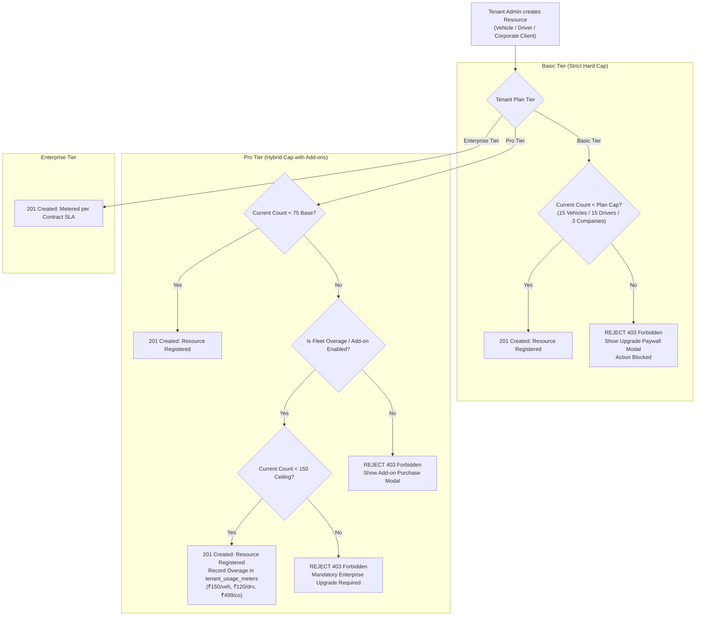
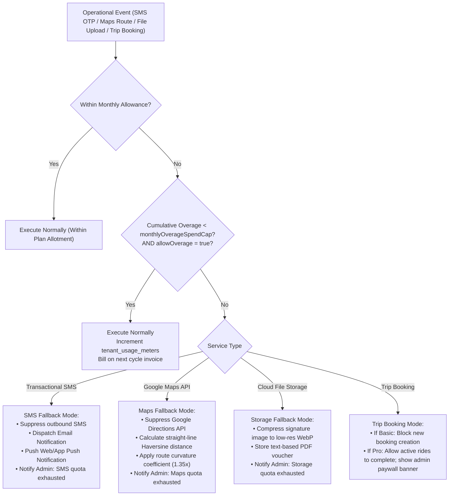
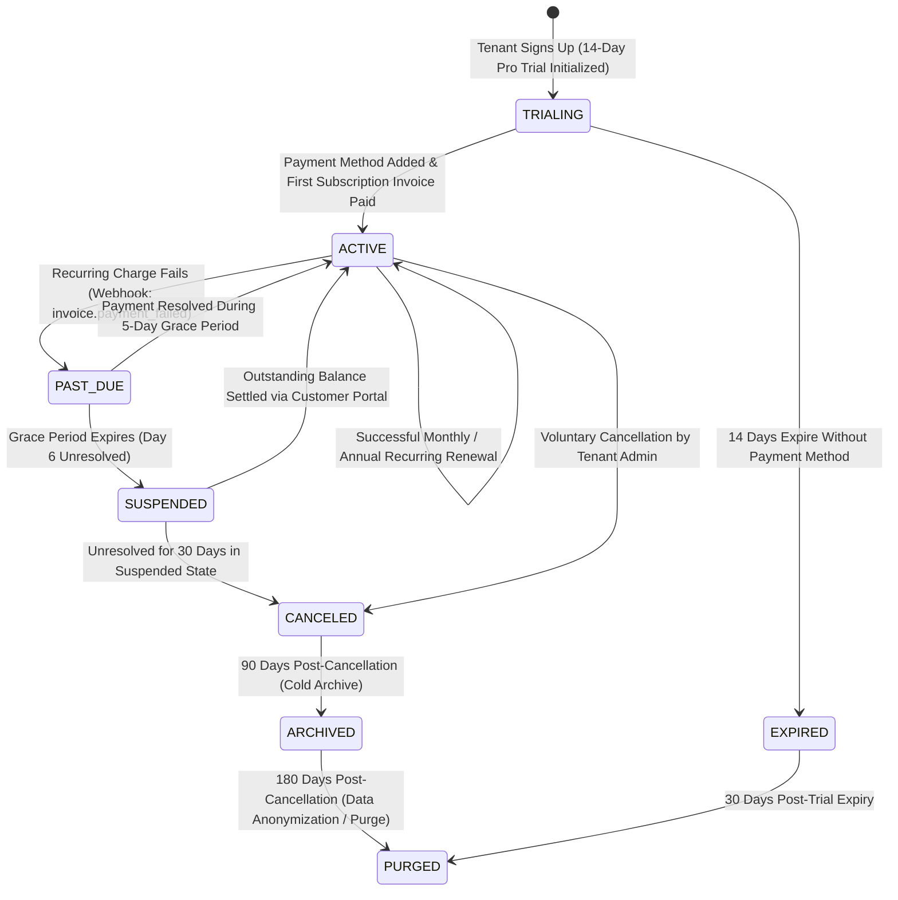

# Document 03: Canonical Subscription & Quota Policy

## 1. Commercial Architecture & Executive Purpose

The Grace Cabs Multi-Tenant SaaS Platform operates on a **Value-Metric Hybrid Monetization Model** tailored for regional taxi operators, fleet contractors, and enterprise corporate logistics departments.

Earlier documents exhibited contradictions regarding:
1. **Annual Pricing Calculations**: A discrepancy between the approximate "2 months free" numbers in [`docs/04_SUBSCRIPTION_TIERS_AND_COMMERCIAL_MODEL.md`](file:///d:/demobooking/demo-bookings/docs/04_SUBSCRIPTION_TIERS_AND_COMMERCIAL_MODEL.md) (₹34,990 / ₹1,19,990) and the precise 15% discount numbers in [`GRACE_CABS_SAAS_DESIGN_REVIEW/03_FINAL_SUBSCRIPTION_AND_QUOTA_RULES.md`](file:///d:/demobooking/demo-bookings/GRACE_CABS_SAAS_DESIGN_REVIEW/03_FINAL_SUBSCRIPTION_AND_QUOTA_RULES.md) (₹35,690 / ₹1,22,390).
2. **Hard Limits vs Paid Overages**: Simultaneous claims that vehicle/driver/client counts were "Hard Caps" that blocked mutations with HTTP 403, while concurrently listing per-unit monthly overage fees.
3. **Billing Domain Conflation**: Lack of clean delineation between platform software licensing and passenger transport fares.

This document establishes the **canonical commercial specification**, resolves all price list ambiguities, reconciles hard versus soft quota policies, defines fallback behavior for metered telemetry, and details the complete 7-stage subscription lifecycle state machine.

---

## 2. Canonical Product Subscription Tiers & Pricing List

```mermaid
graph LR
    subgraph T1["BASIC TIER (Starter Fleet)"]
        B_TARGET["Small / Boutique Operators<br/>(1-15 Vehicles)"]
        B_PRICE["₹3,499 / month<br/>($49 USD)"]
        B_ANNUAL["₹35,690 / year (15% Off)<br/>[Alt: ₹34,990 / yr]"]
        B_CAPS["• 15 Vehicles (Hard Cap)<br/>• 15 Drivers (Hard Cap)<br/>• 3 Corporate Clients (Hard Cap)<br/>• 1,000 Trips / month"]
    end

    subgraph T2["PRO TIER (Regional Growth)"]
        P_TARGET["Mid-Market Multi-City Fleets<br/>(Up to 75 Vehicles)"]
        P_PRICE["₹11,999 / month<br/>($149 USD)"]
        P_ANNUAL["₹1,22,390 / year (15% Off)<br/>[Alt: ₹1,19,990 / yr]"]
        P_CAPS["• 75 Vehicles (Base Cap)<br/>• 75 Drivers (Base Cap)<br/>• 20 Corporate Clients (Base Cap)<br/>• 10,000 Trips / month"]
    end

    subgraph T3["ENTERPRISE TIER (Fleet Network)"]
        E_TARGET["National Aggregators / In-House<br/>(Unlimited Fleet Scale)"]
        E_PRICE["Custom / Starting ₹34,999 / mo<br/>($449+ USD)"]
        E_ANNUAL["Custom Enterprise SLA"]
        E_CAPS["• Unlimited Vehicles<br/>• Unlimited Drivers<br/>• Unlimited Clients<br/>• Unlimited Trips"]
    end

    T1 --> T2 --> T3
```



### Comprehensive Tier Entitlement & Feature Matrix

| Feature / Quota Dimension | Basic Tier (Starter) | Pro Tier (Growth) | Enterprise Tier |
| :--- | :---: | :---: | :---: |
| **Target Audience** | Local taxi operators, boutique car rentals | Regional multi-city fleet operators | National aggregators, enterprise corporate fleets |
| **Canonical Monthly Subscription Price** | **₹3,499 / month** ($49 USD) | **₹11,999 / month** ($149 USD) | **Starting at ₹34,999 / month** ($449+ USD) |
| **Canonical Annual Subscription (15% Discount)** | **₹35,690 / year** | **₹1,22,390 / year** | Custom Enterprise Master Agreement |
| *Alternative Annual Option (2 Months Free)* | *₹34,990 / year (DECISION-COM-01)* | *₹1,19,990 / year (DECISION-COM-01)* | *Custom Enterprise SLA* |
| **Active Vehicle Fleet Limit** | **15 Vehicles** (Strict Hard Cap) | **75 Vehicles** (Base Cap + Add-ons) | **Unlimited** (Metered volume packs) |
| **Active Driver Limit** | **15 Drivers** (Strict Hard Cap) | **75 Drivers** (Base Cap + Add-ons) | **Unlimited** |
| **Corporate Clients (`Company`)** | **3 Companies** (Strict Hard Cap) | **20 Companies** (Base Cap + Add-ons) | **Unlimited** |
| **Monthly Trip Booking Volume** | Up to **1,000 trips / month** | Up to **10,000 trips / month** | **Unlimited** |
| **Fleet Dispatch & Monitoring** | Manual dispatch console | Automated + manual dispatch | AI-assisted auto-allocation |
| **Driver Application Access** | Web PWA access | Web PWA + Native Mobile App | White-labeled Driver App (Play Store) |
| **Live GPS Tracking Telemetry** | Odometer log only | Real-time map tracking | Real-time tracking + historical route replay |
| **Single-Trip Retail Invoicing** | ✅ Included | ✅ Included | ✅ Included |
| **On-Call Multi-Trip Invoicing** | ❌ Not included | ✅ Included | ✅ Included |
| **Monthly Corporate Invoicing** | ❌ Not included | ✅ Included | ✅ Included |
| **Manager Ride Approvals** | Auto-confirm only | Single-tier manager approval | Multi-tier hierarchical approval engine |
| **Workflow Policy Engine** | Standard default rules | Standard default rules | **Configurable Policy Engine** (Domain regex, custom metadata) |
| **Branding & White-Labeling** | Shared SaaS portal | Tenant Subdomain (`operator.gracecabs.in`)| **Full White-Label** (`rides.operator.com`) + Custom CSS |
| **Email Infrastructure** | Shared platform SMTP | Custom SMTP server credentials | Dedicated IP pool & custom DKIM/SPF |
| **SMS OTP / Notifications** | 500 SMS / month included | 5,000 SMS / month included | Custom volume packs or BYO Gateway |
| **Google Maps Geocoding API** | 1,000 queries / month | 10,000 queries / month | High-volume package or BYO API Key |
| **Cloud Storage (Docs/Signatures)**| 5 GB included | 25 GB included | 100 GB included (Scale as needed) |
| **REST API & Webhooks Access** | ❌ No API access | Read-only reporting API | Full bi-directional REST API + Webhooks |
| **Database Deployment Model** | Shared multi-tenant pool | Shared multi-tenant pool | Shared Pool OR Dedicated DB Silo |
| **Support SLA** | Email support (48h SLA) | Priority email & chat (12h SLA) | 24/7 Phone & Dedicated Technical AM (1h SLA) |

---

## 3. Reconciling Hard Caps vs Paid Overages

### 3.1 The Contradiction & Its Resolution
In earlier reviews, asset limits (vehicles, drivers, companies) were simultaneously referred to as "Hard Limits" and assigned overage pricing (₹150, ₹120, ₹499). This contradiction is resolved through a tiered policy:

1. **Basic Tier (Starter)**: **STRICT HARD CAPS**.
   - Absolutely no overages are permitted for vehicles, drivers, or corporate clients.
   - When a tenant reaches 15 vehicles, attempting to register a 16th vehicle is blocked with HTTP `403 Forbidden` (`QUOTA_EXCEEDED`).
   - The UI displays an Upgrade Modal directing the tenant to upgrade to the Pro Tier.
2. **Pro Tier (Growth)**: **BASE HARD CAP WITH ADD-ON EXPANSION PACKS**.
   - The plan includes 75 vehicles, 75 drivers, and 20 corporate clients.
   - Pro tenants who temporarily exceed these counts (e.g., during seasonal peak demand) can either:
     - Purchase **Fleet Add-on Packs** in blocks of 10 vehicles/drivers (₹1,500/month), OR
     - Enable **Metered Fleet Overage** at ₹150/vehicle/month, ₹120/driver/month, and ₹499/company/month up to an absolute ceiling of 150 vehicles. Beyond 150 vehicles, upgrading to Enterprise Tier is mandatory.
3. **Enterprise Tier**: **CONTRACTUAL QUOTA WITH VOLUME TIERS**.
   - Custom negotiated base capacity with tiered volume discounting for additional vehicle blocks.



---

## 4. Metered Operational Telemetry, Spending Caps & Fallback Behavior

Unlike physical assets, operational traffic (trip bookings, SMS dispatches, Google Maps route calculations, cloud file uploads) cannot be abruptly hard-blocked mid-transit without stranding passengers, leaving drivers without trip details, or corrupting active rides.

### 4.1 Metered Telemetry Specification

| Telemetry Component | Unit Measurement | Basic Allotment | Pro Allotment | Enterprise Allotment | Overage Rate (When Permitted) | Telemetry Data Source |
| :--- | :---: | :---: | :---: | :---: | :---: | :--- |
| **Trip Booking Volume** | Completed / Confirmed Trips | 1,000 / mo | 10,000 / mo | Unlimited | **₹3.50 per additional trip** | `COUNT(booking) WHERE tenantId = :id AND status IN (CONFIRMED, CLOSED)` |
| **Transactional SMS** | 160-char SMS OTP / Alerts | 500 / mo | 5,000 / mo | Custom Pack / BYO Gateway | **₹0.30 per additional SMS** | `COUNT(otp) + NotificationService.smsLogs` |
| **Google Maps Geocoding / Routing** | Map API Query | 1,000 / mo | 10,000 / mo | High Volume / BYO API Key | **₹25.00 per 1,000 queries** (₹0.025 / query) | `tenant_usage_meters (METRIC_MAPS)` |
| **Cloud Storage (Documents/Signatures)** | Megabytes / Gigabytes Stored | 5 GB | 25 GB | 100 GB+ | **₹15.00 per additional GB / month** | S3 / MinIO Bucket Inventory Metrics |

### 4.2 Tenant Spending Caps & Graceful Fallback Engine

To protect fleet operators against runaway API costs, every tenant account has configurable overage controls in their billing console:

1. **`allowOverage` (Boolean, Default: `true` for Pro, `false` for Basic)**:
   - When `true`, operational requests exceeding plan limits execute smoothly and log overage metrics to `tenant_usage_meters`.
   - When `false`, the platform enforces strict limits and triggers the fallback behaviors defined below.
2. **`monthlyOverageSpendCap` (Currency, Default: `₹1,000` for Basic, `₹5,000` for Pro)**:
   - A hard financial ceiling on variable overages in a single billing cycle.
   - When the cumulative overage bill reaches this ceiling, fallback behavior engages automatically.



---

## 5. Subscription Lifecycle State Machine & Dunning Rules



### Detailed Lifecycle State Specifications

| Status | Permitted Operational Capabilities | Tenant Administrative Access Level | Dunning & Notification Schedule | Permitted Data Retention |
| :--- | :--- | :--- | :--- | :--- |
| **`TRIALING`** | Full Pro Tier capabilities. Fleet capped at 15 vehicles and 500 trips. | Full platform administrative access. | **Day 1**: Welcome email.<br/>**Day 10**: Trial expiry warning.<br/>**Day 13**: Final trial notice. | Full live access. |
| **`ACTIVE`** | All entitled features, vehicles, drivers, and metered services fully active. | Unrestricted platform access. | Renewal invoice notice sent 7 days prior to billing anchor date. | Full live access. |
| **`PAST_DUE`** | **Operational dispatch continues normally for a 5-Day Grace Period**. Live trips, driver assignments, and customer bookings are uninterrupted. | Full access, but admin console displays prominent persistent **Payment Past Due** warning banner. | **Day 1**: Payment failure alert with retry link.<br/>**Day 3**: Urgent grace period notice.<br/>**Day 5**: Final notice: suspension tomorrow. | Full live access. |
| **`SUSPENDED`** | **Operational Dispatch Frozen**: New booking creation, driver assignment, and trip closure are blocked. Active in-transit rides are permitted to complete. Public booking portal shows "Service Temporarily Unavailable". | **Read-Only Mode**: Invoices, historical trip sheets, passenger lists, and reports can be viewed and exported. Admin mutations blocked. | Daily payment reminder with one-click invoice payment link. | Read-only live access. |
| **`CANCELED`** | Platform completely deactivated. Subdomain and custom domain routes deactivated (HTTP 404/503). | Tenant login permitted **strictly to access billing history and trigger full compliance data export**. | Cancellation confirmation email. Instructions on data export and 90-day archive window. | Exportable for 90 days. |
| **`ARCHIVED`** | Background jobs ignore tenant. Production database records moved to compressed cold archive storage. | Tenant login blocked. Platform Host SuperAdmin can reactivate upon payment of restoration fee. | Reactivation offer at Day 60. | Retained in cold archive for 90 days. |
| **`PURGED`** | Irreversible physical deletion or cryptographic anonymization of personal data (PII). | Records permanently inaccessible. | Final notice sent 7 days prior to purge. | **PII erased per DPDP Act 2023**. Financial invoice records retained 7 years for tax statutory compliance. |

---

## 6. Prorated Upgrades and Downgrades

### 6.1 Mid-Cycle Plan Upgrades (Immediate Effect)
- When a tenant upgrades (e.g., from Basic to Pro on Day 10 of a 30-day billing cycle), the upgrade takes effect **immediately**.
- Quota limits (vehicles, drivers, companies) expand instantly upon gateway payment confirmation.
- **Proration Formula**:
  $$\text{Unused Credit} = \text{Current Tier Price} \times \left(\frac{\text{Days Remaining}}{\text{Total Days in Cycle}}\right)$$
  $$\text{New Tier Cost} = \text{New Tier Price} \times \left(\frac{\text{Days Remaining}}{\text{Total Days in Cycle}}\right)$$
  $$\text{Immediate Charge} = \text{New Tier Cost} - \text{Unused Credit}$$

### 6.2 Plan Downgrades (Scheduled at Period End)
- Downgrades (e.g., Pro to Basic) take effect **at the end of the current billing cycle** (`currentPeriodEnd`).
- **Downgrade Quota Safeguard**:
  Prior to confirming a downgrade request, the system verifies that the tenant's current active fleet complies with the lower tier's limits:
  ```typescript
  if (activeVehicles > targetTier.vehicleQuota || activeDrivers > targetTier.driverQuota || activeCompanies > targetTier.companyQuota) {
    throw new QuotaViolationException(
      `Cannot downgrade to ${targetTier.name}. Current active resources (${activeVehicles} vehicles, ${activeDrivers} drivers, ${activeCompanies} companies) exceed plan limits (${targetTier.vehicleQuota} vehicles, ${targetTier.driverQuota} drivers, ${targetTier.companyQuota} companies). Deactivate excess resources before downgrading.`
    );
  }
  ```

---

## 7. Data Retention & Archiving Policy

| Data Category | Operational State (`ACTIVE`/`PAST_DUE`) | Suspended State (`SUSPENDED`) | Canceled / Archived State | Statutory Mandate & Legal Basis |
| :--- | :--- | :--- | :--- | :--- |
| **Trip Sheets & GPS Telemetry** | Full live database access | Read-only access | Exportable for 90 days; deleted after 180 days | Operational fleet data: 180 days post-cancellation. |
| **Passenger Digital Signatures** | Full live database access | Read-only access | Retained 7 years cryptographically linked to invoices | Digital contract audit trail: 7 years. |
| **Invoices & Financial Bills** | Permanent live database access | Read-only access | Retained 7 years in secure archive | **Indian GST Act 2017 & Income Tax Act**: Mandatory 7-year retention. |
| **Customer Personal Data (PII)**| Full operational access | Read-only access | Anonymized 180 days post-cancellation | **Digital Personal Data Protection Act 2023 (DPDP)**: Right to erasure. |

---

## 8. Total Commercial Separation: SaaS Billing vs Transport Billing

To preserve financial integrity, eliminate legal liabilities, and comply with taxation laws:

1. **Platform Gateway**:
   - Charges software licensing fees (`tenant_subscriptions`).
   - Uses Platform Operator credentials configured in system `.env`.
   - Tax Regime: SAC 998313 (SaaS Software Licensing).
2. **Tenant Mobility Gateway**:
   - Collects passenger fares and corporate contract payments (`invoice`, `onCallInvoice`, `monthly_invoice`).
   - Uses individual Fleet Operator merchant credentials configured in `configuration` table.
   - Tax Regime: SAC 996412 (Passenger Road Transport Services).
   - **The Platform Host never touches or commingles transport fare monies.**
