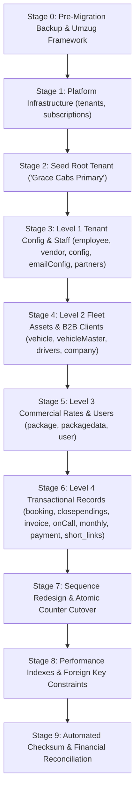
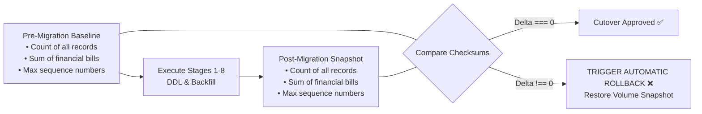

# Document 05: Safe Database Migration & Rollback Plan

## 1. Executive Summary & Verification of Migration Constraints

Migrating the **Grace Cabs / `demo-bookings`** production database to multi-tenancy involves structural alterations to 25+ existing tables, data backfilling for millions of rows, and sequence table redesign.

Earlier plans ([`docs/05_GAP_ANALYSIS_AND_MIGRATION_ROADMAP.md`](file:///d:/demobooking/demo-bookings/docs/05_GAP_ANALYSIS_AND_MIGRATION_ROADMAP.md)) suffered from three dangerous assumptions:
1. **Unsubstantiated "Zero-Downtime" Claims**: Claiming zero-downtime while proposing in-place `ALTER TABLE` statements on active MySQL tables without ghost-table or replication infrastructure.
2. **Blanket Column Addition**: Blindly adding `tenantId` to all tables without topological ordering or classifying child and reference tables.
3. **Absence of Quantitative Verification**: Lacking automated financial and record-count checksums to detect data corruption or loss.

This document establishes an **atomic, topologically ordered, failsafe database migration plan** featuring nullable staging columns, backfill checkpoints, pre/post financial checksum reconciliation, realistic maintenance window parameters, and an automated rollback protocol.

---

## 2. Topological Table Migration Sequence

To prevent foreign key constraint violations, table deadlocks, and orphaned records, DDL operations execute in a strict topological order:



### Table-by-Table Execution Matrix

| Stage | Table Name | Source Model | Action Required | Staging Column | Backfill Rule | Post-Backfill Constraint |
| :-: | :--- | :--- | :--- | :--- | :--- | :--- |
| **0** | `pre_migration_backup` | N/A | Full MySQL volume snapshot | N/A | Pre-migration checksum capture | Verified cold backup image |
| **1** | `tenants` | `Tenant` | `CREATE TABLE` | `tenantId CHAR(36) PK` | Platform Host root infrastructure | `PRIMARY KEY (tenantId)`, `UNIQUE (subdomain)` |
| **1** | `tenant_subscriptions`| `TenantSubscription` | `CREATE TABLE` | `subscriptionId CHAR(36) PK` | Initialized for root tenant | `FK -> tenants(tenantId)` |
| **1** | `tenant_usage_meters` | `TenantUsageMeter` | `CREATE TABLE` | `meterId CHAR(36) PK` | Telemetry counters initialized | `FK -> tenants(tenantId)`, `UNIQUE (tenantId, month, metric)` |
| **1** | `subscription_invoices`| `SubscriptionInvoice` | `CREATE TABLE` | `invoiceId CHAR(36) PK` | SaaS licensing ledger | `FK -> tenants(tenantId)` |
| **1** | `company_policies` | `CompanyPolicy` | `CREATE TABLE` | `policyId CHAR(36) PK` | Extracted dynamic client rules | `FK -> tenants(tenantId)`, `FK -> company(companyId)` |
| **2** | `tenants` (Seed) | `Tenant` | `INSERT ROOT TENANT` | N/A | Insert `ROOT_UUID = 'e7b8a1c0-0000-0000-0000-000000000001'` | Name: "Grace Cabs Primary", Code: "GC" |
| **3** | `employee` | [`employee.ts`](file:///d:/demobooking/demo-bookings/backend/src/models/employee.ts) | Schema Evolution | `ADD tenantId CHAR(36) NULL` | `UPDATE employee SET tenantId = ROOT_UUID` | `MODIFY COLUMN tenantId NOT NULL`, `FK -> tenants` |
| **3** | `vendor` | [`vendor.ts`](file:///d:/demobooking/demo-bookings/backend/src/models/vendor.ts) | Schema Evolution | `ADD tenantId CHAR(36) NULL` | `UPDATE vendor SET tenantId = ROOT_UUID` | `MODIFY COLUMN tenantId NOT NULL`, `FK -> tenants` |
| **3** | `configuration` | [`configuration.ts`](file:///d:/demobooking/demo-bookings/backend/src/models/configuration.ts) | Schema Evolution | `ADD tenantId CHAR(36) NULL` | `UPDATE configuration SET tenantId = ROOT_UUID` | `MODIFY COLUMN tenantId NOT NULL`, `UNIQUE (tenantId)` |
| **3** | `emailConfiguration`| [`emailConfiguration.ts`](file:///d:/demobooking/demo-bookings/backend/src/models/emailConfiguration.ts)| Schema Evolution | `ADD tenantId CHAR(36) NULL` | `UPDATE emailConfiguration SET tenantId = ROOT_UUID` | `MODIFY COLUMN tenantId NOT NULL`, `FK -> tenants` |
| **3** | `partners` | [`Partner.ts`](file:///d:/demobooking/demo-bookings/backend/src/models/Partner.ts) | Schema Evolution | `ADD tenantId CHAR(36) NULL` | `UPDATE partners SET tenantId = ROOT_UUID` | `MODIFY COLUMN tenantId NOT NULL`, `FK -> tenants` |
| **4** | `vehicle` | [`vehicle.ts`](file:///d:/demobooking/demo-bookings/backend/src/models/vehicle.ts) | Schema Evolution | `ADD tenantId CHAR(36) NULL` | `UPDATE vehicle SET tenantId = ROOT_UUID` | `MODIFY COLUMN tenantId NOT NULL`, `FK -> tenants` |
| **4** | `vehicleMaster` | [`vehicleMaster.ts`](file:///d:/demobooking/demo-bookings/backend/src/models/vehicleMaster.ts) | Schema Evolution | `ADD tenantId CHAR(36) NULL` | `UPDATE vehicleMaster SET tenantId = ROOT_UUID` | `MODIFY COLUMN tenantId NOT NULL`, `FK -> tenants` |
| **4** | `drivers` | [`drivers.ts`](file:///d:/demobooking/demo-bookings/backend/src/models/drivers.ts) | Schema Evolution | `ADD tenantId CHAR(36) NULL` | `UPDATE drivers SET tenantId = ROOT_UUID` | `MODIFY COLUMN tenantId NOT NULL`, `FK -> tenants` |
| **4** | `company` | [`company.ts`](file:///d:/demobooking/demo-bookings/backend/src/models/company.ts) | Schema Evolution | `ADD tenantId CHAR(36) NULL` | `UPDATE company SET tenantId = ROOT_UUID` | `MODIFY COLUMN tenantId NOT NULL`, `FK -> tenants` |
| **5** | `package` | [`package.ts`](file:///d:/demobooking/demo-bookings/backend/src/models/package.ts) | Schema Evolution | `ADD tenantId CHAR(36) NULL` | `UPDATE package SET tenantId = ROOT_UUID` | `MODIFY COLUMN tenantId NOT NULL`, `FK -> tenants` |
| **5** | `packagedata` | [`packageData.ts`](file:///d:/demobooking/demo-bookings/backend/src/models/packageData.ts) | Schema Evolution | `ADD tenantId CHAR(36) NULL` | `UPDATE packagedata SET tenantId = ROOT_UUID` | `MODIFY COLUMN tenantId NOT NULL`, `FK -> tenants` |
| **5** | `user` | [`user.ts`](file:///d:/demobooking/demo-bookings/backend/src/models/user.ts) | Schema Evolution | `ADD tenantId CHAR(36) NULL`<br/>`ADD metadata JSON NULL` | `UPDATE user SET tenantId = ROOT_UUID`<br/>Backfill `metadata.corporateEmpId = danfossuserId` | `MODIFY COLUMN tenantId NOT NULL`, `FK -> tenants`, `INDEX (tenantId, email)` |
| **6** | `booking` | [`booking.ts`](file:///d:/demobooking/demo-bookings/backend/src/models/booking.ts) | Schema Evolution | `ADD tenantId CHAR(36) NULL` | `UPDATE booking SET tenantId = ROOT_UUID` | `MODIFY COLUMN tenantId NOT NULL`, `FK -> tenants`, `INDEX (tenantId, bookingDate)` |
| **6** | `closependings` | [`closepending.ts`](file:///d:/demobooking/demo-bookings/backend/src/models/closepending.ts) | Schema Evolution | `ADD tenantId CHAR(36) NULL` | `UPDATE closependings SET tenantId = ROOT_UUID` | `MODIFY COLUMN tenantId NOT NULL`, `FK -> tenants` |
| **6** | `invoice` | [`invoice.ts`](file:///d:/demobooking/demo-bookings/backend/src/models/invoice.ts) | Schema Evolution | `ADD tenantId CHAR(36) NULL` | `UPDATE invoice SET tenantId = ROOT_UUID` | `MODIFY COLUMN tenantId NOT NULL`, `FK -> tenants` |
| **6** | `onCallInvoice` | [`onCallInvoice.ts`](file:///d:/demobooking/demo-bookings/backend/src/models/onCallInvoice.ts) | Schema Evolution | `ADD tenantId CHAR(36) NULL` | `UPDATE onCallInvoice SET tenantId = ROOT_UUID` | `MODIFY COLUMN tenantId NOT NULL`, `FK -> tenants` |
| **6** | `monthly_invoice` | [`monthlyInvoice.ts`](file:///d:/demobooking/demo-bookings/backend/src/models/monthlyInvoice.ts) | Schema Evolution | `ADD tenantId CHAR(36) NULL` | `UPDATE monthly_invoice SET tenantId = ROOT_UUID` | `MODIFY COLUMN tenantId NOT NULL`, `FK -> tenants` |
| **6** | `payment` | [`payment.ts`](file:///d:/demobooking/demo-bookings/backend/src/models/payment.ts) | Schema Evolution | `ADD tenantId CHAR(36) NULL` | `UPDATE payment SET tenantId = ROOT_UUID` | `MODIFY COLUMN tenantId NOT NULL`, `FK -> tenants` |
| **6** | `ordersummery` | [`ordersummery.ts`](file:///d:/demobooking/demo-bookings/backend/src/models/ordersummery.ts) | Schema Evolution | `ADD tenantId CHAR(36) NULL` | `UPDATE ordersummery SET tenantId = ROOT_UUID` | `MODIFY COLUMN tenantId NOT NULL`, `FK -> tenants` |
| **6** | `short_links` | [`shortLink.ts`](file:///d:/demobooking/demo-bookings/backend/src/models/shortLink.ts) | Schema Evolution | `ADD tenantId CHAR(36) NULL` | `UPDATE short_links SET tenantId = ROOT_UUID` | `MODIFY COLUMN tenantId NOT NULL`, `FK -> tenants` |
| **7** | `booking_sequences` | New Composite | `CREATE TABLE` & Cutover | `tenantId CHAR(36)`, `seq_date DATE` | Copy current counters from `booking_sequence` | `PRIMARY KEY (tenantId, seq_date)` |
| **7** | `invoice_sequences` | Redesign | `ALTER TABLE` & Re-Key | `tenantId CHAR(36)` | Copy counters; set `tenantId = ROOT_UUID` | `PRIMARY KEY (tenantId, companyId, financialYear)` |
| **7** | `monthly_booking_sequences`| New Composite | `CREATE TABLE` & Cutover | `tenantId CHAR(36)`, `companyCode`, `FY` | Copy counters from `monthlyBookingSequence` | `PRIMARY KEY (tenantId, companyCode, financialYear)` |
| **7** | `payment_sequences` | New Composite | `CREATE TABLE` & Cutover | `tenantId CHAR(36)`, `seq_date DATE` | Copy counters from `payment_sequence` | `PRIMARY KEY (tenantId, seq_date)` |
| **8** | All Tables | N/A | Compound Indexes | Apply compound indexes | Index generation across all tenant models | Query performance optimization |
| **9** | All Tables | N/A | Automated Verification | Checksum & Sum Comparison | Compute pre vs post totals | Delta MUST EQUAL 0 |

> [!NOTE]
> **Tables Intentionally Excluded from `tenantId` Addition**:
> - `vehicleType`: Shared Global Reference master (`REF`).
> - `pickupcity` & `pickuparea`: Shared Geographic masters (`REF`).
> - `tax`: Standard statutory Indian GST slabs (`REF`).
> - `paymentmode`: Standard transaction mode definitions (`REF`).
> - `otp`: Ephemeral phone-bound verification records (`EPH`).
> - `onCallInvoiceItems` & `monthly_invoice_items`: Normalized child lines inheriting tenancy via parent foreign keys (`CO-Child`).
> - `bookingRule`: Verified 0-byte deprecated code artifact (`DEP`).

---

## 3. Four-Step Staging Pattern for Table Migration

To avoid table corruption or migration aborts, every table undergoing tenancy schema evolution follows an identical four-step pattern:

```sql
-- Step 1: Add Staging Column as NULLABLE
ALTER TABLE `booking` 
  ADD COLUMN `tenantId` CHAR(36) NULL AFTER `bookingId`;

-- Step 2: Backfill with Root Tenant ID
UPDATE `booking` 
  SET `tenantId` = 'e7b8a1c0-0000-0000-0000-000000000001' 
  WHERE `tenantId` IS NULL;

-- Step 3: Validate Zero NULL Rows (Checkpoint)
-- Umzug migration runner aborts if count > 0:
SELECT COUNT(*) FROM `booking` WHERE `tenantId` IS NULL;

-- Step 4: Convert Column to NOT NULL, Add Index, and Apply Foreign Key
ALTER TABLE `booking` 
  MODIFY COLUMN `tenantId` CHAR(36) NOT NULL,
  ADD CONSTRAINT `fk_booking_tenant` 
    FOREIGN KEY (`tenantId`) REFERENCES `tenants`(`tenantId`) ON DELETE RESTRICT;

CREATE INDEX `idx_booking_tenant_date` 
  ON `booking` (`tenantId`, `bookingDate`);
```

---

## 4. Pre- and Post-Migration Checksum & Financial Reconciliation

To mathematically prove that zero data was dropped, altered, or corrupted during migration, the migration harness runs the following reconciliation queries before Stage 1 and after Stage 9:



### Mandatory Reconciliation Audit Queries

```sql
-- 1. Record Count Reconciliation
SELECT 'booking' AS tbl, COUNT(*) AS total_records FROM booking
UNION ALL
SELECT 'user', COUNT(*) FROM user
UNION ALL
SELECT 'company', COUNT(*) FROM company
UNION ALL
SELECT 'vehicle', COUNT(*) FROM vehicle
UNION ALL
SELECT 'drivers', COUNT(*) FROM drivers
UNION ALL
SELECT 'invoice', COUNT(*) FROM invoice
UNION ALL
SELECT 'onCallInvoice', COUNT(*) FROM onCallInvoice
UNION ALL
SELECT 'monthly_invoice', COUNT(*) FROM monthly_invoice
UNION ALL
SELECT 'monthly_invoice_items', COUNT(*) FROM monthly_invoice_items
UNION ALL
SELECT 'onCallInvoiceItems', COUNT(*) FROM onCallInvoiceItems
UNION ALL
SELECT 'payment', COUNT(*) FROM payment;

-- 2. Financial Amount Sum Reconciliation
SELECT 
  'Single-Trip Invoices' AS domain,
  COUNT(*) AS total_invoices,
  COALESCE(SUM(total), 0) AS sum_total,
  COALESCE(SUM(grandTotal), 0) AS sum_grand_total
FROM invoice
UNION ALL
SELECT 
  'On-Call Invoices',
  COUNT(*),
  COALESCE(SUM(amount), 0),
  COALESCE(SUM(totalAmount), 0)
FROM onCallInvoice
UNION ALL
SELECT 
  'Monthly Corporate Invoices',
  COUNT(*),
  COALESCE(SUM(netTotal), 0),
  COALESCE(SUM(finalTotal), 0)
FROM monthly_invoice
UNION ALL
SELECT 
  'Payment Receipts',
  COUNT(*),
  COALESCE(SUM(amount), 0),
  COALESCE(SUM(amount), 0)
FROM payment;
```

**Cutover Rule**: If the pre-migration checksum and post-migration checksum show a delta other than zero on any metric, the migration runner automatically aborts and engages the rollback procedure.

---

## 5. Zero-Downtime Reality Check & Deployment Strategy

### The Zero-Downtime Myth in Single-Instance MySQL
Earlier documents ([`docs/05`](file:///d:/demobooking/demo-bookings/docs/05_GAP_ANALYSIS_AND_MIGRATION_ROADMAP.md)) labeled this transition as "Zero-Downtime Data Migration". In the current deployment environment:
1. The backend runs on a single Node.js Express process connected to a single MySQL 8.0 database configured with Sequelize `sync({ alter: true })`.
2. MySQL `ALTER TABLE ... MODIFY COLUMN ... NOT NULL` and `ADD CONSTRAINT` require **Exclusive Metadata Locks (MDL)**. Under active traffic, concurrent writes will be queued or deadlocked.
3. Therefore, claiming "zero-downtime" is an **UNVERIFIED GOAL** that would risk production transactions during DDL execution.

### Recommended Production Deployment Strategy
- **Maintenance Window Deployment**: Schedule a **30-minute planned maintenance window** during off-peak hours (e.g., Sunday 02:00–02:30 IST).
- Place the edge proxy / Cloudflare in "Scheduled Maintenance" mode.
- Execute Umzug migrations and automated reconciliation.
- Deploy the updated backend code cluster with active `TenantContext` middleware.
- Verify health checks and release the maintenance banner.

---

## 6. Automated Rollback Protocol & Legacy Fallbacks

```mermaid
sequenceDiagram
    autonumber
    actor DevOps as Deployment Engineer
    participant Harness as Umzug Migration Harness
    participant DB as MySQL Production DB
    participant AWS as Storage Volume Snapshot

    DevOps->>AWS: Create Pre-Migration EBS / Volume Snapshot
    DevOps->>Harness: Execute Phase 2 Migrations
    Harness->>DB: Execute Stages 1-8
    
    alt DDL Failure or Checksum Discrepancy
        Harness-->>DevOps: Checksum Mismatch Alert (DELTA != 0)
        DevOps->>Harness: Trigger umzug.down()
        Harness->>DB: Drop created constraints and columns in reverse order
        
        alt Schema Locks or DDL Crash
            DevOps->>AWS: Revert Volume from Snapshot (< 15 Minutes)
            AWS-->>DB: Storage Restored to Exact Pre-Migration State
        end
        DevOps->>DevOps: Post-Mortem Analysis; Abort Cutover
    else Checksum Validated (Delta === 0)
        Harness-->>DevOps: All Checksums Match 100%. Migration Succeeded.
    end
```

### Legacy Fallback Guarantees
1. **30-Day Column Preservation**: The legacy `danfossuserId` column in the `user` table is NOT dropped during Phase 2 migration. It is retained in a read-only state for 30 days while `user.metadata` is actively used.
2. **Configuration Dual-Read**: The legacy single-row `configuration` values are cloned to the root tenant record. If a query requests a global configuration key during the transition, a fallback resolver queries the root tenant row.
