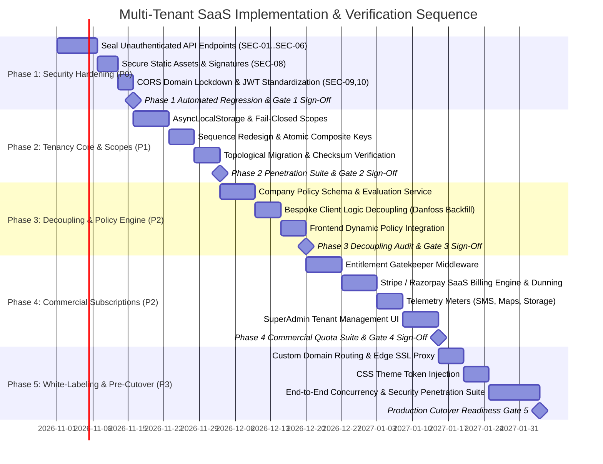

# Document 06: Final Implementation Sequence & Verification Protocol

## 1. Executive Summary & Phasing Strategy

Transitioning the **Grace Cabs / `demo-bookings`** platform to a multi-tenant SaaS architecture requires a disciplined, sequential execution roadmap. Attempting to implement multi-tenancy before sealing existing security vulnerabilities or decoupling hardcoded customer logic would multiply risks, complicate debugging, and risk data corruption.

This document establishes the **Approved 5-Phase Implementation Sequence**, defined by technical dependency and security priority. Every phase includes concrete tasks, target files, and measurable entry and exit gates.

> [!IMPORTANT]
> **DOCUMENTATION PHASE ONLY**: In accordance with the execution rules of Phase 2B, **no source-code modifications, database migrations, or production deployments are authorized by this document**. Execution begins only after formal business sign-off on the open decisions documented in Document 07.

---

## 2. Master Implementation Gantt & Phase Dependencies

---

## 3. Detailed Phase Work Breakdown Structure (WBS)

### Phase 1: Security Hardening & Zero-Trust Foundation (Weeks 1–3)
**Primary Objective**: Remediate all critical and high-severity vulnerabilities identified in Document 04 without modifying application data schemas.

| Task ID | Task Description | Target Source Files | Dependencies | Deliverable & Acceptance Criteria |
| :---: | :--- | :--- | :---: | :--- |
| **T1.1** | Add `authMiddleware` to unprotected routes | [`configurationRoutes.ts`](file:///d:/demobooking/demo-bookings/backend/src/routes/configurationRoutes.ts), [`userRoutes.ts`](file:///d:/demobooking/demo-bookings/backend/src/routes/userRoutes.ts), [`bookingRoutes.ts`](file:///d:/demobooking/demo-bookings/backend/src/routes/bookingRoutes.ts), [`closependingRoutes.ts`](file:///d:/demobooking/demo-bookings/backend/src/routes/closependingRoutes.ts), [`invoiceRoutes.ts`](file:///d:/demobooking/demo-bookings/backend/src/routes/invoiceRoutes.ts), [`onCallRoutes.ts`](file:///d:/demobooking/demo-bookings/backend/src/routes/onCallRoutes.ts) | None | 100% of non-public endpoints return HTTP `401 Unauthorized` for anonymous requests. |
| **T1.2** | Redact plain-text SMTP password & encrypt at rest | [`configurationService.ts`](file:///d:/demobooking/demo-bookings/backend/src/services/configurationService.ts), [`configuration.ts`](file:///d:/demobooking/demo-bookings/backend/src/models/configuration.ts) | T1.1 | `GET /api/config/getConfiguration` excludes `smtpEmailPassword`; password stored via AES-256-GCM. |
| **T1.3** | Secure Excel user import with Bcrypt | [`userRoutes.ts`](file:///d:/demobooking/demo-bookings/backend/src/routes/userRoutes.ts), [`userServices.ts`](file:///d:/demobooking/demo-bookings/backend/src/services/userServices.ts) | T1.1 | User import requires Admin JWT; temporary passwords hashed via Bcrypt (`saltRounds = 12`); `"123456"` eliminated. |
| **T1.4** | Remediate BOLA / IDOR on order routes | [`bookingRoutes.ts`](file:///d:/demobooking/demo-bookings/backend/src/routes/bookingRoutes.ts), [`bookingServices.ts`](file:///d:/demobooking/demo-bookings/backend/src/services/bookingServices.ts) | T1.1 | `/api/order/user/:userId/*` verifies `req.userId === params.userId` or caller holds Admin role. |
| **T1.5** | Secure destructive invoicing endpoints | [`closependingRoutes.ts`](file:///d:/demobooking/demo-bookings/backend/src/routes/closependingRoutes.ts), [`invoiceRoutes.ts`](file:///d:/demobooking/demo-bookings/backend/src/routes/invoiceRoutes.ts), [`onCallRoutes.ts`](file:///d:/demobooking/demo-bookings/backend/src/routes/onCallRoutes.ts) | T1.1 | Deletion/cancellation endpoints require Admin role; physical hard-deletes replaced with soft-deletes. |
| **T1.6** | Remove public static file serving for sensitive assets | [`app.ts`](file:///d:/demobooking/demo-bookings/backend/src/app.ts), new `documentController.ts` | None | Direct static access to `/uploads/signature` and `/invoices` removed; replaced with authenticated streaming. |
| **T1.7** | Restrict CORS origin | [`app.ts`](file:///d:/demobooking/demo-bookings/backend/src/app.ts) | None | Wildcard `origin: "*"` removed; origins validated against approved tenant domain list. |
| **T1.8** | Standardize JWT payload and typing | [`authMiddleware.ts`](file:///d:/demobooking/demo-bookings/backend/src/middleware/authMiddleware.ts), [`Security.ts`](file:///d:/demobooking/demo-bookings/backend/src/utils/Security.ts), [`authServices.ts`](file:///d:/demobooking/demo-bookings/backend/src/services/authServices.ts) | None | `userId` typed as UUID string; JWT payload standardized to `{ userId, email, role, tenantId, companyId }`. |

- **Entry Criteria**: Phase 2B final design review approved; baseline security audit completed.
- **Exit Criteria (Gate 1)**: Automated security regression suite passes with 0 failures; unauthenticated access to sensitive routes is completely eliminated.

---

### Phase 2: Tenancy Core & Fail-Closed Database Isolation (Weeks 4–7)
**Primary Objective**: Deploy tenant database schemas, implement fail-closed tenant context propagation, redesign sequence tables, and execute topological backfill.

| Task ID | Task Description | Target Source Files | Dependencies | Deliverable & Acceptance Criteria |
| :---: | :--- | :--- | :---: | :--- |
| **T2.1** | Create platform infrastructure schemas | `backend/src/migrations/01_platform_init.ts` | Gate 1 | Tables `tenants`, `tenant_subscriptions`, `tenant_usage_meters`, `subscription_invoices` created. |
| **T2.2** | Implement `AsyncLocalStorage` tenant context engine | `backend/src/context/tenantContext.ts` | T2.1 | Thread-safe context propagation storing active `tenantId`, `role`, and `companyId`. |
| **T2.3** | Implement tenant resolution middleware | `backend/src/middleware/tenantMiddleware.ts` | T2.2 | Resolves tenant from Custom Domain, Subdomain, Header (`X-Tenant-ID`), or JWT claim. |
| **T2.4** | Implement fail-closed Sequelize `@DefaultScope` | `backend/src/models/*` (Tenant models) | T2.2 | Queries executed without active tenant context throw `TenantContextMissingError` or fail closed. |
| **T2.5** | Redesign sequence tables | [`booking_sequence.ts`](file:///d:/demobooking/demo-bookings/backend/src/models/booking_sequence.ts), [`invoice_sequence.ts`](file:///d:/demobooking/demo-bookings/backend/src/models/invoice_sequence.ts), [`monthlyBookingSequence.ts`](file:///d:/demobooking/demo-bookings/backend/src/models/monthlyBookingSequence.ts), [`payment_sequence.ts`](file:///d:/demobooking/demo-bookings/backend/src/models/payment_sequence.ts) | T2.1 | Sequences re-keyed to composite `(tenantId, seq_date)` and `(tenantId, companyId, financialYear)`. |
| **T2.6** | Execute topological data migration & checksum audit | Umzug migration runner | T2.1–T2.5 | Level 1–4 tables backfilled with `ROOT_TENANT_ID`; pre/post financial checksum delta is exactly 0. |

- **Entry Criteria**: Gate 1 signed off; pre-migration full database volume snapshot taken.
- **Exit Criteria (Gate 2)**: Cross-tenant penetration tests verify that Tenant A cannot query, mutate, or delete Tenant B records under any circumstances.

---

### Phase 3: Decoupling Bespoke Client Logic & Policy Engine (Weeks 8–10)
**Primary Objective**: Eliminate hardcoded Danfoss logic from the codebase and deploy the dynamic metadata-driven policy engine.

| Task ID | Task Description | Target Source Files | Dependencies | Deliverable & Acceptance Criteria |
| :---: | :--- | :--- | :---: | :--- |
| **T3.1** | Implement `CompanyPolicy` schema & service | `models/companyPolicy.ts`, `services/policyService.ts` | Gate 2 | JSON policy definitions stored per corporate client. |
| **T3.2** | Add `metadata` JSON column to `user` model | [`models/user.ts`](file:///d:/demobooking/demo-bookings/backend/src/models/user.ts) | Gate 2 | Extensible JSON column added for bespoke client fields (e.g., `corporateEmpId`). |
| **T3.3** | Migrate Danfoss records & backfill metadata | Migration script | T3.1, T3.2 | Danfoss user IDs copied from `danfossuserId` to `metadata.corporateEmpId`; Danfoss policy record created. |
| **T3.4** | Decouple backend domain checks | [`authServices.ts`](file:///d:/demobooking/demo-bookings/backend/src/services/authServices.ts), [`userServices.ts`](file:///d:/demobooking/demo-bookings/backend/src/services/userServices.ts) | T3.3 | Hardcoded `companyName.includes("danfoss")` removed; replaced with `policyService.validateEmailDomain()`. |
| **T3.5** | Dynamic policy integration on frontend | [`UserInvoice.tsx`](file:///d:/demobooking/demo-bookings/frontend/src/SuperAdmin/pages/Users/UserInvoice.tsx), [`UserDetails.tsx`](file:///d:/demobooking/demo-bookings/frontend/src/SuperAdmin/pages/Users/UserDetails.tsx), [`UserLogin.tsx`](file:///d:/demobooking/demo-bookings/frontend/src/SuperAdmin/pages/Users/UserLogin.tsx) | T3.4 | Dynamic fields rendered based on company policy; hardcoded Danfoss conditionals removed. |

- **Entry Criteria**: Gate 2 signed off.
- **Exit Criteria (Gate 3)**: Codebase grep confirms zero occurrences of `"danfoss"` in application business logic; all client rules evaluate dynamically.

---

### Phase 4: Commercial Subscription Engine, Quotas & Metering (Weeks 11–13)
**Primary Objective**: Deploy SaaS monetization infrastructure, enforce fleet quotas, and automate recurring subscription billing.

| Task ID | Task Description | Target Source Files | Dependencies | Deliverable & Acceptance Criteria |
| :---: | :--- | :--- | :---: | :--- |
| **T4.1** | Implement Entitlement Gatekeeper Middleware | `middleware/entitlementMiddleware.ts` | Gate 3 | Intercepts vehicle, driver, and company creation APIs; blocks mutations exceeding plan caps. |
| **T4.2** | Integrate Stripe / Razorpay Subscriptions | `services/subscriptionService.ts` | T4.1 | Automated recurring billing; webhook handlers for payment success, failure, and cancellation. |
| **T4.3** | Implement Telemetry Metering | `services/telemetryService.ts` | T4.1 | Tracks monthly SMS dispatches, Google Maps API lookups, and storage bytes in `tenant_usage_meters`. |
| **T4.4** | Build SuperAdmin Tenant Management UI | `frontend/src/SuperAdmin/pages/Tenants/` | T4.2 | Host console to monitor tenant accounts, MRR, active fleets, and plan usage. |

- **Entry Criteria**: Gate 3 signed off.
- **Exit Criteria (Gate 4)**: Quota middleware correctly blocks creation of the 16th vehicle on Basic plan (HTTP 403); payment failure triggers 5-day grace period and dunning state transitions.

---

### Phase 5: Dynamic White-Labeling, Custom Domains & Verification (Weeks 14–16)
**Primary Objective**: Deliver full white-label capabilities for enterprise tenants and execute end-to-end security and load benchmarking.

| Task ID | Task Description | Target Source Files | Dependencies | Deliverable & Acceptance Criteria |
| :---: | :--- | :--- | :---: | :--- |
| **T5.1** | Custom domain routing & edge SSL | Reverse proxy configuration (Cloudflare / Nginx) | Gate 4 | Multi-tenant router resolves tenant from custom domains with valid SSL certificates. |
| **T5.2** | Dynamic CSS variable theming | `frontend/src/context/ThemeContext.tsx`, `index.css` | T5.1 | Tenant primary color, secondary color, and logos injected dynamically at app initialization. |
| **T5.3** | End-to-End penetration testing | Automated test suites | T5.2 | Complete execution of SEC-01 through SEC-06 and IDOR-01 through IDOR-05 test suites. |
| **T5.4** | Concurrency and load benchmarking | k6 / Artillery benchmark scripts | T5.3 | System handles 100 concurrent booking creations and 50 concurrent sequence increments without collisions. |

- **Entry Criteria**: Gate 4 signed off.
- **Exit Criteria (Gate 5)**: 100% test pass rate across boundary penetration, quota enforcement, and concurrency benchmarks; formal production cutover authorization.

---

## 4. Comprehensive Testing & Verification Protocol

### 4.1 Automated Boundary Penetration Test Suite

| Test ID | Test Scenario | Execution Method | Expected Result | Gate Impact |
| :---: | :--- | :--- | :--- | :---: |
| **SEC-01** | Cross-Tenant Order Fetch by ID | Issue `GET /api/order/details/:bookingCode` for a Tenant B order using a Tenant A token. | Response `404 Not Found` or `403 Forbidden`. Zero Tenant B data returned. | **CRITICAL BUILD BLOCKER** |
| **SEC-02** | Cross-Tenant Order Listing | Issue `GET /api/order/getAllOrders` using Tenant A Admin token. | Result array contains **only** records matching Tenant A's `tenantId`. | **CRITICAL BUILD BLOCKER** |
| **SEC-03** | Cross-Tenant Mutation Attempt | Issue `PUT /api/order/editBooking/:id` targeting Tenant B trip using Tenant A token. | Response `404 Not Found` or `403 Forbidden`. Record remains unmodified. | **CRITICAL BUILD BLOCKER** |
| **SEC-04** | Cross-Tenant Driver Assignment | Attempt to assign a Tenant B driver to a Tenant A booking. | Rejected with `400 Bad Request` or foreign key validation error. | **CRITICAL BUILD BLOCKER** |
| **SEC-05** | Cross-Tenant Invoice PDF Stream | Request `GET /api/documents/stream/invoice/:id` for Tenant B invoice using Tenant A token. | Response `403 Forbidden` (`Access denied to cross-tenant asset`). | **CRITICAL BUILD BLOCKER** |
| **SEC-06** | Fail-Closed Context Test | Execute `Booking.findAll()` in a background worker without initializing `tenantStorage`. | Throws `TenantContextMissingError` or returns empty array (`WHERE 1=0`). | **CRITICAL BUILD BLOCKER** |

---

### 4.2 Broken Object-Level Authorization (IDOR) Test Suite

| Test ID | Test Scenario | Execution Method | Expected Result | Gate Impact |
| :---: | :--- | :--- | :--- | :---: |
| **IDOR-01** | Anonymous Order Scrape | Issue `GET /api/order/user/:userId/all` without `Authorization` header. | Server rejects immediately with `401 Unauthorized`. | Zero trip data disclosed. |
| **IDOR-02** | User-to-User Snooping | User X requests `GET /api/order/user/:userId/all` specifying User Y's UUID. | Server rejects with `403 Forbidden`. | User X cannot inspect User Y's rides. |
| **IDOR-03** | Anonymous Invoice Cancellation | Issue `PUT /api/invoiceRoutes/invoice/cancelInvoice` without token. | Server rejects with `401 Unauthorized`. Invoice status unchanged. | Bill status unaltered. |
| **IDOR-04** | Anonymous Monthly Invoice Deletion | Issue `DELETE /api/closePendingOrder/monthlyInvoice/:id` without token. | Server rejects with `401 Unauthorized`. Record preserved. | Zero data loss. |

---

### 4.3 Commercial Quota & Paywall Test Suite

| Test ID | Test Scenario | Execution Method | Expected Result | Gate Impact |
| :---: | :--- | :--- | :--- | :---: |
| **QUOTA-01** | Vehicle Hard Limit Enforcement | Attempt to register 16th vehicle on Basic plan (Quota = 15). | Server rejects with `403 Forbidden` (`Plan vehicle limit reached`). Upgrade URL returned. | Vehicle not created in DB. |
| **QUOTA-02** | Corporate Client Limit Enforcement | Attempt to create 4th corporate client on Basic plan (Quota = 3). | Server rejects with `403 Forbidden` (`Plan company limit reached`). | Company not created in DB. |
| **QUOTA-03** | Soft Quota Trip Overage | Execute 1,001st trip on Basic plan with `allowTripOverage = true`. | Trip created successfully (201 Created); usage incremented in `tenant_usage_meters`. | Overage tracked cleanly. |
| **QUOTA-04** | Soft Quota Hard Cap Fallback | Execute 1,001st trip on Basic plan with `allowTripOverage = false`. | Booking creation blocked or alert rendered to upgrade plan. | Hard cap enforced as requested. |

---

### 4.4 Concurrency & Sequence Integrity Benchmarks

| Benchmark ID | Scenario | Concurrency Target | Target Latency | Pass/Fail Criteria |
| :---: | :--- | :--- | :--- | :--- |
| **BENCH-01** | Concurrent Booking Creation | 100 simultaneous reservations within 1 second across 2 tenants. | $p95 \le 250\text{ms}$ | Zero duplicate booking codes; strictly sequential counters per tenant; zero deadlocks. |
| **BENCH-02** | Concurrent Invoice Finalization | 50 concurrent invoice closures for the same tenant. | $p95 \le 350\text{ms}$ | Sequences increment strictly from $N$ to $N+50$ with zero collisions or gaps. |
| **BENCH-03** | Headless PDF Generation | 20 concurrent invoice PDF requests. | $p95 \le 3.0\text{s}$ | Zero Chromium process orphan leaks; memory remains stable under 1.5 GB. |

---

## 5. Explicit Prohibition Against Production Cutover

> [!CAUTION]
> **GO / NO-GO DIRECTIVE**:
> Production cutover is **EXPLICITLY NOT AUTHORIZED** during this documentation phase.
> 
> Production deployment authorization requires:
> 1. Complete resolution and stakeholder sign-off on all 12 open decisions in Document 07.
> 2. Successful execution and passage of Gates 1 through 5 in staging environments.
> 3. Zero-defect verification on pre/post financial checksums.
