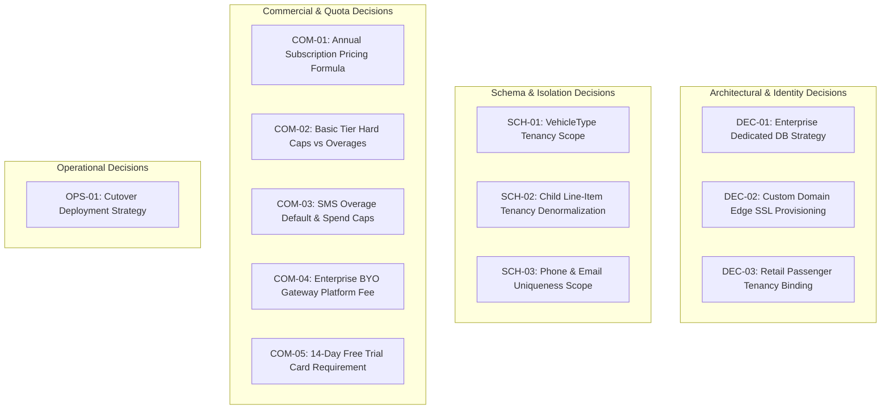

# Document 07: Open Decisions, Unverified Assumptions & Verification Boundaries

## 1. Executive Summary & Governance Purpose

A critical failure in system architecture is silently making commercial, technical, or regulatory assumptions when source documents conflict.

In accordance with the execution rules of **Phase 2B (Document Reconciliation)**, this document compiles the definitive register of:
1. **Source-Verified Facts**: Conclusively proven by line-by-line inspection of the project's source code, models, and configuration.
2. **Document-Derived Proposals**: Architectural and operational designs synthesized and reconciled across earlier design proposals.
3. **Unverified Assumptions**: Hypotheses or design claims that cannot be proven without live runtime infrastructure testing or load benchmarking.
4. **Decisions Requiring Business Approval**: Commercial pricing policies, quota caps, deployment options, and legal retention choices that require formal executive sign-off prior to Phase 1/2 execution.

---

## 2. Definitive Register of Decisions Requiring Business Approval

The following 12 decisions require formal executive and business stakeholder sign-off:

### Detailed Decision Specifications

| Decision ID | Domain | Topic | Option A | Option B | Architectural & Commercial Trade-offs | Recommendation | Stakeholder Authority |
| :---: | :--- | :--- | :--- | :--- | :--- | :--- | :--- |
| **DEC-01** | Architecture | Enterprise Dedicated DB Strategy | **Dynamic Connection Pooling**: Application switches database connections dynamically per tenant request. | **Isolated Container Cluster**: Provision dedicated containerized app/DB instances per enterprise client. | Option A in Sequelize is notorious for connection pool leaks and memory exhaustion. Option B provides absolute process-level security boundaries and simpler compliance. | **Recommend Option B** | VP Engineering / CTO |
| **DEC-02** | Infrastructure | Custom Domain Edge SSL Provisioning | **Cloudflare for SaaS**: Automated SSL certificate issuance and edge DDoS proxying via Cloudflare API. | **In-House Reverse Proxy**: Caddy / Nginx reverse proxy with Certbot Let's Encrypt automated issuance. | Option A eliminates operational overhead of managing certificates on backend servers and includes edge CDN/DDoS. Option B requires no third-party SaaS dependency. | **Recommend Option A** | Lead DevOps / Infrastructure |
| **DEC-03** | Identity | Retail Passenger Tenancy Binding | **Platform Root User Pool**: Direct retail passengers belong to a global platform tenant (`tenantId = NULL`). | **Fleet Operator Bound**: Retail passengers are bound to the specific Fleet Operator whose portal they registered through (`tenantId = operatorTenantId`). | Option A violates tenant isolation, risks cross-operator passenger poaching, and creates regulatory PII commingling liabilities under DPDP Act 2023. Option B provides total isolation. | **Recommend Option B** | Product / Legal Counsel |
| **SCH-01** | Database | `VehicleType` Tenancy Scope | **Platform-Global Reference Master**: Standardized vehicle categories (Sedan, SUV, Hatchback) shared across all tenants. Rate differences handled in `packagedata`. | **Tenant-Owned Table**: Each tenant defines and manages their own independent `vehicleType` rows. | Option A standardizes vehicle classifications for the shared driver app and customer PWA while allowing custom rates in `packagedata`. Option B causes catalog fragmentation. | **Recommend Option A** | Lead Architect |
| **SCH-02** | Database | Child Line-Item Tenancy Denormalization | **Pure Normalized (No Direct `tenantId`)**: Child items (`monthly_invoice_items`, `onCallInvoiceItems`) inherit tenancy via parent foreign key. | **Denormalized `tenantId`**: Add `tenantId` column to all child line items. | Option A prevents parent/child tenant mismatch bugs and simplifies cascades. Option B enables standalone indexed queries but risks data corruption if out of sync. | **Recommend Option A** | Database Architect |
| **SCH-03** | Database | User Mobile & Email Uniqueness Scope | **Platform-Wide Global Uniqueness**: `UNIQUE(mobile)` and `UNIQUE(email)` enforced across the entire database. | **Tenant-Scoped Uniqueness**: `UNIQUE(tenantId, mobile)` and `UNIQUE(tenantId, email)`. | Option A blocks a user from holding accounts with two independent regional fleet operators. Option B enables multi-operator accounts while guaranteeing tenant isolation. | **Recommend Option B** | Product / Lead Architect |
| **COM-01** | Commercial | Annual Subscription Pricing Formula | **Exact 15% Annual Discount**: Basic = ₹35,690 / year, Pro = ₹1,22,390 / year. | **2 Months Free (~16.7% Discount)**: Basic = ₹34,990 / year, Pro = ₹1,19,990 / year. | Option A aligns with standard SaaS financial compounding. Option B is psychologically simpler for marketing and sales collateral ("Get 2 Months Free"). | **Business Decision** (Open for Sales/Finance) | VP Sales / Head of Finance |
| **COM-02** | Commercial | Basic Tier Asset Hard Caps vs Overages | **Strict Hard Cap**: No overages allowed on Basic tier; 16th vehicle is blocked with HTTP 403; requires upgrade to Pro. | **Paid Overages on Basic**: Basic tenants can exceed 15 vehicles by paying ₹150/veh/mo without upgrading base tier. | Option A protects the commercial upgrade pathway to Pro Tier. Option B offers flexibility to micro-fleets but reduces Average Revenue Per User (ARPU). | **Recommend Option A** | Chief Commercial Officer |
| **COM-03** | Commercial | SMS Overage Default Behavior & Spend Cap | **Enabled by Default with ₹1,000 Cap**: Overage allowed up to ₹1,000 monthly spend cap before triggering email fallback. | **Hard Cap at Tier Allotment**: Dispatches blocked at 500 SMS; immediately falls back to email/push notifications. | Option A ensures critical passenger OTP delivery during surge bookings. Option B guarantees zero variable cost surprises for fleet operators. | **Recommend Option A** | Product Manager |
| **COM-04** | Commercial | Enterprise BYO Payment Gateway Platform Fee | **0.0% Platform Fee**: Enterprise clients bringing their own Razorpay/Stripe credentials pay zero platform GMV fee. | **0.5% Platform GMV Fee**: Platform host levies a 0.5% fee on all transport volume processed via BYO gateways. | Option A accelerates enterprise sales adoption and positions platform as pure software. Option B captures substantial GMV upside but creates friction. | **Recommend Option A** | CEO / Chief Commercial Officer |
| **COM-05** | Commercial | 14-Day Free Trial Credit Card Requirement | **Frictionless Trial (No Card Required)**: 14-day Pro trial requires only email and phone verification. | **Credit Card Upfront**: 14-day trial requires payment method pre-authorization. | Option A maximizes top-of-funnel conversion for regional taxi operators. Option B ensures higher trial-to-paid conversion and filters spam. | **Recommend Option A** | Head of Growth / Marketing |
| **OPS-01** | Operations | Cutover Deployment Strategy | **Theoretical Zero-Downtime**: Attempt online schema evolution under live traffic. | **Planned 30-Minute Maintenance Window**: Schedule off-peak maintenance window (Sunday 02:00–02:30 IST) to execute DDL and checksum verification safely. | In single-node MySQL with active connections, online DDL risks metadata lock queues and write deadlocks. A planned maintenance window guarantees zero data loss. | **Recommend Option B** | VP Engineering / Operations |

---

## 3. Four-Tier Classification of Findings & Requirements

### 3.1 Tier 1: Source-Verified Facts
The following items are **100% verified facts** confirmed by direct line-by-line inspection of the current repository:
1. **Plain-Text SMTP Credentials Exposed**: [`configurationRoutes.ts:10`](file:///d:/demobooking/demo-bookings/backend/src/routes/configurationRoutes.ts#L10) and [`configurationService.ts:98-115`](file:///d:/demobooking/demo-bookings/backend/src/services/configurationService.ts#L98-L115) return unencrypted Mailgun/SMTP credentials without authentication.
2. **Unauthenticated Configuration Overwrite**: [`configurationRoutes.ts:7`](file:///d:/demobooking/demo-bookings/backend/src/routes/configurationRoutes.ts#L7) permits anonymous overwrite of service tax and invoice prefixes.
3. **Unauthenticated Bulk User Excel Import**: [`userRoutes.ts:18`](file:///d:/demobooking/demo-bookings/backend/src/routes/userRoutes.ts#L18) and [`userServices.ts:322`](file:///d:/demobooking/demo-bookings/backend/src/services/userServices.ts#L322) inject active accounts with default password `"123456"` with no auth.
4. **Cross-Tenant Administrative Order Leaks**: [`bookingServices.ts:358-386`](file:///d:/demobooking/demo-bookings/backend/src/services/bookingServices.ts#L358-L386) dumps all bookings across all clients for any non-user role.
5. **Unauthenticated Order Scraping (IDOR)**: [`bookingRoutes.ts:38-50`](file:///d:/demobooking/demo-bookings/backend/src/routes/bookingRoutes.ts#L38-L50) exposes order details and user histories anonymously.
6. **Unauthenticated Invoice Deletion**: [`closependingRoutes.ts:37`](file:///d:/demobooking/demo-bookings/backend/src/routes/closependingRoutes.ts#L37), [`invoiceRoutes.ts:29`](file:///d:/demobooking/demo-bookings/backend/src/routes/invoiceRoutes.ts#L29), and [`onCallRoutes.ts:19-21`](file:///d:/demobooking/demo-bookings/backend/src/routes/onCallRoutes.ts#L19-L21) allow anonymous deletion of monthly and on-call bills.
7. **Public Static Asset Directories**: [`app.ts:70-86`](file:///d:/demobooking/demo-bookings/backend/src/app.ts#L70-L86) and [`app.ts:114-156`](file:///d:/demobooking/demo-bookings/backend/src/app.ts#L114-L156) serve passenger signatures and invoice PDFs publicly.
8. **Permissive CORS Wildcard**: [`app.ts:74-82`](file:///d:/demobooking/demo-bookings/backend/src/app.ts#L74-L82) configures `origin: "*"` with `credentials: true`.
9. **JWT Type Inconsistency & Omission of `tenantId`**: [`authMiddleware.ts:4-28`](file:///d:/demobooking/demo-bookings/backend/src/middleware/authMiddleware.ts#L4-L28) declares `userId: number` (UUID mismatch) and token payload omits `tenantId`.
10. **Hardcoded Danfoss Logic**: Column `danfossuserId` in [`user.ts:36`](file:///d:/demobooking/demo-bookings/backend/src/models/user.ts#L36); string check `companyName.includes("danfoss")` in [`authServices.ts:325`](file:///d:/demobooking/demo-bookings/backend/src/services/authServices.ts#L325).
11. **Global Sequence Tables**: [`booking_sequence.ts`](file:///d:/demobooking/demo-bookings/backend/src/models/booking_sequence.ts) and [`payment_sequence.ts`](file:///d:/demobooking/demo-bookings/backend/src/models/payment_sequence.ts) are keyed only by `seq_date`.
12. **Raw SQL Scope Bypasses**: [`onCallServices.ts:2367`](file:///d:/demobooking/demo-bookings/backend/src/services/onCallServices.ts#L2367) executes raw SQL without tenant filters.
13. **Asynchronous Background Context Loss**: [`empServices.ts:2498`](file:///d:/demobooking/demo-bookings/backend/src/services/empServices.ts#L2498) spawns an untracked `setTimeout` for auto-approval.
14. **Physical Table Names Verified**: Confirmed `short_links` (not `shortlinks`), `otp` (not `otps`), `ordersummery` (with 'e'), and verified `bookingRule.ts` is a 0-byte file.

---

### 3.2 Tier 2: Document-Derived Proposals
The following items are reconciled architectural proposals synthesized from the supplied documentation:
1. **3-Tier Taxonomy**: Platform Host -> SaaS Tenant Fleet Operator -> Corporate Client / Retail Customer.
2. **Fail-Closed Default Scopes**: Replacing `docs/03` fail-open scope with `createFailClosedTenantScope` throwing `TenantContextMissingError`.
3. **Separation of Billing Domains**: SaaS software subscription billing (`tenant_subscriptions`) strictly isolated from transport operational invoicing (`invoice`, `onCallInvoice`, `monthly_invoice`).
4. **Decoupled Workflow Policy Engine**: Dynamic metadata JSON schema (`company_policies`) replacing hardcoded customer branches.
5. **Topological Database Migration**: 9-stage migration sequence utilizing nullable staging columns, backfill checkpoints, and index creation.
6. **Composite Multi-Tenant Sequences**: Atomic counters re-keyed to `(tenantId, seq_date)` and `(tenantId, companyId, financialYear)`.

---

### 3.3 Tier 3: Unverified Assumptions (Requiring Runtime Testing)
The following items cannot be conclusively proven by static code analysis and represent **unverified assumptions requiring runtime load testing**:
1. **Zero-Downtime Feasibility**: Claimed in earlier roadmaps, but unverified under production MySQL locking behavior. Treated as an unverified goal; maintenance window recommended instead.
2. **Sequence Race Conditions under High Concurrency (SEC-13)**: The assumption that atomic MySQL upserts in `payment.ts` or `booking.ts` will collide or cause duplicate keys at 100+ requests/sec requires active k6 benchmark verification (Benchmark BENCH-01).
3. **Headless Chromium Memory Leaks (SEC-14)**: The assumption that batch invoice PDF generation via Puppeteer causes process exhaustion requires runtime stress testing under 20+ concurrent PDF generations (Benchmark BENCH-03).
4. **Sequelize `sync({ alter: true })` Migration Behavior**: Current code uses `sync({ alter: true })` in development ([`backend/src/models/index.ts:37`](file:///d:/demobooking/demo-bookings/backend/src/models/index.ts#L37)). Running this in production alongside Umzug migrations is an unverified risk and must be disabled (`sync: false`).

---

## 4. Final Verification Protocol & Pre-Cutover Sign-Off Checklist

Before any code modifications or migrations are scheduled for production execution, the following sign-off checklist must be completed by the responsible authorities:

| Sign-Off Milestone | Responsible Authority | Required Evidence / Deliverable | Status |
| :--- | :--- | :--- | :---: |
| **Commercial Pricing Alignment** | VP Sales / Head of Finance | Confirmation of COM-01 (15% vs 2 Months Free) and COM-02 (Basic Hard Caps). | ⏳ Pending Review |
| **Security Architecture Sign-Off** | Lead Security Architect | Approval of Document 04 remediation specifications for SEC-01 through SEC-17. | ⏳ Pending Review |
| **Database Schema Approval** | Database Architect / Lead Dev | Verification of Document 02 ownership matrix and Stage 1–9 topological order. | ⏳ Pending Review |
| **Deployment Strategy Approval** | Lead DevOps / Operations | Approval of OPS-01 (30-minute scheduled maintenance window). | ⏳ Pending Review |
| **Legal & Privacy Compliance** | Legal Counsel | Approval of DPDP Act 2023 180-day PII anonymization and 7-year tax retention. | ⏳ Pending Review |
