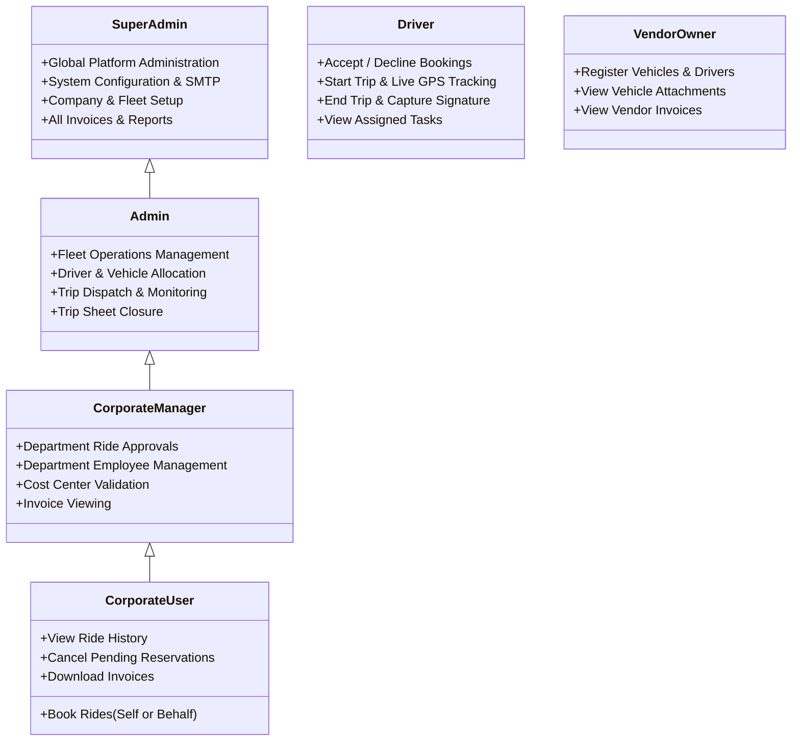
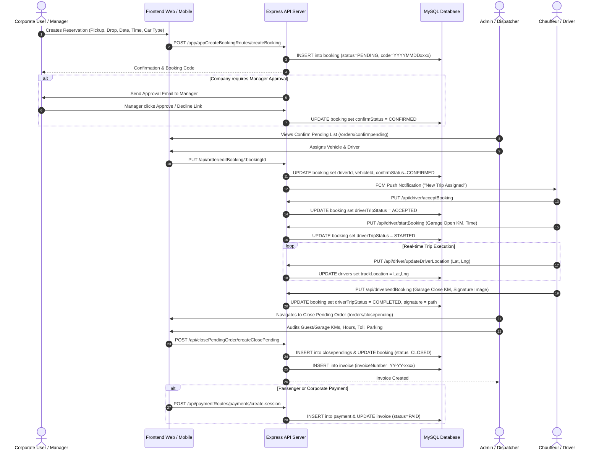

# Document 01: Existing System Architecture & Technical Specifications

## 1. Executive System Overview

The **Grace Cabs Fleet & Corporate Mobility Management Platform** (`demo-bookings`) is a full-stack web and mobile backend system designed for fleet operations, on-demand cab reservations, corporate employee transport, and B2B billing reconciliation.

### Technology Stack Summary

| Layer | Technologies & Libraries |
| :--- | :--- |
| **Frontend Web** | React 19.1.0, TypeScript 4.9.5, React Router DOM 7.7.0, TailwindCSS, Lucide React, FontAwesome 6, Recharts 3.1.0, jsPDF & jsPDF-AutoTable, XLSX / XLSX-js-Style, React-DatePicker, React-Hot-Toast. |
| **Backend API** | Node.js, Express.js 5.1.0, TypeScript 4.9.5, ts-node-dev. |
| **ORM & Database** | Sequelize 6.37.7, Sequelize-TypeScript 2.1.6, MySQL2 3.14.2 (MySQL Dialect). |
| **Authentication & Crypto** | JSON Web Tokens (`jsonwebtoken` 9.0.2), Bcrypt 6.0.0, Custom Security Helpers. |
| **External Integrations** | Firebase Admin 13.5.0 (FCM Push Notifications), Twilio 5.9.0 & 2Factor.in (SMS OTPs), Nodemailer 7.0.5 (SMTP Transactor), Puppeteer 24.17.1 (Headless Chromium Server-side PDF Generation), Payment Gateway SDK/HTTP Webhooks. |

---

## 2. Application Architecture & Topology

The codebase is organized as a unified monorepo containing two primary directories:
- `backend/`: Express.js REST API server, Sequelize models, controllers, business services, and static asset handlers.
- `frontend/`: React Single Page Application (SPA) containing the SuperAdmin management portal, Corporate Manager/User views, and public landing pages.

```mermaid
graph TD
    subgraph Frontend["Frontend SPA (React 19 / Vite / React-Scripts)"]
        PUB_PAGES["Public Website & Landing<br/>(Home, About, Services, Partners)"]
        AUTH_VIEWS["Auth Views<br/>(/adminlogin, /Company/:seoUrl)"]
        ADMIN_PORTAL["SuperAdmin Management Console<br/>(Master, Vehicles, Orders, Invoices, Reports)"]
        CORP_PORTAL["Corporate User & Manager Workspace<br/>(Bookings, Approvals, Invoices)"]
    end

    subgraph Backend["Backend API Server (Express 5 / Node.js)"]
        MW_STACK["Middleware Stack<br/>(CORS, JSON Parser, AuthMiddleware, Multer)"]
        WEB_ROUTES["Standard REST APIs<br/>(/api/auth, /api/order, /api/company, etc.)"]
        APP_ROUTES["Mobile / Driver Application APIs<br/>(/app/appRoutes, /app/appCreateBookingRoutes, /app/appInvoiceRoutes)"]
        SERVICES["Business Service Layer<br/>(bookingServices, closependingorderServices, invServices, onCallServices)"]
        PUPPETEER["PDF Generator Service<br/>(Puppeteer Headless Engine)"]
    end

    subgraph Database["Relational Storage (MySQL)"]
        MYSQL[("MySQL Database (demodb)<br/>37+ Sequelize Entities")]
    end

    Frontend -->|HTTP / REST (Axios)| MW_STACK
    MW_STACK --> WEB_ROUTES
    MW_STACK --> APP_ROUTES
    WEB_ROUTES --> SERVICES
    APP_ROUTES --> SERVICES
    SERVICES --> PUPPETEER
    SERVICES --> MYSQL
```

---

## 3. Database Architecture & Entity Specifications

The platform utilizes Sequelize-TypeScript with active database auto-synchronization (`sequelize.sync({ alter: true })` in [backend/src/models/index.ts](file:///d:/demobooking/demo-bookings/backend/src/models/index.ts#L37)). The relational data layer comprises **37 distinct models**:

### 3.1 Core Entity Dictionary

| Model Name | Table Name | Primary Key | Key Relationships | Functional Role |
| :--- | :--- | :--- | :--- | :--- |
| **`Company`** | `company` | `companyId` (UUID) | HasMany `Booking`, HasMany `Invoice`, HasMany `MonthlyInvoice`, BelongsTo `User`, BelongsTo `Employee` | Corporate accounts/clients utilizing fleet services (e.g., Danfoss). Holds GST, address, operating hours, manager approval flags, and vanity `seoUrl`. |
| **`User`** | `user` | `userId` (UUID) | BelongsTo `Company`, HasMany `Booking` | Corporate employees and passengers. Contains login credentials, corporate manager associations (`managerId`, `managerEmail`), gender, addresses (JSON), and customer-specific IDs (`danfossuserId`). |
| **`Employee`** | `employee` | `employeeId` (UUID) | HasMany `Vendor`, HasMany `Company`, HasMany `Drivers`, HasMany `Booking` | Internal staff, dispatchers, operations managers, and SuperAdmin users. |
| **`Drivers`** | `drivers` | `driverId` (UUID) | BelongsTo `Vehicle`, BelongsTo `VehicleType`, BelongsTo `Employee`, HasMany `Booking` | Chauffeurs/drivers executing trips. Contains license details, real-time GPS coordinates (`trackLocation`), FCM tokens, and ratings. |
| **`Vehicle`** | `vehicle` | `vehicleId` (UUID) | BelongsTo `VehicleType`, HasMany `Drivers`, HasOne `VehicleMaster` | Vehicle records indicating manufacturer, model, images, and availability status (`availableStatus`). |
| **`VehicleMaster`** | `vehicleMaster` | `vehicleMasterId` (UUID) | BelongsTo `Vehicle`, BelongsTo `VehicleType`, BelongsTo `Vendor` | Fleet registration linking physical vehicle number plate, vehicle model, type, and vehicle owner (`Vendor`). |
| **`VehicleType`** | `vehicletype` | `vehicleTypeId` (UUID) | HasMany `Vehicle`, HasMany `Drivers`, HasMany `VehicleMaster` | Vehicle classifications (e.g., Sedan, SUV, Premium, Tempo Traveller). |
| **`Vendor`** | `vendor` | `vendorId` (UUID) | BelongsTo `Employee`, HasMany `VehicleMaster`, HasMany `Invoice` | Vehicle owners, fleet sub-contractors, or vendor partners supplying vehicles and drivers. |
| **`Booking`** | `booking` | `bookingId` (UUID) | BelongsTo `User`, BelongsTo `Employee`, BelongsTo `Vehicle`, BelongsTo `Drivers`, BelongsTo `VehicleType`, BelongsTo `Company`, BelongsTo `Payment`, HasMany `Invoice` | Core reservation record capturing passenger, pickup/drop coordinates, flight/train numbers, trip status, driver status, signature, and approval tokens. |
| **`ClosePending`** | `closependings` | `closependingId` (UUID) | BelongsTo `PackageData`, BelongsTo `Company`, HasMany `Invoice` | Post-trip audit record capturing garage KMs, guest KMs, opening/closing timestamps, additional KMs/hours, extra driver batta, tolls/parking, and computed tax breakdown. |
| **`Invoice`** | `invoice` | `invoiceId` (UUID) | BelongsTo `Booking`, BelongsTo `Company`, BelongsTo `Payment`, BelongsTo `ClosePending` | Single-trip bill generated upon trip closure, containing itemized charges, taxes (CGST, SGST, IGST), and status. |
| **`OnCallInvoice`** | `onCallInvoice` | `onCallBillId` (UUID) | BelongsTo `Company`, HasMany `OnCallInvoiceItems` | Consolidated on-call multi-trip invoice billing multiple trips under one parent document. |
| **`OnCallInvoiceItems`** | `onCallInvoiceItems`| `onCallInvoiceItemId` (UUID)| BelongsTo `OnCallInvoice` | Itemized line item of an OnCall invoice representing an individual trip sheet and vehicle run. |
| **`MonthlyInvoice`** | `monthly_invoice` | `monthlyInvoiceId` (UUID) | BelongsTo `Company`, HasMany `MonthlyInvoiceItems` | Monthly aggregated billing invoice for corporate contract clients. |
| **`MonthlyInvoiceItems`** | `monthly_invoice_items`| `monthlyInvoiceItemId` (UUID)| BelongsTo `MonthlyInvoice` | Itemized daily route run, pickup point, vehicle type, and monthly contracted rate item. |
| **`Payment`** | `payment` | `paymentId` (UUID) | HasMany `Booking`, HasMany `Invoice` | Financial transaction record capturing transaction IDs, payment mode, amount, PG order IDs, and status. |
| **`PaymentMode`** | `paymentmode` | `paymentModeId` (UUID) | Referenced by payments | Payment methods supported (Cash, Credit Card, Bank Transfer, UPI, Corporate Credit). |
| **`Package`** | `package` | `packageId` (UUID) | BelongsTo `Company` | Rate category definition (`Out Station` vs `Local City Use`) per company. |
| **`PackageData`** | `packagedata` | `packageDataId` (UUID) | BelongsTo `Company` | Rate matrix storing package tier configurations (e.g., 4hrs/40km, 8hrs/80km) in a JSON payload. |
| **`Pickupcity`** | `pickupcity` | `pickupCityId` (UUID) | HasMany `Pickuparea` | Master list of operating cities (e.g., Chennai, Bangalore). |
| **`Pickuparea`** | `pickuparea` | `pickupAreaId` (UUID) | BelongsTo `Pickupcity` | Master sub-localities, airports, and railway zones. |
| **`Tax`** | `tax` | `taxId` (UUID) | Referenced in pricing | Tax definitions (CGST, SGST, IGST percentages). |
| **`Configuration`** | `configuration` | `configId` (UUID) | Global single-row | Global system settings: default tax percentage, invoice prefix, due days, cancellation lead time, and SMTP server credentials. |
| **`EmailConfiguration`** | `emailconfiguration`| `emailConfigId` (UUID) | Global | Reusable HTML email templates for user registration, booking confirmations, invoices, and manager alerts. |
| **`BookingSequence`** | `booking_sequence` | `seq_date` (VARCHAR Date)| Referenced by Booking hook | Daily atomic atomic auto-increment counter generating codes like `YYYYMMDD0001`. |
| **`InvoiceSequence`** | `invoice_sequence` | `sequenceId` (UUID) | Scoped by `companyId` & `financialYear` | Per-company annual financial invoice numbering sequence (`COMPANY-YY-YY-0001`). |
| **`MonthlyBookingSequence`**| `monthly_booking_sequence`| `monthlyBookingSequenceId`| Global sequence counter | Auto-increment sequence for monthly billing reference numbers. |
| **`PaymentSequence`** | `payment_sequence` | `seq_date` (VARCHAR Date)| Referenced by Payment | Atomic daily sequence counter for payment receipts. |
| **`MapCount`** | `mapcount` | `mapCountId` (UUID) | Telemetry counter | Global usage counter tracking Google Maps API lookups and route geocodes. |
| **`ShortLink`** | `shortlinks` | `shortLinkId` (UUID) | SMS CTA redirection | Short URLs (`/r?l=CODE`) redirected to tracking or invoice approval pages via SMS. |
| **`OTP`** | `otps` | `otpId` (UUID) | User / Driver phone auth | Temporary 6-digit one-time passwords with expiry timestamps. |
| **`Partner`** | `partner` | `partnerId` (UUID) | Public web inquiry | Partner driver/vendor inquiries registered from public web forms. |

---

## 4. User Roles & Access Control Model

The existing application uses role-based classification stored in the `role` column across the `employee`, `user`, `vendor`, and `drivers` tables:



### RBAC Permission Matrix

| Feature / Action | SuperAdmin | Admin | Corporate Manager | Corporate User | Driver | Vendor / Owner |
| :--- | :---: | :---: | :---: | :---: | :---: | :---: |
| **System Configuration & SMTP** | ✅ Yes | ❌ No | ❌ No | ❌ No | ❌ No | ❌ No |
| **Create/Edit Company Master** | ✅ Yes | ✅ Yes | ❌ No | ❌ No | ❌ No | ❌ No |
| **Upload Users via Excel** | ✅ Yes | ✅ Yes | ❌ No | ❌ No | ❌ No | ❌ No |
| **Create/Edit Package & Rates** | ✅ Yes | ✅ Yes | ❌ No | ❌ No | ❌ No | ❌ No |
| **Assign Driver & Vehicle to Trip** | ✅ Yes | ✅ Yes | ❌ No | ❌ No | ❌ No | ❌ No |
| **Approve / Decline Ride** | ✅ Yes | ✅ Yes | ✅ Yes (Own Dept) | ❌ No | ❌ No | ❌ No |
| **Book Ride (Personal/Behalf)** | ✅ Yes | ✅ Yes | ✅ Yes | ✅ Yes | ❌ No | ❌ No |
| **Accept/Start/End Trip** | ❌ No | ❌ No | ❌ No | ❌ No | ✅ Yes | ❌ No |
| **Close Trip Sheet (KMs/Hours)**| ✅ Yes | ✅ Yes | ❌ No | ❌ No | ❌ No | ❌ No |
| **Generate & Cancel Invoices** | ✅ Yes | ✅ Yes | ❌ No | ❌ No | ❌ No | ❌ No |
| **View Monthly Consolidated Invoices**| ✅ Yes | ✅ Yes | ✅ Yes (Own Co.) | ❌ No | ❌ No | ❌ No |
| **Register Vehicles in Master** | ✅ Yes | ✅ Yes | ❌ No | ❌ No | ❌ No | ✅ Yes |

---

## 5. End-to-End Business Workflows

### 5.1 The Complete Trip Lifecycle



### 5.2 ClosePending Calculation Algorithm

Trip billing is computed inside [backend/src/services/closependingorderServices.ts](file:///d:/demobooking/demo-bookings/backend/src/services/closependingorderServices.ts). It enforces strict operational rules:
1. **Garage vs Guest Metrics**: Both garage-to-garage and guest pickup-to-drop metrics are logged. The billing base uses the agreed package rule.
2. **Package Base**: A package tier (e.g., 40 KMs, 4 Hours @ ₹1,200) is matched against the selected `vehicleType`.
3. **Overage Calculations**:
   - `additionalKms = MAX(0, totalKms - packageKms)`
   - `additionalKmsAmount = additionalKms * additionalKmRate`
   - `additionalHours = MAX(0, totalHours - packageHours)`
   - `additionalHoursAmount = additionalHours * additionalHourRate`
4. **Extra Charges & Allowances**:
   - `extraDriverBeta = driverBattaDays * perDayDriverBeta`
   - Extra charges breakup JSON: `[{ title: "Toll", amount: 250 }, { title: "Parking", amount: 100 }]`
5. **Taxation & Discounts**:
   - `subTotal = packageAmount + additionalKmsAmount + additionalHoursAmount + extraCharges + extraDriverBeta - discountAmount - advanceAmount`
   - `CGST`, `SGST`, or `IGST` computed based on state jurisdiction and company tax allowances (`allowTax`).

### 5.3 Multi-Mode Invoicing Engine

The system supports three distinct invoicing paradigms:
1. **Single-Trip Retail/Corporate Invoice (`Invoice`)**: Generated immediately upon trip closure. Suitable for pay-per-trip clients or card payments.
2. **On-Call Invoicing (`OnCallInvoice`)**: Aggregates multiple unbilled completed trips for a specific company into an itemized multi-trip bill ([backend/src/services/onCallServices.ts](file:///d:/demobooking/demo-bookings/backend/src/services/onCallServices.ts)).
3. **Monthly Consolidated Invoicing (`MonthlyInvoice`)**: Aggregates dedicated recurring daily routes, employee shifts, and fixed vehicle contracts for large enterprise clients ([backend/src/services/closependingorderServices.ts](file:///d:/demobooking/demo-bookings/backend/src/services/closependingorderServices.ts#L23)).

---

## 6. Comprehensive API Catalog

The backend routes are partitioned into standard web management routes and driver/mobile application routes.

| Group / Prefix | Source File | Method | Endpoint Path | Auth Middleware | Description |
| :--- | :--- | :---: | :--- | :---: | :--- |
| **Auth** | `authRoutes.ts` | `POST` | `/api/auth/empLogin` | ❌ None | Employee, admin, and SuperAdmin login. |
| | | `POST` | `/api/auth/companyLogin` | ❌ None | Corporate employee login validated via `seoUrl`. |
| | | `POST` | `/api/auth/createUser` | ❌ None | Corporate user registration. |
| | | `POST` | `/api/auth/send-otp` | ❌ None | Mobile OTP generation via 2Factor/Twilio. |
| | | `POST` | `/api/auth/verify-otp` | ❌ None | Mobile OTP verification and JWT session grant. |
| **Company** | `companyRoutes.ts` | `GET` | `/api/company/getAllCompany` | ❌ **None** | Fetches all registered corporate clients. |
| | | `GET` | `/api/company/:seoUrl` | ❌ None | Public retrieval of company branding by vanity URL. |
| | | `GET` | `/api/company/getCompanyById/:id` | ✅ Bearer | Full company record retrieval. |
| | | `PUT` | `/api/company/companyUpdate/:id` | ✅ Bearer | Updates company address, GST, and logo upload. |
| **Orders** | `bookingRoutes.ts` | `GET` | `/api/order/getAllOrders` | ✅ Bearer | Fetches order list (filters only for `user` role). |
| | | `GET` | `/api/order/status/:status` | ✅ Bearer | Retrieves orders by lifecycle status. |
| | | `PUT` | `/api/order/editBooking/:bookingId` | ✅ Bearer | Assigns vehicle, driver, and updates details. |
| | | `GET` | `/api/order/user/:userId/all` | ❌ **None** | **IDOR exposure**: Fetches user orders without auth. |
| | | `GET` | `/api/order/user/:userId/pending` | ❌ **None** | **IDOR exposure**: Fetches pending user orders. |
| **ClosePending**| `closependingRoutes.ts`| `POST` | `/api/closePendingOrder/createClosePending`| ✅ Bearer | Closes trip sheet, computes overage, generates bill. |
| | | `POST` | `/api/closePendingOrder/monthlyInvoice/create`| ✅ Bearer | Creates consolidated monthly corporate invoice. |
| | | `DELETE`| `/api/closePendingOrder/monthlyInvoice/:id`| ❌ **None** | **Security Risk**: Deletes monthly invoice without auth. |
| **Invoices** | `invoiceRoutes.ts` | `GET` | `/api/invoiceRoutes/getAllInvoices` | ✅ Bearer | Lists all generated single-trip invoices. |
| | | `GET` | `/api/invoiceRoutes/invoices/:userId` | ❌ **None** | Fetches invoices for a specific user ID. |
| | | `PUT` | `/api/invoiceRoutes/invoice/cancelInvoice`| ❌ **None** | **Security Risk**: Cancels invoice without auth. |
| **OnCall Inv** | `onCallRoutes.ts` | `POST` | `/api/oncallinvoice/createOncallInvoice` | ❌ **None** | Generates consolidated OnCall invoice. |
| | | `GET` | `/api/oncallinvoice/getAll` | ❌ **None** | Lists all OnCall invoices across all companies. |
| | | `DELETE`| `/api/oncallinvoice/onCallInvoice/:id` | ❌ **None** | Deletes OnCall bill without auth. |
| **Drivers** | `driverRoutes.ts` | `GET` | `/api/driver/getAllDrivers` | ✅ Bearer | Retrieves all active fleet drivers. |
| | | `PUT` | `/api/driver/acceptBooking` | ✅ Bearer | Driver trip acceptance. |
| | | `PUT` | `/api/driver/startBooking` | ✅ Bearer | Driver trip initiation with starting odometer. |
| | | `PUT` | `/api/driver/endBooking` | ✅ Bearer | Trip completion with signature upload. |
| | | `PUT` | `/api/driver/updateDriverLocation` | ✅ Bearer | Ingests real-time GPS coordinates. |
| **Vehicles** | `vehicleRoutes.ts` | `GET` | `/api/vehicle/getAllVehicle` | ❌ None | Retrieves vehicle catalog. |
| | `vehicleMasterRoutes.ts`| `GET` | `/api/vehicleMaster/getAll` | ❌ None | Retrieves registered fleet number plates. |
| **Users** | `userRoutes.ts` | `POST` | `/api/user/upload-users` | ❌ **None** | **Critical**: Unauthenticated Excel user import. |
| | | `GET` | `/api/user/getAllUsers` | ✅ Bearer | Retrieves all registered platform users. |
| | | `GET` | `/api/user/getUsersByCompany/:companyId`| ❌ **None** | Retrieves corporate employee directory. |
| **Config** | `configurationRoutes.ts`| `GET` | `/api/config/getConfiguration` | ❌ **None** | **Critical**: Dumps plain-text SMTP passwords. |
| **Payments** | `paymentRoutes.ts` | `POST` | `/api/paymentRoutes/payments/create-session`| ❌ None | Initiates payment gateway checkout session. |
| | | `POST` | `/api/paymentRoutes/payments/callback` | ❌ None | Public payment gateway webhook receiver. |
| **Mobile App** | `appCreateBookingRoutes.ts`| `POST`| `/app/appCreateBookingRoutes/createBooking`| ✅ Bearer| Passenger reservation submission from mobile. |
| | `appInvoiceRoutes.ts` | `POST` | `/app/appInvoiceRoutes/generate-invoice-pdf`| ❌ None | Triggers Puppeteer PDF invoice compilation. |
| | | `GET` | `/app/appInvoiceRoutes/download/invoice/:file`| Signed Token | Streams compiled PDF to client. |
