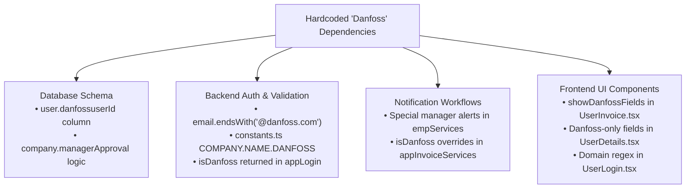

# Document 02: Security & Data Isolation Vulnerability Audit

## 1. Executive Summary

This audit assesses the data isolation, authentication, access control, and architectural integrity of the **Grace Cabs** application codebase. 

While the system successfully manages complex logistics workflows, the analysis reveals **critical security vulnerabilities**, **total lack of company-level data isolation**, and **pervasive customer-specific hardcoding** that present substantial compliance, confidentiality, and scalability risks.

---

## 2. Multi-Tenant Data Isolation Failures

In a multi-company or SaaS environment, strict isolation between corporate clients is non-negotiable. The current codebase treats the application as an operator-only tool with superficial tenant tagging:

### 2.1 Cross-Tenant Data Leakage in Administrative Queries

In [backend/src/services/bookingServices.ts](file:///d:/demobooking/demo-bookings/backend/src/services/bookingServices.ts#L358-L386), the primary `getAllOrders` service method implements an authorization check that segregates data **only** for users with the explicit role `ROLES.USER`:

```typescript
// backend/src/services/bookingServices.ts (Lines 322-386)
if (role === ROLES.USER) {
  const orders = await Booking.findAll({
    // ...
    where: { userId: userid },
    order: [['createdAt', 'DESC']]
  });
  return res.status(200).json({ success: true, data: orders });
} else {
  // 🔴 VULNERABILITY: Any other role (Admin, SuperAdmin, Manager, Employee, Vendor)
  // executes findAll() with NO companyId or tenant filter!
  const orders = await Booking.findAll({
    include: [ /* Vehicle, VehicleType, User, Company */ ],
    order: [['createdAt', 'DESC']]
  });
  return res.status(200).json({ success: true, data: orders });
}
```

#### Impact
- If a corporate manager from **Company A** logs into the portal or accesses the API, the backend executes the `else` branch and returns all bookings, passenger names, phone numbers, and travel trails for **Company B**, **Company C**, and retail customers.
- The same defect exists in [backend/src/controllers/bookingControllers.ts](file:///d:/demobooking/demo-bookings/backend/src/controllers/bookingControllers.ts#L8-L37) across `getConfirmedOrders`, `getPendingOrders`, `getClosedOrders`, `getCompletedOrders`, and `getPaymentCompletedOrders`.

### 2.2 Global Status Endpoints with Zero Tenant Scoping

In [backend/src/services/bookingServices.ts](file:///d:/demobooking/demo-bookings/backend/src/services/bookingServices.ts#L407-L414):
```typescript
export const getOrdersByStatus = async (confirmStatus: number) => {
  return await Booking.findAll({
    where: { confirmStatus },
    include: [{ model: VehicleType }, { model: Vehicle }],
    order: [["createdAt", "DESC"]],
  });
};
```
Every status query dumps platform-wide bookings without evaluating `companyId`.

---

## 3. Critical Security Vulnerabilities

### 3.1 Broken Object-Level Authorization (BOLA / IDOR)

Multiple endpoints rely on user-supplied URL parameters without validating whether the requesting caller owns or has permissions to access the specified record:

| Affected Route | File & Line | Exposure Description |
| :--- | :--- | :--- |
| `GET /api/order/user/:userId/all` | [bookingRoutes.ts:43](file:///d:/demobooking/demo-bookings/backend/src/routes/bookingRoutes.ts#L43) | **Unauthenticated IDOR**: Any anonymous party can enumerate `:userId` and harvest all travel history, passenger names, coordinates, and costs. |
| `GET /api/order/user/:userId/pending` | [bookingRoutes.ts:44](file:///d:/demobooking/demo-bookings/backend/src/routes/bookingRoutes.ts#L44) | **Unauthenticated IDOR**: Exposes pending trips for any user ID without token verification. |
| `GET /api/order/user/:userId/pending-invoices` | [bookingRoutes.ts:45](file:///d:/demobooking/demo-bookings/backend/src/routes/bookingRoutes.ts#L45) | Exposes pending invoices, billing amounts, and corporate cost centers without authentication. |
| `GET /api/invoiceRoutes/invoices/:userId` | [invoiceRoutes.ts:24](file:///d:/demobooking/demo-bookings/backend/src/routes/invoiceRoutes.ts#L24) | Dumps complete invoice details for any arbitrary user without token check. |
| `GET /api/user/getUsersByCompany/:companyId` | [userRoutes.ts:54](file:///d:/demobooking/demo-bookings/backend/src/routes/userRoutes.ts#L54) | Publicly dumps all corporate employees, phone numbers, email addresses, and roles for any company UUID. |
| `GET /api/user/:id/addresses` | [userRoutes.ts:40](file:///d:/demobooking/demo-bookings/backend/src/routes/userRoutes.ts#L40) | Dumps private residential and office addresses without authentication. |

### 3.2 Unauthenticated Sensitive Infrastructure Endpoints

#### 1. Plain-text SMTP Credential Exposure
- **Endpoint**: `GET /api/config/getConfiguration` in [backend/src/routes/configurationRoutes.ts](file:///d:/demobooking/demo-bookings/backend/src/routes/configurationRoutes.ts#L10)
- **Vulnerability**: Completely unauthenticated. Invoking `GET /api/config/getConfiguration` returns the single-row `configuration` table record, which stores:
  ```json
  {
    "smtpServer": "smtp.mailgun.org",
    "smtpEmailAddress": "noreply@mg.gracetravel.in",
    "smtpEmailPassword": "••••••••••••",
    "smtpEmailPort": 25,
    "serviceTaxPercentage": 7.5,
    "dueDays": 7
  }
  ```
- **Exploitation Impact**: An adversary can immediately seize the company's production SMTP server credentials, weaponize the domain for spam/phishing, or intercept corporate password reset messages.

#### 2. Unauthenticated Bulk User Excel Injection
- **Endpoint**: `POST /api/user/upload-users` in [backend/src/routes/userRoutes.ts](file:///d:/demobooking/demo-bookings/backend/src/routes/userRoutes.ts#L18)
- **Vulnerability**: Has no `authMiddleware`. Accepts multipart file uploads directly into `uploads/`.
- **Code Flaw**: In [backend/src/services/userServices.ts](file:///d:/demobooking/demo-bookings/backend/src/services/userServices.ts#L322):
  ```typescript
  // Defaults
  if (!userPayload.password) userPayload.password = "123456"; // 🔴 Plain-text default!
  if (!userPayload.role) userPayload.role = "user";
  if (!userPayload.status) userPayload.status = "active";
  ```
- **Exploitation Impact**: Unauthenticated attackers can upload rogue employee files, overwrite existing user records across companies, and establish accounts with known default passwords (`123456`).

#### 3. Unauthenticated Destructive Invoicing Endpoints
- **`DELETE /api/closePendingOrder/monthlyInvoice/:monthlyInvoiceId`**: Anyone can delete corporate monthly billing statements ([closependingRoutes.ts:37](file:///d:/demobooking/demo-bookings/backend/src/routes/closependingRoutes.ts#L37)).
- **`PUT /api/invoiceRoutes/invoice/cancelInvoice`**: Anyone can cancel finalized trip invoices ([invoiceRoutes.ts:29](file:///d:/demobooking/demo-bookings/backend/src/routes/invoiceRoutes.ts#L29)).
- **`DELETE /api/oncallinvoice/onCallInvoice/:onCallBillId`**: Anyone can purge OnCall invoices ([onCallRoutes.ts:19](file:///d:/demobooking/demo-bookings/backend/src/routes/onCallRoutes.ts#L19)).

---

## 4. The "Danfoss" Problem: Hardcoded Bespoke Client Logic

The platform contains deep, hardcoded branch logic tailored specifically for a client named **Danfoss**. This pattern is an anti-pattern for SaaS applications, making the codebase brittle and creating security leakage risks.

### 4.1 Evidence of Customer Hardcoding



1. **Dedicated Database Column for Single Customer**:
   - In [backend/src/models/user.ts](file:///d:/demobooking/demo-bookings/backend/src/models/user.ts#L36):
     ```typescript
     @Column(DataType.STRING)
     danfossuserId!: string;
     ```
   - An entire column exists in the shared `user` table exclusively for one corporate customer's internal employee numbering scheme.

2. **Hardcoded Corporate Domain Verification**:
   - In [backend/src/services/authServices.ts](file:///d:/demobooking/demo-bookings/backend/src/services/authServices.ts#L325-L334) & [userServices.ts](file:///d:/demobooking/demo-bookings/backend/src/services/userServices.ts#L415-L422):
     ```typescript
     const isDanfoss = company.companyName?.toLowerCase().includes("danfoss");
     if (isDanfoss) {
       if (!normalizedEmail.endsWith("@danfoss.com")) {
         return res.status(400).json({
           success: false,
           message: "For Danfoss company, email must be @danfoss.com only."
         });
       }
     }
     ```

3. **Customer Name Hardcoded into Constants**:
   - In [backend/src/utils/costants.ts](file:///d:/demobooking/demo-bookings/backend/src/utils/costants.ts#L60-L64):
     ```typescript
     export const COMPANY = {
       NAME: {
         DANFOSS: "danfoss"
       }
     }
     ```

4. **Frontend View Bifurcation**:
   - In [frontend/src/SuperAdmin/pages/Users/UserInvoice.tsx](file:///d:/demobooking/demo-bookings/frontend/src/SuperAdmin/pages/Users/UserInvoice.tsx#L374-L380):
     ```typescript
     const isDanfoss =
       name.includes("danfoss") ||
       code.includes("danfoss") ||
       seoUrl.includes("danfoss");
     setShowDanfossFields(isDanfoss);
     ```
   - In [frontend/src/SuperAdmin/pages/Users/UserDetails.tsx](file:///d:/demobooking/demo-bookings/frontend/src/SuperAdmin/pages/Users/UserDetails.tsx#L106-L107):
     ```typescript
     const danfossCompanyId = companyList.find(c => c.companyName.toLowerCase().includes('danfoss'));
     // Renders "Is Manager" checkbox ONLY if formData.companyId === danfossCompanyId
     ```

### 4.2 Impact on Multi-Tenant SaaS Evolution
- **Scalability Blocker**: Onboarding 50 corporate clients would necessitate 50 new column definitions, dozens of hardcoded `if/else` checks, and fragile frontend conditions.
- **Privacy Leak**: Other clients inspecting frontend JavaScript bundles or backend error messages discover proprietary internal identifiers and domain rules belonging to Danfoss.
- **Maintenance Nightmare**: Any change in Danfoss's internal requirements risks regression bugs across all standard clients.

---

## 5. Token, Authentication & Session Deficiencies

### 5.1 Type-Mismatch and JWT Validation Defect

In [backend/src/middleware/authMiddleware.ts](file:///d:/demobooking/demo-bookings/backend/src/middleware/authMiddleware.ts#L4-L28):
```typescript
interface AuthenticatedRequest extends Request {
  userId?: number; // 🔴 In reality, User, Employee, and Driver IDs are UUID strings!
  role?: string;
}

export const authMiddleware = (req: AuthenticatedRequest, res: Response, next: NextFunction) => {
  // ...
  const decoded = jwt.verify(token, process.env.JWT_SECRET!) as {
    userId: number; // 🔴 Expecting number, but token contains UUID string
    roles: string;  // 🔴 Tokens issue 'roles' in some services, but 'role' in others
  };
  req.userId = decoded.userId;
  req.role = decoded.roles;
  next();
};
```
- **Inconsistent Token Signatures**: `empLogin` signs `{ userId, roles }`, whereas `userLogin` signs `{ userId, roles, companyId }`.
- **Missing Tenant Context in Middleware**: The `authMiddleware` extracts `req.userId` and `req.role`, but **completely discards `companyId`**. Downstream service functions do not have access to verified tenant scope from the token.

### 5.2 Client-Side Session Storage Vulnerability

In [frontend/src/SuperAdmin/pages/Login/Login.tsx](file:///d:/demobooking/demo-bookings/frontend/src/SuperAdmin/pages/Login/Login.tsx#L46-L61) and `UserLogin.tsx`:
- JWT tokens, user roles, user IDs, and `companyId` are stored in browser `localStorage`.
- The frontend layout checks permissions using:
  ```typescript
  const role = localStorage.getItem("role"); // 🔴 Insecure! Easily modified via DevTools
  ```
- **Cross-Site Scripting (XSS) Hazard**: Any XSS vulnerability allows complete extraction of all bearer tokens and user credentials stored in `localStorage`.

---

## 6. Shared Sequences and Concurrency Risks

1. **Global Booking Sequence**:
   - [backend/src/models/booking.ts](file:///d:/demobooking/demo-bookings/backend/src/models/booking.ts#L63-L93) uses an atomic sequence table `booking_sequence` keyed strictly by date (`seq_date`).
   - Every booking on the platform shares a sequential counter (`YYYYMMDD0001`, `YYYYMMDD0002`).
   - **Business Intelligence Leak**: Competitors or corporate clients can infer total daily reservation volume simply by monitoring sequential booking codes across consecutive orders.
2. **Invoice Numbering Collisions**:
   - [backend/src/models/invoice.ts](file:///d:/demobooking/demo-bookings/backend/src/models/invoice.ts#L61-L95) attempts to generate per-company invoice numbers, but the lookup relies on extracting numeric suffixes via regex from existing invoice codes rather than transactional atomic locks when `t` is null.

---

## 7. Storage, File Uploads & CORS Configuration

1. **Wildcard Permissive CORS**:
   - In [backend/src/app.ts](file:///d:/demobooking/demo-bookings/backend/src/app.ts#L74-L82):
     ```typescript
     app.use(cors({
       origin: "*", // 🔴 Allows arbitrary domains to make credentialed requests
       methods: ["GET", "POST", "PUT", "DELETE", "PATCH"],
       credentials: true,
       allowedHeaders: ["Content-Type", "Authorization"]
     }));
     ```
2. **Public Unauthenticated Static File Serving**:
   - In [backend/src/app.ts](file:///d:/demobooking/demo-bookings/backend/src/app.ts#L70-L86):
     ```typescript
     app.use('/uploads', express.static(uploadsFolder));
     app.use('/uploads/signature', express.static(path.join(__dirname, '..', '..', 'uploads', 'signature')));
     app.use('/invoices', express.static(path.join(process.cwd(), 'uploads', 'invoices')));
     app.use('/oncallinvoice', express.static(path.join(process.cwd(), 'uploads', 'oncallinvoice')));
     ```
   - **Customer Signatures and Invoices are Public**: Anyone guessing or generating file names in `/uploads/signature/` or `/invoices/` can view passenger signatures, travel routes, employee IDs, and financial bills without logging in.

---

## 8. Prioritized Vulnerability Remediation Matrix

| ID | Vulnerability | Severity | Source Location | Direct Exploit Impact | Recommended Remediation |
| :---: | :--- | :---: | :--- | :--- | :--- |
| **V-01** | Plain-text SMTP Password Exposure | **CRITICAL** | `configurationRoutes.ts:10` | Full compromise of mail infrastructure; phishing. | Require SuperAdmin JWT; never return password in GET response. |
| **V-02** | Unauthenticated User Import | **CRITICAL** | `userRoutes.ts:18` | Arbitrary user creation; mass account takeover. | Require SuperAdmin/Admin JWT; enforce strong bcrypt hashing on import. |
| **V-03** | Cross-Tenant Data Leak in Orders | **HIGH** | `bookingServices.ts:358` | Corporate clients view rival companies' trips & staff. | Enforce row-level tenant filtering (`where: { companyId }`) in all queries. |
| **V-04** | Unauthenticated IDOR Order/User Routes | **HIGH** | `bookingRoutes.ts:43-50` | Scraping of full travel history and passenger data. | Add `authMiddleware`; verify `req.userId === params.userId` or caller is Admin. |
| **V-05** | Unauthenticated Invoice Deletion & Cancellation | **HIGH** | `closependingRoutes.ts:37` & `invoiceRoutes.ts:29` | Malicious deletion of billing and audit records. | Enforce Admin JWT and log immutable audit trails. |
| **V-06** | Hardcoded Client Logic (Danfoss) | **MEDIUM** | `user.ts:36`, `authServices.ts:325`, `UserInvoice.tsx` | Platform cannot scale; brittle; private logic exposed. | Migrate to generic Workflow Rule Engine & dynamic schema attributes. |
| **V-07** | Public Signature & Invoice File Access | **MEDIUM** | `app.ts:70-86` | Exposure of passenger signatures and corporate bills. | Serve static files through authenticated streaming endpoints with signed URLs. |
| **V-08** | Wildcard CORS with Credentials | **MEDIUM** | `app.ts:78` | Cross-site request forgery and token interception. | Restrict CORS to authorized frontend domains and tenant subdomains. |
| **V-09** | Global Sequential Booking Codes | **LOW** | `booking.ts:63` | Volume enumeration and order guessing. | Prefix booking codes with tenant identifier or generate secure random tokens. |
