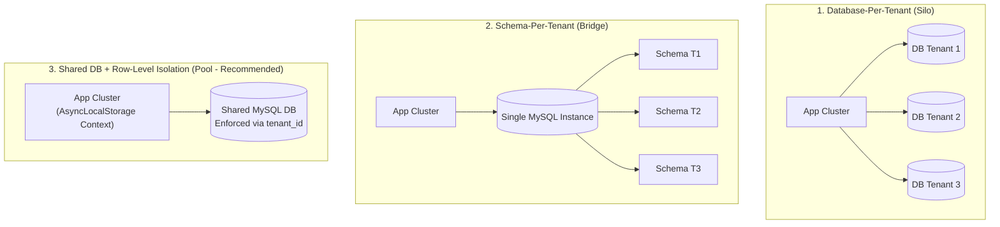
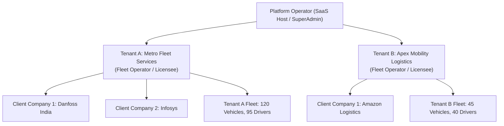
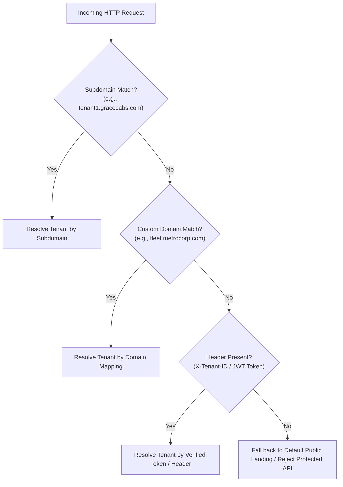
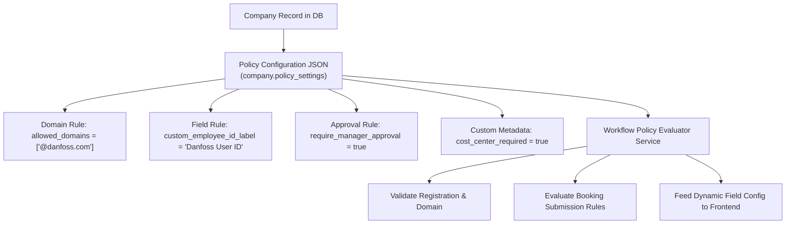
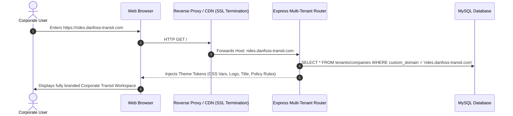

# Document 03: Multi-Tenant SaaS Feasibility & Target Architecture

## 1. Feasibility Assessment

Transitioning the **Grace Cabs** application from a bespoke, operator-centric deployment into a scalable, secure **Multi-Tenant Software-as-a-Service (SaaS)** platform is **highly technically feasible**.

### 1.1 Feasibility Scorecard

| Dimension | Feasibility Rating | Analysis & Justification |
| :--- | :---: | :--- |
| **Data Layer Flexibility** | **HIGH (9/10)** | The data layer already uses Sequelize-TypeScript with UUID primary keys and soft deletes (`isDeleted`). Adding `tenantId` columns and implementing Sequelize global scopes can be executed via non-breaking migrations. |
| **Business Logic Maturity** | **VERY HIGH (9.5/10)** | Core domain workflows (garage/guest distance calculations, tiered pricing, driver tracking, multi-mode invoicing, payment gateway callbacks) are fully developed and mature. |
| **Frontend Modularity** | **MEDIUM-HIGH (8/10)** | The React SPA uses functional components and a unified `PageLayout`. Refactoring requires standardizing styling tokens into CSS variables and replacing hardcoded customer flags with dynamic tenant configuration hooks. |
| **Decoupling Effort** | **MEDIUM (7/10)** | Eliminating customer-specific logic (Danfoss hardcoding) requires migrating bespoke database columns and `if/else` branches into a metadata JSON store and a generic policy evaluation service. |
| **Security & Isolation Lift** | **CRITICAL / HIGH PRIORITY** | Achieving multi-tenant compliance requires introducing strict `authMiddleware` across all unprotected endpoints and binding every SQL query to an active `TenantContext`. |

---

## 2. Evaluation of Tenancy Isolation Models

Selecting the appropriate tenancy model is an architectural trade-off between **data isolation**, **operational complexity**, **infrastructure cost**, and **schema evolution velocity**.



### Comprehensive Comparison Matrix

| Evaluation Criteria | 1. Database-per-Tenant | 2. Schema-per-Tenant | 3. Shared DB with Row-Level Isolation (Recommended) |
| :--- | :--- | :--- | :--- |
| **Data Isolation** | **Maximum**: Physical separation prevents accidental cross-tenant queries. | **High**: Logical schema boundary prevents cross-schema joins by default. | **Medium-High**: Enforced in application ORM layer via global scopes and foreign keys. |
| **Infrastructure Cost** | **High**: Significant connection pooling and database instance overhead. | **Medium**: Single instance, but hundreds of schemas consume memory caches. | **Lowest**: Optimal resource sharing and connection pool reuse. |
| **Schema Migrations** | **Complex**: Must execute DDL migrations across $N$ distinct databases. | **Complex**: Must run migrations across $N$ schemas; high failure risk. | **Simplest**: Single unified schema migration with `sequelize-cli` / `umzug`. |
| **Tenant Onboarding** | **Slow**: Requires programmatic provisioning of new databases and users. | **Moderate**: Requires creating new schema tables on demand. | **Instantaneous**: Single atomic SQL transaction inserts new `Tenant` record. |
| **Reporting & Analytics** | **Very Difficult**: Requires cross-database federated queries or ETL pipelines. | **Difficult**: Requires cross-schema union queries or consolidated warehouse. | **Simplest**: Cross-tenant platform metrics and billing audits queried directly. |
| **Suitability for Grace Cabs**| Overkill for current fleet scale; excessive operational maintenance. | Cumbersome for Sequelize connection management in Node.js. | **Optimal**: Matches the existing Sequelize structure and accelerates time-to-market. |

### Architectural Recommendation
Adopt **Model 3: Shared Database with Strict Row-Level Isolation**, complemented by **Sequelize Global Scopes** and Node.js **`AsyncLocalStorage`**. For high-compliance enterprise tiers, provide a dedicated database option (hybrid silo/pool).

---

## 3. Recommended Target Architecture

### 3.1 Tenant Hierarchy & Terminology

In the target multi-tenant SaaS model, the hierarchy is structured into three clear levels:



1. **Platform Operator (SuperAdmin)**: The SaaS platform owner managing tenant accounts, global subscriptions, billing tiers, and system health.
2. **Tenant (`tenant_id`)**: A fleet operator, cab company, or enterprise fleet manager subscribing to the platform. Owns its independent fleet, drivers, pricing packages, branding, and billing accounts.
3. **Company (`company_id`)**: A B2B corporate client of a specific Tenant (e.g., Danfoss contracting Metro Fleet Services for staff transit).

---

## 4. Implementation Design: Tenant Context & Row-Level Isolation

### 4.1 Tenant Context via `AsyncLocalStorage`

To prevent accidental data leakage across concurrent asynchronous requests, the application utilizes Node.js native `AsyncLocalStorage` to store the active tenant context for each HTTP execution thread.

```typescript
// Proposed: backend/src/context/tenantContext.ts
import { AsyncLocalStorage } from "async_hooks";

export interface TenantContextData {
  tenantId: string;
  userId: string;
  role: string;
  companyId?: string;
}

export const tenantStorage = new AsyncLocalStorage<TenantContextData>();

export const getTenantContext = (): TenantContextData => {
  const context = tenantStorage.getStore();
  if (!context) {
    throw new Error("Security Violation: Operation invoked outside active TenantContext");
  }
  return context;
};
```

### 4.2 Tenant Identification Strategies

The target architecture resolves the tenant identity through three prioritized mechanisms:



### 4.3 Automated Sequelize Global Scopes

Every tenant-owned entity (`Booking`, `User`, `Vehicle`, `Drivers`, `Vendor`, `Invoice`, `PackageData`, `ClosePending`) inherits a mandatory `tenantId` foreign key and an automatic Sequelize scope:

```typescript
// Proposed: Tenant-Aware Model Scope Pattern
@DefaultScope(() => {
  const ctx = tenantStorage.getStore();
  // SuperAdmin global operations bypass scope when explicitly requested
  if (!ctx || ctx.role === "SUPERADMIN_GLOBAL") {
    return { where: { isDeleted: false } };
  }
  return {
    where: {
      tenantId: ctx.tenantId,
      isDeleted: false,
    },
  };
})
@Table({ tableName: 'booking' })
export class Booking extends Model {
  @ForeignKey(() => Tenant)
  @Column({ type: DataType.UUID, allowNull: false })
  tenantId!: string;

  // ... remaining existing fields
}
```

#### Benefit
Service functions calling `Booking.findAll()` or `Invoice.findOne()` will **automatically** include `WHERE tenantId = ?` at the database engine level, mathematically eliminating cross-tenant data leakage.

---

## 5. Decoupling the "Danfoss" Problem: The Generic Policy Engine

To eliminate customer-specific hardcoding, custom business requirements must be transformed into a dynamic, rule-based **Policy Configuration Engine**.

### 5.1 Architecture of the Policy Engine



### 5.2 Schema Definition for Dynamic Tenant/Company Policies

```typescript
// Proposed: Generic Policy Settings Structure
export interface CompanyPolicySettings {
  branding: {
    customLogoUrl?: string;
    portalTitle?: string;
  };
  identity: {
    allowedEmailDomains: string[];        // e.g. ["@danfoss.com"] or ["@client.com"]
    employeeIdLabel: string;             // e.g. "Danfoss User ID" or "Employee Number"
    requireCostCenter: boolean;
    requireDepartment: boolean;
  };
  bookingWorkflow: {
    requireManagerApproval: boolean;
    approvalThresholdAmount?: number;    // e.g. Auto-approve if < ₹1,500
    allowSelfBookingOnBehalf: boolean;
    minAdvanceBookingMinutes: number;    // e.g. 60 mins
    allowNightTravel: boolean;
  };
  invoicing: {
    billingCycle: "TRIP" | "ON_CALL" | "MONTHLY";
    taxExempt: boolean;
    customInvoicePrefix?: string;
  };
}
```

### 5.3 Extensible User Metadata

Rather than altering database schemas with bespoke columns (`danfossuserId`), the `user` table will utilize a structured `metadata` JSON field:

```typescript
// In User Model:
@Column({
  type: DataType.JSON,
  allowNull: true,
  defaultValue: {},
})
metadata!: Record<string, any>; // Stores { corporateEmpId: "D12345", costCenter: "CC-902" }
```

---

## 6. Dynamic White-Labeling & Custom Domain Routing

To enable SaaS customers to offer a fully branded experience to their corporate accounts, the platform incorporates a dynamic white-labeling subsystem:



### Frontend Theme Token Injection

The frontend layout inspects the active tenant profile and applies dynamic CSS variables to the DOM root:

```typescript
// In Frontend Root Theme Provider:
export const applyTenantTheme = (branding: TenantBranding) => {
  document.documentElement.style.setProperty('--primary-color', branding.primaryColor || '#275981');
  document.documentElement.style.setProperty('--secondary-color', branding.secondaryColor || '#1e40af');
  document.title = branding.companyName ? `${branding.companyName} | Fleet Portal` : 'Mobility Portal';
};
```

---

## 7. Tenant-Isolated Sequencing Architecture

To replace the vulnerable global `booking_sequence` and prevent business intelligence leakage:
1. Re-structure sequence counters to be strictly composite-keyed by `[tenant_id, financial_year, sequence_type]`.
2. Generate tenant-prefixed booking codes: `[TENANT_CODE]-[YYYYMMDD]-[0001]`.
3. Provide corporate clients the option to configure independent invoice series prefixes.
