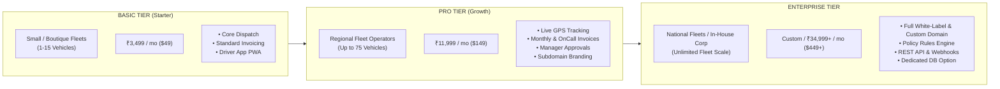
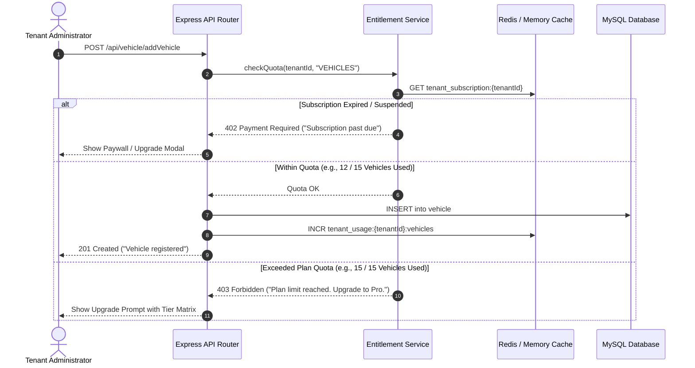

# Document 04: Subscription Tiers & Commercial Model

## 1. Commercial Strategy & Market Positioning

Transforming **Grace Cabs** into a commercial Multi-Tenant SaaS platform enables fleet operators, regional taxi companies, and enterprise corporate logistics departments to leverage a battle-tested mobility management backend on a modern subscription model.

### 1.1 Monetization Model
The platform adopts a **Hybrid SaaS Commercial Structure**:
1. **Predictable Base Subscription Fee**: Monthly or annual recurring platform access tiered by operational scale.
2. **Value-Metric Capacity Quotas**: Primary limits anchored to **Active Fleet Size (Vehicles & Drivers)** and **Corporate Accounts (B2B Client Companies)**.
3. **Usage-Based Telemetry & API Metering**: Pass-through or metered billing for high-cost variable services (SMS OTP notifications via Twilio/2Factor, Google Maps geocoding telemetry via `MapCount`, and storage for digital signatures and invoices).

---

## 2. Product Subscription Tiers



---

## 3. Comprehensive Feature Entitlement & Quota Matrix

| Feature / Resource Entitlement | Basic Tier (Starter) | Pro Tier (Growth) | Enterprise Tier |
| :--- | :---: | :---: | :---: |
| **Target Customer** | Local operators, boutique car rentals | Mid-market regional fleet operators | Large aggregators, nationwide fleets, in-house corporate transit |
| **Monthly Pricing (Indicative)** | ₹3,499 / month | ₹11,999 / month | Starting at ₹34,999 / month |
| **Annual Pricing (Discounted)** | ₹34,990 / year | ₹1,19,990 / year | Custom Enterprise SLA |
| **Active Vehicle Fleet Limit** | Up to **15 Vehicles** | Up to **75 Vehicles** | **Unlimited** (Metered packages) |
| **Active Driver Limit** | Up to **15 Drivers** | Up to **75 Drivers** | **Unlimited** |
| **Corporate Accounts (`Company`)** | Up to **3 Companies** | Up to **20 Companies** | **Unlimited** |
| **Monthly Trip Volume** | Up to 1,000 trips / month | Up to 10,000 trips / month | Unlimited |
| **Trip Dispatch & Management** | ✅ Standard manual dispatch | ✅ Automated & manual dispatch | ✅ Intelligent automated allocation |
| **Driver Application Access** | ✅ Web PWA access | ✅ Dedicated mobile app / PWA | ✅ Custom-branded Driver App (Play Store) |
| **Live GPS Tracking & Telemetry** | ❌ Odometer log only | ✅ Real-time map tracking | ✅ Real-time tracking + playback trails |
| **Single-Trip Retail Invoicing** | ✅ Included | ✅ Included | ✅ Included |
| **On-Call Multi-Trip Invoicing** | ❌ Not included | ✅ Included | ✅ Included |
| **Monthly Consolidated Invoicing**| ❌ Not included | ✅ Included | ✅ Included |
| **Passenger Digital Signatures** | ✅ Standard upload | ✅ High-resolution cloud storage| ✅ Legally compliant digital audit trail |
| **Corporate Manager Ride Approvals**| ❌ Auto-confirm only | ✅ Single-tier manager approval | ✅ Multi-tier hierarchical approval engine |
| **Custom Workflow Policy Engine**| ❌ Standard rules | ❌ Standard rules | ✅ **Included** (Domain restrictions, bespoke employee codes, custom workflows) |
| **Branding & White-Labeling** | Shared SaaS portal | Tenant Subdomain (`operator.fleetapp.com`) | **Full White-Label** on Custom Domain (`rides.operator.com`) + Custom CSS |
| **Email Infrastructure** | Shared system SMTP | Custom SMTP server credentials | Dedicated IP pool & custom DKIM/SPF |
| **SMS OTP / Notifications** | 500 SMS / month included | 5,000 SMS / month included | Enterprise volume rates / BYO Gateway |
| **Payment Gateway Integration** | Manual cash/bank transfer | Integrated PG (Razorpay/Stripe) | Multi-merchant payment gateway support |
| **Bulk User Excel Upload** | ❌ Manual user entry | ✅ Standard Excel import | ✅ Advanced import with LDAP/SSO sync |
| **Audit Logs & Data Retention** | 90 days retention | 1 year retention | 7 years / Permanent audit trail |
| **REST API & Webhook Access** | ❌ No API access | ❌ Read-only reporting API | ✅ Full Bi-directional REST API & Webhooks |
| **Database Deployment Model** | Shared multi-tenant pool | Shared multi-tenant pool | Shared Pool OR Dedicated DB Silo |
| **Support SLA** | Email support (48h SLA) | Priority email & chat (12h SLA) | Dedicated Account Manager & 24/7 (1h SLA)|

---

## 4. Overage Charges & Metered Billing Rules

To preserve platform margin and prevent infrastructure abuse, usage beyond plan allowances is metered and billed automatically:

| Metered Component | In-Plan Allowance | Overage Rate | Telemetry Source |
| :--- | :--- | :--- | :--- |
| **Additional Vehicles** | Plan maximum | ₹150 / vehicle / month | `COUNT(vehicle) WHERE isDeleted=false` |
| **Additional Drivers** | Plan maximum | ₹120 / driver / month | `COUNT(drivers) WHERE isDeleted=false` |
| **Additional Corporate Companies**| Plan maximum | ₹499 / company / month | `COUNT(company) WHERE isDeleted=false` |
| **Transactional SMS** | Tier allotment | ₹0.30 per additional SMS | `COUNT(otps)` + Twilio/2Factor API logs |
| **Google Maps Geocoding** | 1,000 calls / month | ₹2.50 per 100 queries | Database `MapCount` telemetry model |
| **Document Cloud Storage** | 5 GB (Basic) / 25 GB (Pro)| ₹15 per additional GB | S3 / Cloud Storage bucket metrics |

---

## 5. Billing Engine & Entitlement Enforcement Architecture

### 5.1 Real-Time Entitlement Gatekeeper Middleware

Every administrative mutation (e.g., adding a vehicle, creating a driver, or onboarding a new company) is intercepted by an **Entitlement Enforcement Middleware** that checks the active subscription status and quota limits:



### 5.2 Subscription Entity Data Model

```typescript
// Proposed: SaaS Subscription Models
@Table({ tableName: 'tenant_subscriptions' })
export class TenantSubscription extends Model {
  @PrimaryKey
  @Column({ type: DataType.UUID, defaultValue: DataType.UUIDV4 })
  subscriptionId!: string;

  @ForeignKey(() => Tenant)
  @Column(DataType.UUID)
  tenantId!: string;

  @Column(DataType.ENUM('BASIC', 'PRO', 'ENTERPRISE'))
  planTier!: 'BASIC' | 'PRO' | 'ENTERPRISE';

  @Column(DataType.ENUM('ACTIVE', 'PAST_DUE', 'CANCELED', 'TRIALING'))
  status!: 'ACTIVE' | 'PAST_DUE' | 'CANCELED' | 'TRIALING';

  @Column(DataType.INTEGER)
  vehicleQuota!: number;

  @Column(DataType.INTEGER)
  driverQuota!: number;

  @Column(DataType.INTEGER)
  companyQuota!: number;

  @Column(DataType.STRING)
  paymentGatewaySubscriptionId!: string; // Stripe or Razorpay Subscription ID

  @Column(DataType.DATE)
  currentPeriodStart!: Date;

  @Column(DataType.DATE)
  currentPeriodEnd!: Date;

  @Column(DataType.DATE)
  trialEndsAt!: Date;
}
```

### 5.3 Automated Lifecycle Management & Webhooks
1. **Recurring Invoicing via Payment Gateways**: Automated recurring subscription charge via Razorpay Subscriptions / Stripe Billing.
2. **Dunning & Grace Periods**:
   - Payment Failure Webhook (`invoice.payment_failed`): Status changes to `PAST_DUE`. A 5-day grace period is granted with automated email reminders.
   - Grace Period Expiry: Read-only access enabled; trip dispatch and new booking creations blocked until payment resolution.
3. **Prorated Upgrades**: Customers can upgrade instantly from Basic to Pro with prorated credit calculation.
