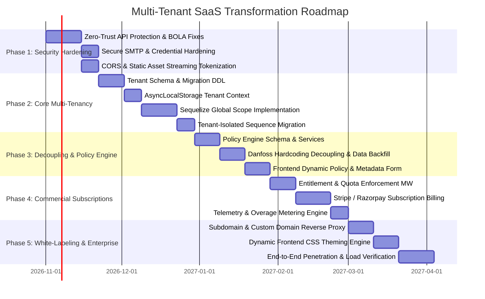
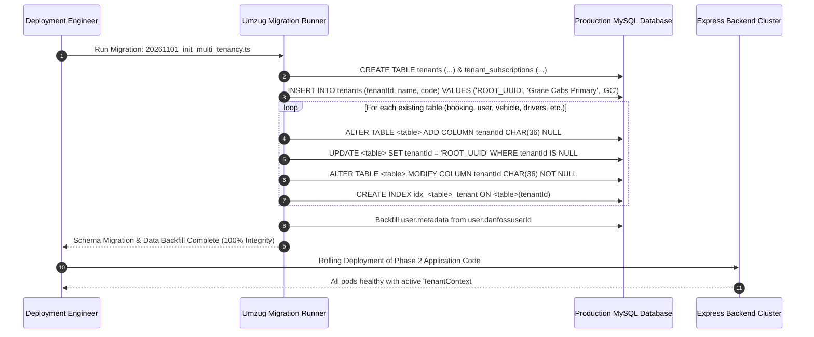

# Document 05: Gap Analysis & Migration Roadmap

## 1. Executive Gap Analysis

This analysis contrasts the current state of the **Grace Cabs** application against the target **Multi-Tenant SaaS Platform**. It outlines the architectural, data, security, and operational transitions required to execute this modernization without service interruption.

---

## 2. Comprehensive Architectural Gap Matrix

| Architectural Domain | Current State (Monolithic / Bespoke) | Target State (Multi-Tenant SaaS) | Gap Severity | Implementation Complexity |
| :--- | :--- | :--- | :---: | :---: |
| **Tenant Isolation** | Single-tenant database model. All records share common tables. Non-user queries (`getAllOrders`) return cross-tenant data. | Strict row-level isolation via `tenant_id` foreign keys and automatic Sequelize global scopes on all 37+ entities. | **CRITICAL** | Medium (3-4 weeks) |
| **Tenant Context** | No tenant awareness in Express middleware. Tenant information discarded during JWT decode. | Asynchronous execution context via Node.js native `AsyncLocalStorage` (`tenantStorage`). | **CRITICAL** | Low (1 week) |
| **API Authorization** | Multiple sensitive endpoints unauthenticated (SMTP config, user import, user order history, invoice deletion). | Zero-Trust API architecture. 100% authenticated endpoints via strict JWT + Role & Tenant validation. | **CRITICAL** | Low-Medium (1-2 weeks) |
| **Customer Hardcoding**| Customer-specific column (`danfossuserId`), hardcoded email domain checks (`@danfoss.com`), and custom UI flags. | Configurable **Workflow Policy Engine** storing dynamic rules and user metadata in structured JSON payloads. | **HIGH** | Medium (2 weeks) |
| **Sequence Numbering** | Global atomic booking sequence (`booking_sequence`) leaks daily operational volume across all clients. | Per-tenant, per-financial-year composite sequences (`[tenant_id, financial_year, seq_type]`). | **MEDIUM** | Low (1 week) |
| **Static File Security** | Signatures and invoices served publicly from `/uploads/` and `/invoices/` via `express.static`. | Authenticated asset streaming via presigned URLs or signed token middleware. | **HIGH** | Low (1 week) |
| **Branding & Theming** | Hardcoded Grace Cabs logo and palette. Danfoss branding hardcoded conditionally. | Dynamic White-Labeling Engine with CSS variable injection, per-tenant subdomains, and custom domains. | **MEDIUM** | Medium (2-3 weeks) |
| **Billing & Quotas** | Manual billing for cab trips. No platform subscription, seat quota, or fleet limit enforcement. | Integrated SaaS Subscription Engine (Basic, Pro, Enterprise) with Stripe/Razorpay automated billing. | **HIGH** | Medium-High (3 weeks) |
| **CORS Configuration** | Wildcard permissive CORS (`origin: "*"`) with credentials enabled. | Strict CORS origin reflection restricted to verified tenant subdomains and custom domains. | **MEDIUM** | Low (1-2 days) |

---

## 3. Five-Phase Engineering Roadmap

---

### Phase 1: Security Hardening & Zero-Trust Foundation (Weeks 1–3)
**Objective**: Eliminate critical attack vectors, plug data leakage holes, and secure administrative infrastructure without disrupting daily operations.

#### Detailed Action Items
1. **Fix Broken Object-Level Authorization (IDOR)**:
   - Add `authMiddleware` to all unprotected endpoints in [backend/src/routes/bookingRoutes.ts](file:///d:/demobooking/demo-bookings/backend/src/routes/bookingRoutes.ts#L43-L50) (`/user/:userId/*`).
   - Implement ownership validation: Verify that `req.userId === req.params.userId` or caller role is `admin` / `superadmin`.
2. **Seal Credential & Infrastructure Exposures**:
   - Protect `GET /api/config/getConfiguration`. Redact sensitive fields (`smtpEmailPassword`) from standard responses.
   - Enforce authentication on `POST /api/user/upload-users`. Enforce Bcrypt hashing for default passwords rather than plain text.
   - Enforce authentication on `DELETE /api/closePendingOrder/monthlyInvoice/:id` and `PUT /api/invoiceRoutes/invoice/cancelInvoice`.
3. **CORS & Static Asset Protection**:
   - Restrict CORS origin in [backend/src/app.ts](file:///d:/demobooking/demo-bookings/backend/src/app.ts#L74) to verified application hostnames.
   - Wrap `/uploads/signature/` and `/invoices/` behind signed token validation or authenticated streaming controllers.

---

### Phase 2: Core Multi-Tenancy & Row-Level Data Isolation (Weeks 4–7)
**Objective**: Implement logical data isolation across all database models, binding all operations to an active tenant context.

#### Detailed Action Items
1. **Database DDL Evolution**:
   - Create the `tenants` and `tenant_subscriptions` tables.
   - Execute an atomic migration script adding `tenantId` (UUID) with index and foreign key across all 37 core tables.
2. **Implement `TenantContext` Infrastructure**:
   - Create `tenantStorage` utilizing Node.js `AsyncLocalStorage`.
   - Implement `tenantResolutionMiddleware` to extract tenant identity from Subdomain, Custom Domain, or JWT claims.
3. **Automate Sequelize Model Scoping**:
   - Apply a base `@DefaultScope` to all models appending `where: { tenantId }`.
   - Refactor `getAllOrders` and `getOrdersByStatus` to rely on ORM scoping rather than ad-hoc queries.
4. **Isolate Sequence Generators**:
   - Refactor `booking_sequence` and `invoice_sequence` to maintain counters scoped by `[tenantId, financialYear]`.

---

### Phase 3: Generic Workflow Policy Engine & Decoupling Danfoss Logic (Weeks 8–10)
**Objective**: Abstract bespoke customer logic into a flexible, metadata-driven rules engine.

#### Detailed Action Items
1. **Create Policy Configuration Model**:
   - Implement `company_policies` table storing JSON policy definitions (email domains, required fields, approval conditions).
   - Add `metadata` JSON column to `user` model to hold custom client fields.
2. **Execute Danfoss Logic Decoupling**:
   - Migrate existing Danfoss entries into a dedicated `CompanyPolicy` record (`allowedEmailDomains = ["@danfoss.com"]`, `employeeIdLabel = "Danfoss User ID"`).
   - Backfill `user.danfossuserId` values into `user.metadata.corporateEmpId`.
   - Remove hardcoded `companyName.includes("danfoss")` checks from [authServices.ts](file:///d:/demobooking/demo-bookings/backend/src/services/authServices.ts#L325) and [userServices.ts](file:///d:/demobooking/demo-bookings/backend/src/services/userServices.ts#L415).
3. **Frontend Dynamic Adaptation**:
   - Refactor [frontend/src/SuperAdmin/pages/Users/UserInvoice.tsx](file:///d:/demobooking/demo-bookings/frontend/src/SuperAdmin/pages/Users/UserInvoice.tsx) to replace `showDanfossFields` with dynamic policy checks (`companyPolicy.identity.requireCorporateId`).

---

### Phase 4: Subscription Billing Engine & Metering (Weeks 11–13)
**Objective**: Build the monetization infrastructure to bill tenant operators and enforce fleet limits.

#### Detailed Action Items
1. **Entitlement Gatekeeper Middleware**:
   - Intercept vehicle, driver, and company creation APIs with real-time quota verification against the active subscription tier.
2. **Payment Gateway Integration**:
   - Integrate Stripe Billing / Razorpay Subscriptions for automated recurring plan fees.
   - Handle webhook lifecycle events (`invoice.payment_succeeded`, `invoice.payment_failed`, `subscription.canceled`).
3. **Telemetry & Metering Tracking**:
   - Connect SMS dispatches and Google Maps geocoding (`MapCount`) to the metered usage billing engine.
   - Build SuperAdmin Tenant Management Console to monitor MRR, active fleets, and platform health.

---

### Phase 5: Dynamic White-Labeling, Custom Domains & Enterprise Polish (Weeks 14–16)
**Objective**: Deliver full white-label capabilities for enterprise tenants and execute comprehensive load/security verification.

#### Detailed Action Items
1. **Subdomain & Custom Domain Routing**:
   - Configure reverse proxy (Cloudflare SSL for SaaS / Nginx) to terminate custom domain SSL and forward host headers.
   - Build DNS verification service allowing tenants to point CNAME records to the platform.
2. **Dynamic Frontend Theming**:
   - Implement CSS variable theme injection at frontend initialization based on tenant branding tokens.
3. **Comprehensive Security & Load Audit**:
   - Execute penetration tests verifying that cross-tenant data access is impossible under all conditions.

---

## 4. Zero-Downtime Data Migration Plan

To upgrade existing production deployments without downtime or data loss:

### Migration Execution Procedure

### Rollback Strategy & Failsafe
1. **Pre-Migration Snapshot**: Full binary snapshot of the MySQL database prior to migration execution.
2. **Non-Destructive DDL**: The legacy `danfossuserId` column and existing tables are retained in a read-only state during Phase 2 to allow instant codebase rollback if unexpected anomalies occur.
3. **Continuous Data Validation**: Automated checksum verification comparing pre-migration and post-migration booking and invoice totals.
