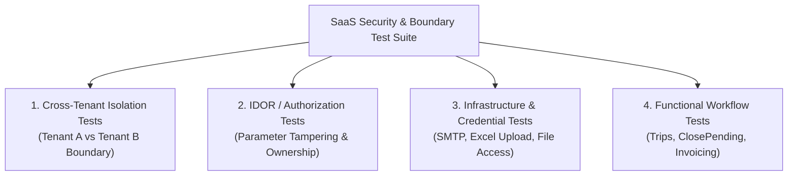
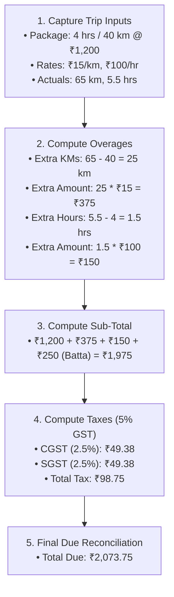
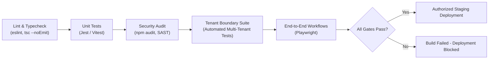

# Document 06: Testing & Verification Checklist

## 1. Executive Quality Assurance Mandate

Transitioning the **Grace Cabs** application into an enterprise-grade Multi-Tenant SaaS platform requires a rigorous, automated verification protocol. This document outlines the test suites, security boundary penetration procedures, and acceptance criteria necessary to guarantee absolute data isolation, eliminate vulnerabilities, and verify billing and workflow accuracy.

---

## 2. Multi-Tenant Boundary & Security Penetration Test Suite

### 2.1 Cross-Tenant Data Isolation Test Matrix

| Test Case ID | Test Objective | Execution Method | Expected Result | Pass/Fail Criteria |
| :---: | :--- | :--- | :--- | :--- |
| **SEC-01** | Cross-Tenant Order Fetch by ID | Issue `GET /api/order/details/:bookingCode` for a Tenant B order using a Tenant A JWT token. | Response must return `404 Not Found` or `403 Forbidden`. | **CRITICAL**: Any disclosure of Tenant B data is an immediate build blocker. |
| **SEC-02** | Cross-Tenant List Isolation | Issue `GET /api/order/getAllOrders` using Tenant A Admin token. | Result array contains **only** records matching Tenant A's `tenantId`. | **CRITICAL**: Zero records from Tenant B or Root may appear. |
| **SEC-03** | Cross-Tenant Mutation Attempt | Issue `PUT /api/order/editBooking/:bookingId` targeting Tenant B trip using Tenant A token. | Response `404 Not Found` or `403 Forbidden`. Record remains unmodified. | **CRITICAL**: Mutation must be blocked at ORM scope level. |
| **SEC-04** | Cross-Tenant Driver Assignment | Attempt to assign a Driver belonging to Tenant B to a Booking belonging to Tenant A. | Foreign key constraint or ORM validation error (`400 Bad Request`). | **CRITICAL**: Drivers cannot be shared across tenant boundaries. |
| **SEC-05** | Cross-Tenant Invoice PDF Stream | Issue `GET /app/appInvoiceRoutes/download/invoice/:fileName` using token issued to Tenant A for Tenant B invoice. | Response `403 Forbidden` (`Token not valid for this file`). | **CRITICAL**: Invoices must be isolated. |
| **SEC-06** | Cross-Tenant User Enumeration | Issue `GET /api/user/getUsersByCompany/:companyId` for Tenant B company using Tenant A token. | Response `404 Not Found` or `403 Forbidden`. | Zero user records returned. |

---

### 2.2 Broken Object-Level Authorization (IDOR) Test Matrix

| Test Case ID | Test Objective | Execution Method | Expected Result | Pass/Fail Criteria |
| :---: | :--- | :--- | :--- | :--- |
| **IDOR-01** | Anonymous Order History Scrape | Issue `GET /api/order/user/:userId/all` without `Authorization` header. | Server must immediately reject with `401 Unauthorized`. | No user or trip information disclosed. |
| **IDOR-02** | User-to-User Order Snooping | User X requests `GET /api/order/user/:userId/all` specifying User Y's UUID. | Server rejects with `403 Forbidden` (Caller does not match target user). | User X cannot inspect User Y's private rides. |
| **IDOR-03** | Anonymous Invoice Scrape | Issue `GET /api/invoiceRoutes/invoices/:userId` without bearer token. | Server rejects with `401 Unauthorized`. | Zero invoice data returned. |
| **IDOR-04** | Anonymous Invoice Cancellation | Issue `PUT /api/invoiceRoutes/invoice/cancelInvoice` without admin token. | Server rejects with `401 Unauthorized`. Invoice status unchanged. | Bill status remains unaltered. |
| **IDOR-05** | Anonymous Monthly Invoice Deletion | Issue `DELETE /api/closePendingOrder/monthlyInvoice/:id` without admin token. | Server rejects with `401 Unauthorized`. Record preserved. | Zero data loss. |

---

### 2.3 Credential & Infrastructure Hardening Test Matrix

| Test Case ID | Test Objective | Execution Method | Expected Result | Pass/Fail Criteria |
| :---: | :--- | :--- | :--- | :--- |
| **INF-01** | Plain-text SMTP Password Leakage | Issue `GET /api/config/getConfiguration` unauthenticated and authenticated. | Unauthenticated: `401 Unauthorized`. Authenticated: `smtpEmailPassword` field redacted (`null` or omitted). | Plain-text password must never appear in API responses. |
| **INF-02** | Unauthenticated User Import | Issue `POST /api/user/upload-users` with multipart Excel payload without token. | Server rejects with `401 Unauthorized`. No file saved to disk. | Uploads blocked without valid credentials. |
| **INF-03** | Default Password Bcrypt Hashing | Execute valid Excel user upload for users with no password specified. | Database `user.password` must contain valid Bcrypt hash (`$2b$10$...`), never plain text `123456`. | `bcrypt.compare("123456", hash)` evaluates to `true`. |
| **INF-04** | Public Signature Asset Exposure | Issue `GET /uploads/signature/passenger_sig.png` directly from web browser. | Server rejects with `401 Unauthorized` or `403 Forbidden` unless authorized signed token is presented. | Direct static directory traversal blocked. |
| **INF-05** | CORS Policy Enforcement | Issue HTTP request from origin `https://malicious-site.com` with credentials. | Response headers do **not** return `Access-Control-Allow-Origin: *`. Preflight rejected. | Cross-site unauthorized requests blocked. |

---

## 3. Functional Workflow & Calculation Verification Checklist

### 3.1 Trip Lifecycle & ClosePending Pricing Reconciliation

- [ ] **Package Matching**: Correct package identified based on selected `vehicleType` and company package matrix.
- [ ] **Garage vs Guest Selection**: System applies garage-to-garage or guest-to-guest distance based on corporate contract setting.
- [ ] **Overage Calculation Precision**:
  - `additionalKmsAmount = MAX(0, actualKms - pkgKms) * additionalKmRate` (Verified to 2 decimal places).
  - `additionalHoursAmount = MAX(0, actualHours - pkgHours) * additionalHourRate` (Verified to 2 decimal places).
- [ ] **Driver Allowances & Extra Charges**: Night batta and outstation day batta added correctly based on timestamps.
- [ ] **Tax Breakdown Integrity**:
  - Intra-state trip: CGST (50% of tax rate) + SGST (50% of tax rate) correctly separated.
  - Inter-state trip: IGST (100% of tax rate) applied.
  - Tax-exempt corporate clients (`allowTax = false`): Zero tax charged.

---

### 3.2 Invoicing Multi-Paradigm Verification

- [ ] **Single-Trip Retail Invoice**:
  - Generated synchronously upon `createClosePending`.
  - PDF compiled via Puppeteer headless browser within $\le 2.5$ seconds.
  - Numbering conforms to `[COMPANY_CODE]-[YY-YY]-[SEQ]`.
- [ ] **On-Call Consolidated Invoicing**:
  - Unbilled completed trips correctly aggregated into `onCallInvoiceItems`.
  - Trips marked as billed to prevent double-invoicing.
  - Subtotals and consolidated tax summaries match the mathematical sum of individual line items.
- [ ] **Monthly Recurring Corporate Invoicing**:
  - Daily fixed route items and vehicle rentals aggregated correctly for selected month.
  - Sequence generator maintains unique sequential codes per corporate client.

---

### 3.3 Dynamic Policy Engine & Danfoss Decoupling Verification

- [ ] **Domain Validation**:
  - Corporate client with `allowedEmailDomains: ["@danfoss.com"]` accepts `john.doe@danfoss.com`.
  - Rejects `john.doe@gmail.com` with localized error: `"Email domain not permitted for this organization"`.
  - Corporate client without domain restriction permits standard business emails.
- [ ] **Dynamic Employee ID**:
  - UI displays `"Danfoss User ID"` when company policy specifies `employeeIdLabel: "Danfoss User ID"`.
  - UI displays `"Staff Code"` when company policy specifies `employeeIdLabel: "Staff Code"`.
  - Stored cleanly in `user.metadata.corporateEmpId` without schema alterations.
- [ ] **Manager Approval Rule**:
  - When `requireManagerApproval: true`, booking enters `PENDING` state and triggers manager email.
  - When `requireManagerApproval: false`, booking auto-confirms into `CONFIRMED` state.

---

## 4. Performance, Load & Concurrency Test Protocol

| Test Scenario | Concurrency & Load Target | Success Benchmark | Monitoring Metric |
| :--- | :--- | :--- | :--- |
| **Concurrent Booking Creation** | 100 simultaneous reservations submitted within 1 second. | Zero duplicate booking codes; 100% successful inserts; zero MySQL deadlock errors. | Atomic transaction duration $\le 150\text{ms}$. |
| **Multi-Tenant API Throughput** | 500 requests/sec across 50 simulated tenants for 10 minutes. | Zero cross-tenant data leakage; $p95$ latency $\le 250\text{ms}$; error rate $< 0.1\%$. | Node.js event loop lag $\le 20\text{ms}$; MySQL CPU $\le 65\%$. |
| **Concurrent PDF Generation** | 20 concurrent invoice PDF compile requests. | All PDFs generated without Chromium memory leaks; server memory remains stable. | Puppeteer worker pool memory $\le 1.2\text{GB}$. |
| **Sequence Counter Atomicity** | 50 concurrent invoice finalizations for the same tenant. | Sequences increment strictly from $N$ to $N+50$ with zero collisions or gaps. | Database transaction lock wait $\le 300\text{ms}$. |

---

## 5. Automated CI/CD Quality Gates

Prior to merging any pull request into the SaaS repository branch, the following automated gates must pass:

1. **Static Analysis & Typecheck**: `npm run build` executes without TypeScript compilation warnings or any untyped `any` leaks in tenant context.
2. **Automated Tenant Boundary Test Suite**: Suite of 25+ integration tests attempting unauthorized cross-tenant read, write, update, and delete actions. If even one test returns data across a tenant boundary, the CI pipeline fails immediately.
3. **Dependency Vulnerability Scan**: Zero high or critical vulnerabilities permitted in `npm audit`.
4. **Code Coverage Threshold**: Minimum 85% code coverage across `tenantContext`, `authMiddleware`, and `closependingorderServices`.
