# Grace Cabs Platform — Architecture Analysis & Multi-Tenant SaaS Transformation Dossier

## Executive Overview

This documentation dossier represents a comprehensive architectural, security, database, and feasibility analysis of the **Grace Cabs Fleet & Corporate Mobility Management Platform** (`demobooking / demo-bookings`). It details the current state of the application, audits company-level data isolation and security vulnerabilities, evaluates the transition to a modern **Multi-Tenant Software-as-a-Service (SaaS)** architecture, designs commercial subscription tiers, and delivers an actionable engineering migration roadmap with test suites.

---

## Document Index & Navigation

| Document | Title | Scope & Key Highlights |
| :--- | :--- | :--- |
| **[01_EXISTING_SYSTEM_ARCHITECTURE.md](./01_EXISTING_SYSTEM_ARCHITECTURE.md)** | **Existing System Architecture & Technical Specifications** | Complete full-stack breakdown (React 19 + Express 5 + Sequelize/MySQL), 37+ data models, entity relationships, user roles & RBAC matrix, complete API catalog (27+ route files), and end-to-end trip & invoice lifecycles. |
| **[02_SECURITY_AND_DATA_ISOLATION_AUDIT.md](./02_SECURITY_AND_DATA_ISOLATION_AUDIT.md)** | **Security & Data Isolation Vulnerability Audit** | Critical audit of tenant leakage, Broken Object-Level Authorization (BOLA/IDOR), unauthenticated endpoints exposing SMTP credentials and user databases, hardcoded client logic (e.g., Danfoss bespoke overrides), and plain-text fallback credentials. |
| **[03_MULTI_TENANT_SAAS_FEASIBILITY_AND_ARCHITECTURE.md](./03_MULTI_TENANT_SAAS_FEASIBILITY_AND_ARCHITECTURE.md)** | **Multi-Tenant SaaS Feasibility & Target Architecture** | Architectural evaluation of tenancy models (Database-per-tenant vs Schema-per-tenant vs Row-Level Isolation). Recommended architecture with `AsyncLocalStorage` tenant context, Sequelize global scopes, tenant-aware sequences, dynamic white-labeling, and workflow rule engine. |
| **[04_SUBSCRIPTION_TIERS_AND_COMMERCIAL_MODEL.md](./04_SUBSCRIPTION_TIERS_AND_COMMERCIAL_MODEL.md)** | **Subscription Tiers & Commercial Monetization Model** | Comprehensive product tiering (Basic, Pro, Enterprise), feature entitlement matrix, quota limits (vehicles, drivers, corporate portals, API access, SLA), overage calculation, and billing integration blueprint. |
| **[05_GAP_ANALYSIS_AND_MIGRATION_ROADMAP.md](./05_GAP_ANALYSIS_AND_MIGRATION_ROADMAP.md)** | **Gap Analysis & Phased Engineering Roadmap** | Gap matrix comparing current state vs target SaaS state across database, APIs, authentication, and UI. 5-phase migration roadmap (Foundation -> Tenant Isolation -> Policy Engine -> Billing -> White-Labeling) with zero-downtime data migration scripts. |
| **[06_TESTING_AND_VERIFICATION_CHECKLIST.md](./06_TESTING_AND_VERIFICATION_CHECKLIST.md)** | **Testing, Security Boundary & Verification Checklist** | End-to-end testing protocol: Cross-tenant data isolation penetration testing, IDOR test suites, booking & invoice reconciliation testing, concurrent load benchmarks, and automated CI/CD quality gates. |

---

## Architecture Summary at a Glance

```mermaid
graph TD
    subgraph Clients["Client Layer"]
        SA_UI["SuperAdmin Web Portal<br/>(React 19 / Tailwind)"]
        CU_UI["Corporate Portal<br/>(Client Subdomain / Custom Domain)"]
        DRV_APP["Driver Mobile App / PWA<br/>(Firebase FCM / Web)"]
        PUB_UI["Public Booking & Landing<br/>(Grace Cabs)"]
    end

    subgraph API_GW["API & Gateway Layer (Node.js / Express 5)"]
        MW["Tenant Context & Auth Middleware<br/>(JWT + AsyncLocalStorage)"]
        RT_AUTH["Auth & OTP Routes"]
        RT_ORD["Booking & Dispatch Routes"]
        RT_INV["Billing & Invoicing Routes"]
        RT_DRV["Driver & Tracking Routes"]
    end

    subgraph Core_Services["Business Logic & Service Layer"]
        DISPATCH["Dispatch & Vehicle Matching Engine"]
        TRIP["Trip Lifecycle & ClosePending Engine"]
        BILLING["Invoice (Trip, OnCall, Monthly) Engine"]
        NOTIF["Notification Engine (FCM, Twilio, Nodemailer)"]
        RULE_ENG["Workflow Policy Engine (Replaces Hardcoded Danfoss Logic)"]
    end

    subgraph Data_Layer["Storage & Data Layer (MySQL / Sequelize)"]
        SHARED_DB[("Multi-Tenant MySQL Database<br/>Tenant Scoped via tenant_id")]
        SEQ_TBL[("Tenant-Isolated Sequences<br/>(Booking, Invoice, Payment)")]
        DOCS[("Secure File Storage<br/>(Invoices, Signatures, Logos)")]
    end

    Clients --> API_GW
    API_GW --> Core_Services
    Core_Services --> Data_Layer
```

---

## Key Findings & Critical Takeaways

1. **Monolithic Multi-Company Design without Multi-Tenancy**: The existing application supports multiple corporate clients (`company` table), but does so within an operator-centric, single-tenant administrative architecture. Administrative queries (such as `getAllOrders`, `getConfirmedOrders`, `getAllInvoices`) query global tables without filtering by company or tenant.
2. **Deeply Embedded Client-Specific Code (Danfoss Overrides)**: Features tailored for a specific enterprise client (`Danfoss`) were hardcoded directly into the database schema (`danfossuserId`), service logic (domain checks for `@danfoss.com`), and frontend components (`showDanfossFields`, `isDanfoss`). To scale as a SaaS platform, this logic must be decoupled into a generic, configurable **Workflow Rule Engine**.
3. **Severe Security & Authorization Exposures**: Several critical endpoints lack authentication middleware entirely. For instance, `/api/config/getConfiguration` exposes SMTP server passwords; `/api/user/upload-users` allows unauthenticated bulk user injection with default passwords (`123456`); and multiple user/order endpoints exhibit Broken Object-Level Authorization (IDOR).
4. **Feasibility of SaaS Migration**: The codebase possesses a strong domain foundation (sophisticated trip closing with garage/guest kilometer split, multi-mode invoicing including trip-level, on-call, and monthly consolidated invoicing, driver tracking, and payment gateway hooks). Transitioning to a true multi-tenant SaaS platform using **Shared Database with Row-Level Tenant Context** is highly feasible with minimal schema disruption when following the phased roadmap.
